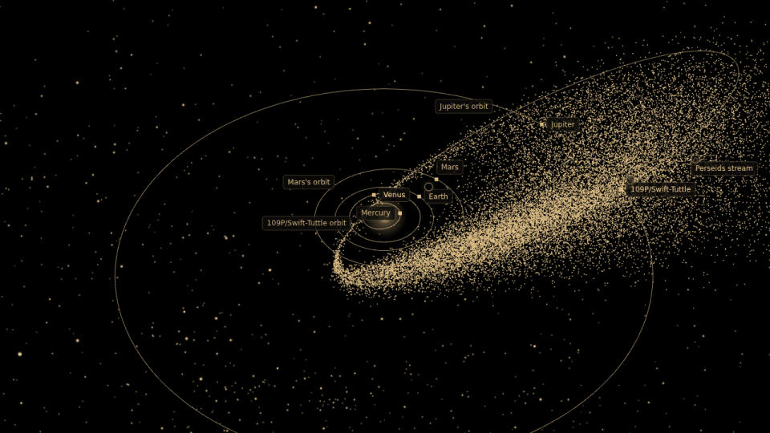
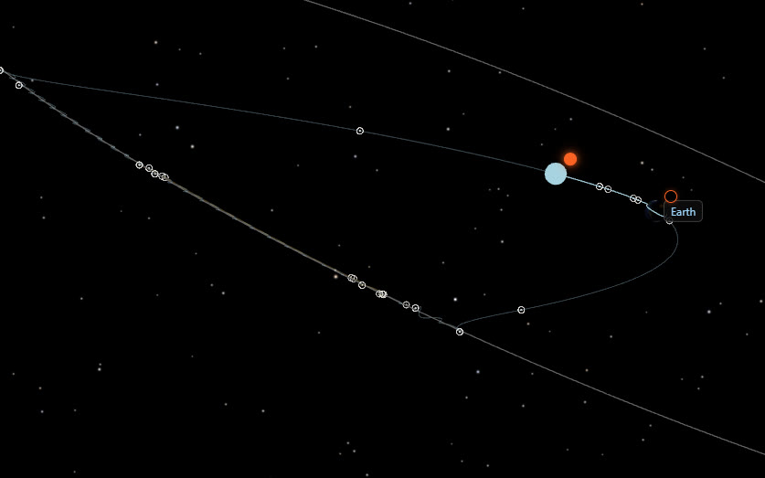
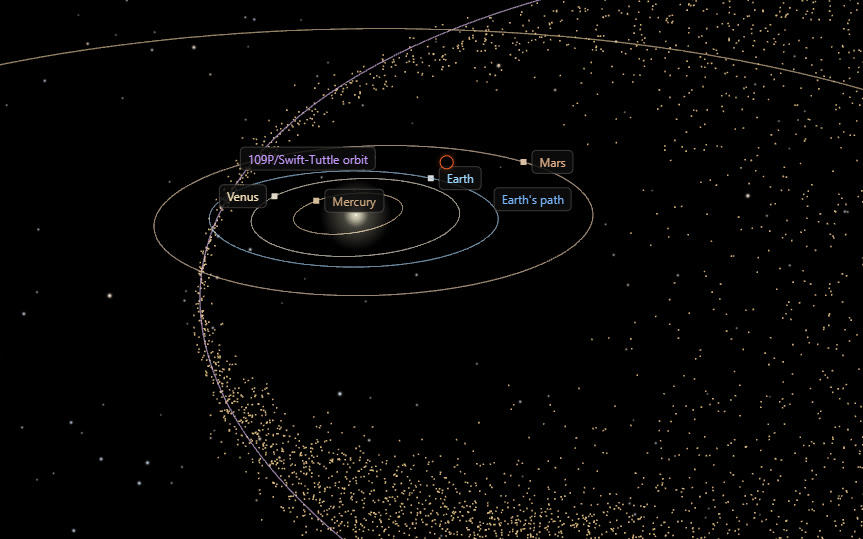
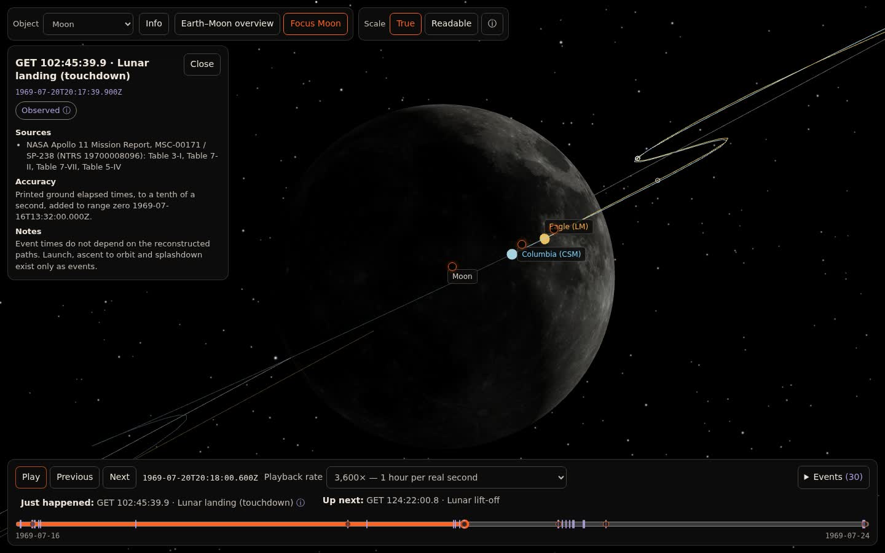
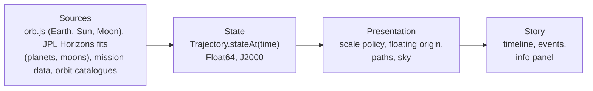

# Astraeus

Everything in space, where it is right now, drawn in the browser.



<sub>The Perseid stream over one year, one frame per week. Each dot is a measured meteoroid orbit. Orbits: [Global Meteor Network](https://globalmeteornetwork.org), CC BY 4.0. Stars: HYG database (astronexus), CC BY-SA 4.0.</sub>

[](LICENSE)  

Astraeus is a TypeScript and Three.js engine for telling stories with real astronomical data. Give it a time and it returns where each body is, with where that number came from. The engine draws it at true scale without jitter, and a story adds a timeline, events, story panels and an info panel on top.

## One engine, two stories

| | |
|---|---|
|  |  |
| **Apollo 11.** Eight days to the Moon and back, rebuilt between the anchor points in NASA's mission report. Seven story panels. | **The Perseids.** Earth through comet Swift-Tuttle's trail, 25,588 measured orbits. Three story panels. |
| [Try it](https://astraeus.anipatke.com/app.html) | [Try it](https://astraeus.anipatke.com/app.html?experience=showers) |

<sub>Perseids image: orbits from the Global Meteor Network, CC BY 4.0.</sub>

## In numbers

**30** Apollo 11 events, timed from NASA's report &middot; **25,588** measured Perseid orbits (Global Meteor Network, 2025) &middot; **51 AU** comet orbit, drawn whole &middot; **1** settings file to add a new shower

## How it knows



Every number in the info panel carries a label. **Observed** means someone measured it, like the time of the Apollo 11 landing from NASA's report. **Modelled** means it comes from a published method or a fit to one, like the planet positions fitted to JPL Horizons. **Illustrative** means it fills a gap: where each meteor sits along its orbit today was never measured, so the dots are spread evenly and say so. The rule behind it: be reliable where the data exists, plausible where it doesn't, and explicit about the difference.

## Story panels

A story can list short panels in a JSON file: [Apollo 11 has seven](packages/astraeus-demo-apollo11/data/stories/apollo11/panels.json) and [the Perseids have three](packages/astraeus-demo-showers/data/stories/perseids/panels.json). Each panel is tied to a moment, an event or an anchor point in the data. It opens when playback reaches that moment and holds playback for a few seconds. It carries one of the three badges above and lists its sources. On a wide screen the panel sits on the right edge, and on a phone it is a bottom sheet. Its look and behaviour follow the panel parts of Planetary Explorer, rewritten for Astraeus.

## A shower is a settings file

The Geminids are one JSON file, [`packages/astraeus-demo-showers/data/showers/geminids.json`](packages/astraeus-demo-showers/data/showers/geminids.json). The code has no Geminid-specific lines. A new file in that folder becomes `?experience=showers&shower=<name>`; `?experience=showers` opens the first shower.

```json
{
  "id": "geminids",
  "label": "Geminids",
  "parentBody": "3200 Phaethon",
  "stream": { "iauCode": 4, "seed": 20261214 },
  "timeline": { "span": "year", "yearStartUtc": "2019-09-21T00:00:00Z", "rateSecondsPerSecond": 604800 },
  "activity": {
    "peakUtc": "2019-12-14T04:33:33Z",
    "peakRate": 150,
    "rateUnit": "meteors per hour (ZHR)",
    "source": { "name": "International Meteor Organization, 2019 Meteor Shower Calendar" }
  },
  "radiant": { "raDeg": 113.0, "decDeg": 32.4, "equinox": "J2000" }
}
```

<sub>Trimmed. The full file also holds the parent's orbital elements, the quality rule and each source's citation.</sub>

## Architecture



The repository is a set of npm workspaces, one per folder under [`packages/`](packages/):

- **The engine**, [`packages/astraeus`](packages/astraeus/), published to npm as `astraeus`. Its [README](packages/astraeus/README.md) is the guide for building a story on it. It imports no other package.
- **Its data packages**, `astraeus-data` and the `astraeus-data-*` packages (one per planet system, plus the constellations), published with it.
- **The demos**, the `astraeus-demo-*` packages (Apollo 11, the meteor showers, the planets), and **the site**, `astraeus-site`: the pages, the Vite config, the public build and the browser checks. These stay private.

Small apps in [`examples/`](examples/) use the packed engine the way an outside project would. A demo imports only the engine, and the site imports only the engine and the demos; `packages/astraeus-site/tests/packageBoundaries.test.ts` fails any other import. Each package keeps its own credits and licences.

Planets and their moons are placed by curve fits of JPL Horizons positions; Earth, the Sun and the Moon by orb.js. Design ["Planet positions from Horizons"](.savepoint/Design.md#planet-positions-from-horizons) and [astronomy validation](docs/ASTRONOMY_VALIDATION.md) say how each was made and checked.

## Run it locally

You need Node 22.12 or newer.

```bash
git clone https://github.com/anipatke/Astraeus.git
cd Astraeus
npm install
npm run dev
```

Open the address Vite prints (usually `http://localhost:5173/`). The pitch page is `/`, and the app is `/app.html`. In Developer mode, Display settings, "Copy view link" gives a link with `?view=` and the time, which opens the same camera view.

| Experience | URL |
|---|---|
| Apollo 11 (default) | `/app.html` |
| Meteor showers: the Perseids (default) | `/app.html?experience=showers` |
| Meteor showers: the Geminids | `/app.html?experience=showers&shower=geminids` |
| The planets, Jupiter first, with a planet switch | `/app.html?experience=planets&planet=jupiter` |

The star sky (HYG) and the Perseid and Geminid orbits (Global Meteor Network) are committed, so nothing needs fetching. `node packages/astraeus/tools/data/fetch-hyg-stars.mjs` rebuilds the stars, and `node packages/astraeus-demo-showers/tools/data/fetch-meteoroid-orbits.mjs <iauCode> --months YYYYMM,YYYYMM [--ship <story>]` rebuilds a shower's orbits.

## Develop

```bash
npm run typecheck
npm run build                  # production bundle in dist/
npm run apollo11:reconstruct   # re-run the offline Apollo 11 reconstruction
npm run check:engine-alone     # the engine alone, copied out, then typechecked, linted and tested
npm run check:public-build     # build the public site and check its files and page sizes
```

`ASTRAEUS_PUBLIC_BUILD=1 npm run build` makes the public build: the pictures marked local-only are replaced by a flat-colour placeholder. `npm run check:public-build` makes that build in a scratch folder and checks that nothing local-only is in it and that no page's first download is over its limit. The page limits are in [`load-budget.mjs`](packages/astraeus-site/tools/validate/load-budget.mjs) (`node packages/astraeus-site/tools/validate/load-budget.mjs dist` prints each page against its limit), and each planet view's moon limits in [`viewLimits.json`](packages/astraeus-demo-planets/src/experiences/planets/viewLimits.json). Planet pictures stay at full quality (owner, 2026-10-17), so Saturn is the heaviest view. A change that makes a page heavier raises its limit on purpose, with the new measurement.

## Running the checks

```
npm install
npx playwright-core install chromium   # once
npm test                               # unit tests
npm run check:browser -- --tier quick  # every page and view, the phone journey, the packed examples
npm run check:browser                  # the full tier: the quick steps plus the longer journeys (release run)
```

A Full Objective Check usually runs `npm run check:browser -- --tier quick --skip-examples`, leaving out the packed examples unless the change touches packaging, `examples/` or the public API; a Task runs no browser check unless it changes a browser script. Which command runs when is decided in the [browser policy](docs/agents/browser-policy.md). Each browser run writes its results to a new folder under `docs/evidence/`. What each step protects, its time limit, a dated measured time, how to find a run's results and how to diagnose a failure are in [`docs/BROWSER_CHECKS.md`](docs/BROWSER_CHECKS.md).

Design notes and validation reports are in [`docs/`](docs/); [where each fact lives](docs/README.md) says which file owns what. Start with [astronomy validation](docs/ASTRONOMY_VALIDATION.md), [Apollo 11 sources](packages/astraeus-demo-apollo11/credits/APOLLO11_SOURCES.md) and [donor provenance](docs/DONOR_PROVENANCE.md). Changes are in the [engine changelog](packages/astraeus/CHANGELOG.md).

## Credits and licences

**The MIT licence covers the code only.** Pictures and data keep their own licences (CC BY 4.0, CC BY-SA 4.0, public domain and so on). Every asset with its source, licence and status is on the [assets page](https://astraeus.anipatke.com/assets.html); each package keeps its own `credits/`, `NOTICE` and, for the engine, [third-party library notices](packages/astraeus/licenses/).

- Milky Way picture, CC BY-SA 4.0: render by Kevinmloch (bsrender) from Gaia EDR3, ESA/Gaia/DPAC, Wikimedia Commons. Resized, re-encoded, dimmed when drawn.
- Bright stars, CC BY-SA 4.0 (this star file only): HYG database v4.2, astronexus.
- Sun, Mercury, Mars, Jupiter, Saturn, Uranus and Neptune maps, CC BY 4.0: Solar System Scope, based on NASA imagery.
- Earth, Moon, Venus and Io maps, public domain: NASA Earth Observatory (Blue Marble: Next Generation, Reto Stöckli), NASA SVS CGI Moon Kit, USGS Astrogeology (Magellan; Galileo and Voyager).
- Saturn's moon maps (Cassini), Triton (Voyager 2) and Pluto (New Horizons) from NASA/JPL, and Charon from USGS Astrogeology: listed one by one on the assets page.
- Global Meteor Network, CC BY 4.0: globalmeteornetwork.org; Vida et al. 2020, MNRAS 491(2); Vida et al. 2021, MNRAS 506(4).
- Shower facts: IAU Meteor Data Center (Jenniskens et al. 2020; Jopek & Kanuchova 2017) and the American Meteor Society calendar.
- Orbits and positions: NASA/JPL Horizons and Small-Body Database; orb.js by lizard-isana; IAU WGCCRE 2015 report, Archinal et al. 2018.
- Apollo 11, public domain: NASA Apollo 11 Mission Report, MSC-00171 / SP-238.
- Planetary Explorer, an earlier project by Ani Patke: some code ideas (camera gestures, atmosphere glow, picture loading, info-panel layout), the story panel's look and the Mercury, Venus, Mars and Io pictures came from planetary-explorer.anipatke.com.

## Built with

Built with [Savepoint](https://getsavepoint.dev), by [Ani Patke](https://anipatke.com). Astraeus is an experiment, built in spikes; each tests one claim about the engine.
