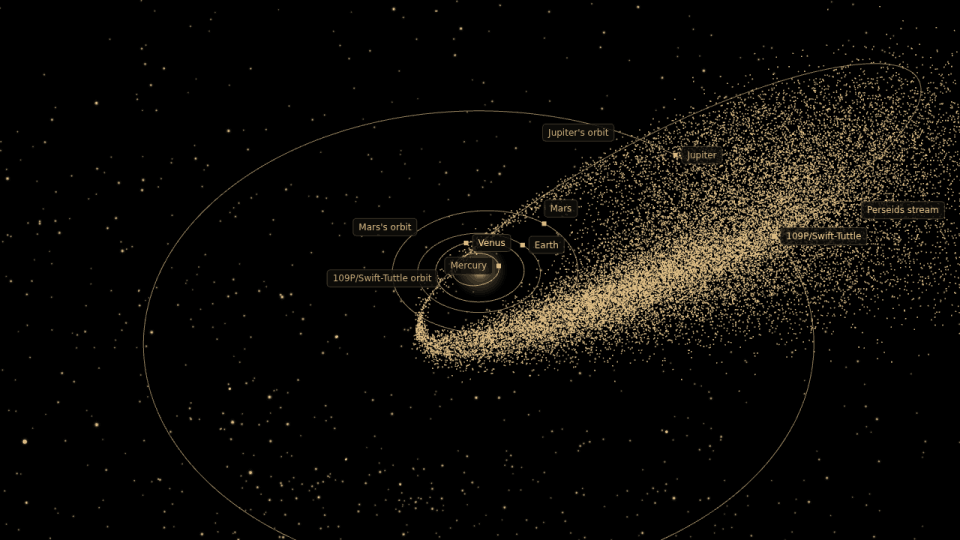
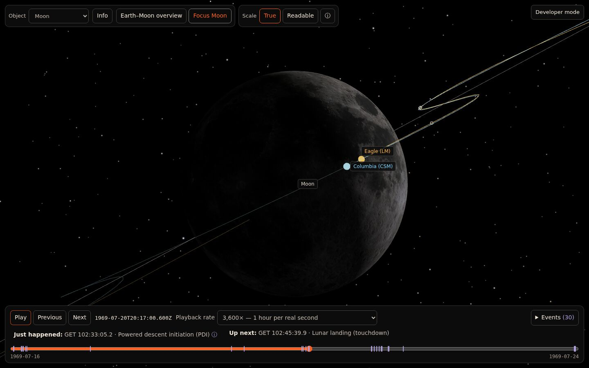
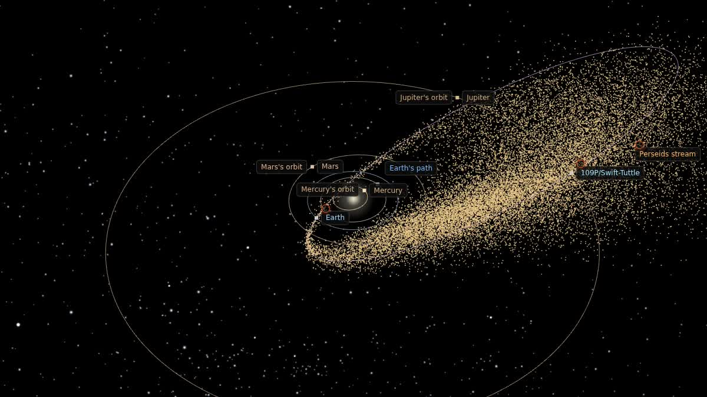
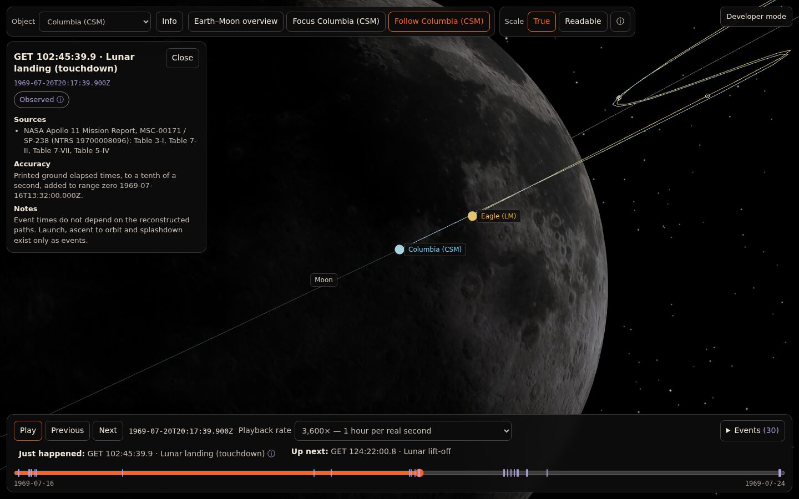
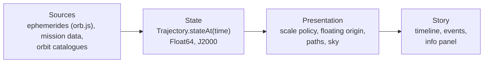

# Astraeus

Everything in space, where it is right now, drawn in the browser.



<sub>The Perseid stream over one year, one frame per week. Each dot is a measured meteoroid orbit. Orbits: [Global Meteor Network](https://globalmeteornetwork.org), CC BY 4.0. Stars: Yale Bright Star Catalogue.</sub>

[](LICENSE)  

Astraeus is a TypeScript and Three.js engine for telling stories with real astronomical data. Give it a time and it returns where each body is, with where that number came from. The engine draws it at true scale without jitter, and a story adds a timeline, events and an info panel on top.

## One engine, two stories

| | |
|---|---|
|  |  |
| **Apollo 11.** Eight days to the Moon and back, rebuilt between the anchor points in NASA's mission report. | **The Perseids.** Earth through comet Swift-Tuttle's trail, 25,588 measured orbits. |
| [Try it](https://astraeus.curiouscode.ai/app.html) (going live soon) | [Try it](https://astraeus.curiouscode.ai/app.html?experience=shower-perseids) (going live soon) |

<sub>Perseids image: orbits from the Global Meteor Network, CC BY 4.0.</sub>

## In numbers

**30** Apollo 11 events, timed from NASA's report &middot; **25,588** measured Perseid orbits (Global Meteor Network, 2025) &middot; **51 AU** comet orbit, drawn whole &middot; **1** settings file to add a new shower

## How it knows



Every number in the info panel carries a label. **Observed** means someone measured it, like the time of the Apollo 11 landing from NASA's report. **Modelled** means it comes from a published method, like the planets from VSOP87. **Illustrative** means it fills a gap: where each meteor sits along its orbit today was never measured, so the dots are spread evenly and say so. The rule behind it: be reliable where the data exists, plausible where it doesn't, and explicit about the difference.

## A shower is a settings file

The Geminids are one JSON file, [`data/showers/geminids.json`](data/showers/geminids.json). The code has no Geminid-specific lines. A new file in that folder becomes `?experience=shower-<name>`.

```json
{
  "id": "geminids",
  "label": "Geminids",
  "parentBody": "3200 Phaethon",
  "stream": { "iauCode": 4, "seed": 20261214 },
  "timeline": { "span": "year", "rateSecondsPerSecond": 604800 },
  "activity": {
    "peakUtc": "2026-12-13T23:31:44Z",
    "peakRate": 150,
    "rateUnit": "meteors per hour (ZHR)",
    "source": { "name": "American Meteor Society, Meteor Shower Calendar 2026" }
  },
  "radiant": { "raDeg": 113.0, "decDeg": 32.4, "equinox": "J2000" }
}
```

<sub>Trimmed. The full file also holds the parent's orbital elements, the quality rule and each source's citation.</sub>

## Architecture



- `src/core/` is the scientific core: time, state vectors, orientation, scale policies and trajectories, with no Three.js or React.
- `src/app/` draws it: floating origin, camera, paths, sky and labels.
- `src/shell/` holds the reusable timeline, event list and info panel.
- `src/experiences/` holds each story: Apollo 11, the Earth-Moon explorer, Jupiter and Io, and the showers.

## Run it locally

You need Node 22.12 or newer.

```bash
git clone https://github.com/anipatke/Astraeus.git
cd Astraeus
npm install
npm run dev
```

Open the address Vite prints (usually `http://localhost:5173/`). The pitch page is `/`, and the app is `/app.html`.

| Experience | URL |
|---|---|
| Apollo 11 (default) | `/app.html` |
| The Perseids | `/app.html?experience=shower-perseids` |
| The Geminids | `/app.html?experience=shower-geminids` |
| Earth and Moon | `/app.html?experience=earth-moon` |
| Jupiter and Io | `/app.html?experience=jupiter-io` |

Optional steps, each local only and never committed:

- **Real stars:** `node tools/data/fetch-stars.mjs` fetches the Yale Bright Star Catalogue, 8,404 naked-eye stars. Without it the sky shows the Milky Way only.
- **CAMS orbits:** `node tools/data/fetch-meteoroid-orbits.mjs 7` fetches the CAMS Perseid orbits, and `4` fetches the Geminids. The CAMS terms are not confirmed, so these are not shipped. The Geminids need this step to show a stream.
- **Perseids work out of the box.** They default to the Global Meteor Network orbits (CC BY 4.0), and a compact copy of those 25,588 orbits is committed at `data/stories/perseids/gmn-iau-7.json`. Nothing needs fetching.

## Develop

```bash
npm test             # unit tests
npm run typecheck
npm run build        # production bundle in dist/
npm run apollo11:reconstruct   # re-run the offline Apollo 11 reconstruction
```

`ASTRAEUS_PUBLIC_BUILD=1 npm run build` makes the public build: the pictures marked local-only are replaced by a flat-colour placeholder. `node tools/validate/public-build-assets.mjs` then checks that none of them, and nothing from `data/local/`, is in `dist/`.

The browser checks in `tools/validate/` drive the app in headless Chromium through `playwright-core`, which `npm install` adds. Install the browser once with `npx playwright-core install chromium`, start `npm run dev -- --port 5199`, then run for example `node tools/validate/browser-shell.mjs`. Set `ASTRAEUS_URL` to point a script at another address and `PLAYWRIGHT_CORE` to use another copy of the library.

Design notes and validation reports are in [`docs/`](docs/): [Spike 01](docs/ASTRAEUS_SPIKE_01.md), [Spike 02](docs/ASTRAEUS_SPIKE_02.md), [astronomy validation](docs/ASTRONOMY_VALIDATION.md), [Apollo 11 sources](docs/APOLLO11_SOURCES.md) and [donor provenance](docs/DONOR_PROVENANCE.md).

## Assets, science and credits

Everything the demos draw, with its source, licence and whether it can go public. The same list, with pictures, is on the [assets page](https://astraeus.curiouscode.ai/assets.html).

**The MIT licence covers the code only.** Pictures and data keep their own licences, as listed below (CC BY 4.0, public domain, local only and so on). The NASA Earth and Moon pictures are public domain and are not covered by MIT.

| Asset | Source | Licence | Status |
|---|---|---|---|
| Milky Way panorama | ESO eso0932a, ESO/S. Brunier | CC BY 4.0 | Public |
| Bright stars (8,404) | Yale Bright Star Catalogue, 5th rev., Hoffleit & Warren 1991 | Terms not established as public domain | This machine only |
| Sun, Mercury, Venus, Mars, Jupiter maps | Solar System Scope, based on NASA imagery | CC BY 4.0 | Public |
| Io map | USGS Galileo and Voyager mosaic | Public domain | Public |
| Earth map | NASA Earth Observatory, Blue Marble: Next Generation with topography and bathymetry, July 2004 (Reto Stöckli) | Public domain | Public |
| Moon map | NASA Scientific Visualization Studio, CGI Moon Kit (SVS 4720), LROC colour map with polar fill | Public domain | Public |
| Earth, Sun, Moon positions | orb.js (EPV00, lunar series), checked against JPL Horizons | Open-source library | Public |
| Planet positions | VSOP87A via orb.js, Bretagnon & Francou 1988 | Published theory | Public |
| Comet 109P/Swift-Tuttle, asteroid 3200 Phaethon | NASA JPL Small-Body Database | Public | Public |
| Apollo 11 paths and events | NASA Apollo 11 Mission Report, MSC-00171 / SP-238 | Public domain | Public |
| Perseid orbits (25,588) | Global Meteor Network trajectory summaries, Vida et al. | CC BY 4.0 | Public, with credit |
| Perseid and Geminid orbits | CAMS v3, 2010 to 2016, P. Jenniskens | Terms pending | This machine only |
| Shower facts | IAU Meteor Data Center; American Meteor Society calendar | Published reference values | Public |

Credit lines, word for word:

- Milky Way panorama, CC BY 4.0: ESO/S. Brunier. eso0932a, eso.org/public/images/eso0932a. Changed: split in two and turned into the J2000 sky frame.
- Sun, Mercury, Venus, Mars, Jupiter maps, CC BY 4.0: Solar System Scope (solarsystemscope.com/textures), based on NASA imagery and elevation data.
- Io map, public domain: USGS Astrogeology Science Center; NASA/JPL Galileo and Voyager missions.
- Earth map, public domain: NASA Earth Observatory (Blue Marble: Next Generation, Reto Stöckli). July 2004 with topography and bathymetry, science.nasa.gov/earth/earth-observatory/blue-marble-next-generation. Changed: resampled to 4096x2048.
- Moon map, public domain: NASA's Scientific Visualization Studio. CGI Moon Kit, svs.gsfc.nasa.gov/4720, LROC WAC colour map with polar fill. Changed: converted to JPEG.
- Global Meteor Network, CC BY 4.0: Global Meteor Network, globalmeteornetwork.org. Vida et al. 2020, MNRAS 491(2); Vida et al. 2021, MNRAS 506(4).
- CAMS: CAMS Meteoroid Orbit Database v3, P. Jenniskens, SETI Institute. Jenniskens et al. 2018, Planetary and Space Science 154.
- IAU Meteor Data Center: Jenniskens et al. 2020, Planetary and Space Science 182; Jopek & Kanuchova 2017, Planetary and Space Science 143.
- Bright stars: Yale Bright Star Catalogue, 5th revised edition, Hoffleit & Warren 1991, via CDS Strasbourg.
- Orbits and positions: NASA/JPL Horizons and Small-Body Database. orb.js by lizard-isana. VSOP87, Bretagnon & Francou 1988. IAU WGCCRE 2015 report, Archinal et al. 2018.
- Apollo 11, public domain: NASA Apollo 11 Mission Report, MSC-00171 / SP-238.
- Shower calendar: American Meteor Society, Meteor Shower Calendar 2026/2027.
- Planetary Explorer, an earlier project by Ani Patke: some code ideas (camera gestures, atmosphere glow, picture loading, info-panel layout) and the Mercury, Venus, Mars and Io pictures came from planetary-explorer.anipatke.com.

Third-party library notices are in [`licenses/`](licenses/).

## Status and roadmap

Astraeus is an experiment, built in spikes. Each spike tests one claim about the engine.

**Done**
- Earth and Moon on a real ephemeris, checked against JPL Horizons.
- Apollo 11, rebuilt from NASA's report, with 30 timed events.
- A reusable shell: timeline, camera modes, scale toggle, info panel.
- A group of measured orbits drawn as a stream, and showers from a settings file (Perseids and Geminids).
- The Sun, planets and comets on their orbits, and a real-star sky.

**Next**
- Put the demos live at astraeus.curiouscode.ai.

**Later**
- Package the engine so others can build a story on it.
- The view from the ground.

## Built with

Built with [Savepoint](https://getsavepoint.dev), by [Ani Patke](https://anipatke.com).
