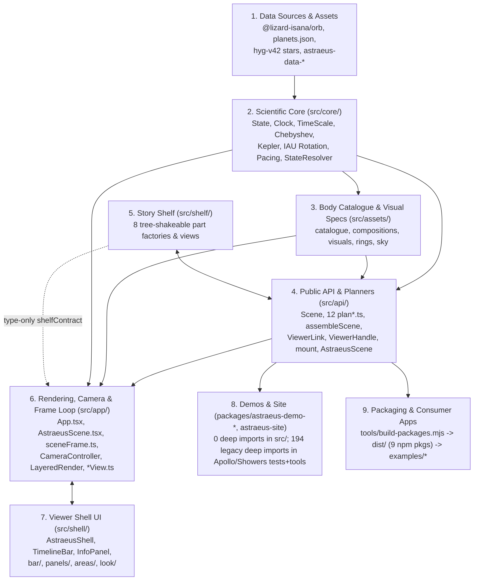

# Astraeus — Independent End-to-End Engineering Audit

## Audit Metadata

| Field | Value |
|---|---|
| **Audit date** | 2026-11-21 (Australia/Sydney, AEDT) |
| **Provider** | Google |
| **Model** | Gemini 4 Neon |
| **Repository** | `https://github.com/anipatke/Astraeus` (`/home/user/code/Astraeus`) |
| **Git branch** | `main` |
| **Exact audited commit SHA** | `55295278cac768f80ab8fb5bc82a6887b7cf775b` (`Release 0.9.5`) |
| **Package version** | `astraeus@0.9.5` and 8 `astraeus-data*` packages `@0.9.5` (workspace root `astraeus-workspace@0.1.0`) |
| **Working-tree status** | Clean for all tracked files; pre-existing untracked `docs/research/` present and untouched; `audits/` excluded from discovery |
| **Node / npm versions** | Node `v24.16.0` / npm `12.2.1` |
| **Operating system & hardware** | Linux `6.18.33.2-microsoft-standard-WSL2` x86_64, 16 vCPUs, 7.8 GiB RAM (+ 8.0 GiB swap) |
| **Verification tools used** | TypeScript 6 compiler API AST analyzer (read-only scratch script), `lizard`, `git` / Savepoint history mining, `junit.xml` & `docs/evidence/browser-*` analysis, isolated `/tmp` sandbox execution of `lint`, `typecheck`, `build`, `test`, `test:full`, `check:engine-alone`, `check:pack`, `check:node-consumer`, `check:react-consumer`, `check:shelf-split`, `npm audit`, standalone Node scientific verification script, and isolated mutation-sensitivity probes |
| **Audit scope** | Full repository: all 13 workspace packages (`packages/*`), 4 consumer examples (`examples/*`), root build/verification tools (`tools/*`), `.github/workflows/publish.yml`, `docs/` (excluding `docs/research/`), and `.savepoint/` metadata/history. Entire `audits/` directory excluded from discovery. |
| **Environmental limitations** | 1. `npm run check:browser` was not re-executed end-to-end inside the audit sandbox (per profiling rules against redundant expensive runs); browser timings and step results are drawn from the same-day run `docs/evidence/browser-20261121T080311Z/` (committed at HEAD's exact code state) plus 96 earlier archived runs (`docs/evidence/browser-*`). 2. Browser evidence runs under headless Chromium software WebGL (`--use-gl=swiftshader`) on WSL2; real hardware GPU frame pacing and visual aesthetics were not measured. 3. All verification commands and mutation probes were executed in an isolated `/tmp` clone so zero tracked or untracked files in `/home/user/code/Astraeus` were altered (other than writing this report). |

---

## A. Executive Verdict

**Overall verdict: Astraeus has a genuinely well-conceived scientific core and public API foundation, but it has crossed an inflection point where accidental complexity, runtime rendering/lifecycle defects, and an unsustainable verification harness are now growing faster than engine capability. It needs targeted stabilization and disciplined simplification — not a rewrite.**

### Direct answers to core audit questions

1. **Is the underlying architecture sound?** **Yes, at the macro level.** Separating absolute-time physical state in EQJ kilometres (`src/core/`) from scale policies, floating origin, R3F presentation (`src/app/`), viewer chrome (`src/shell/`), and a single public front door (`src/api/`) is clean, coherent, and mechanically enforced. All four demos/site `src/` trees now consume Astraeus exclusively through `"astraeus"`, proving the boundary is real.
2. **Is the codebase unnecessarily complex?** **Yes.** Production code totals 385 files (27,890 SLOC), while tests total 313 files (38,078 SLOC — 1.37× production SLOC). Genuine scientific and GPU complexity accounts for a healthy minority; the bulk of the cognitive load is accidental: a 617-line `App.tsx` mirroring ~25 mutable `SceneControls` fields across 42 `useState` hooks, a 616-line `AstraeusShell.tsx` taking 46 props with serial-numbered imperative request effects, a 4-layer `ViewerHandle` → `ViewerLink` → 11 micro-delegates → `ViewerControl` forwarding stack, 129 production files under 30 SLOC (33.5% of all prod files), 6 separate Kepler solvers, WeakMap side-channels built to appease the API lock, and a 2,134-line browser driver that is 51% dead code.
3. **How maintainable is it?** **Adequate today, deteriorating toward Weak over a 2–3 year horizon** unless simplified. Local scientific or shelf changes remain clean, but UI/viewer-lifecycle edits funnel through `App.tsx` and `AstraeusShell.tsx`, minor API additions ripple across lockfiles, allowlists, README tables, and refactor-pin snapshots, and every patch release lockstep-republishes ~190 MB of unchanged binary moon data across 9 npm packages.
4. **How easily can it be extended?** **Easy within its current niche (solar-system flybys, meteor streams, sky-figure stories), blocked outside it.** Three of the four target consumer scenarios hit hard walls: asteroid belt explorers hit a sharp chasm between scalable-but-unpickable `addGroup` and pickable-but-O(N²)/CPU-bound `addBodySet`; ground-based observers are fundamentally unsupported (body-centre EQJ only, no surface lat/lon, zenith-up, Alt-Az horizon, or refraction); fictional star systems cannot define a custom root star, textured custom spheres, trajectories centred on custom bodies, or custom `ScalePolicy` instances (despite `ScalePolicy` being publicly documented as "Open").
5. **Is it suitable for external developers?** **Conditionally yes for solar-system/spacecraft/constellation web apps, with important caveats.** The `"astraeus"` front door, `SceneError` codes, dual `mount`/`AstraeusScene` parity, and Node cold-load support are strong. However, external developers currently inherit: 10 Hz full-tree React re-renders while paused, 3×N forced DOM reflows per animation frame in `SceneLabels.ts`, ungated production `JSON.stringify` browser-test diagnostics at 60 Hz, GPU memory leaks on unmount, broken multi-viewer texture disposal, a 30-body hard rendering ceiling, missing `engines` metadata, and ~5.4 MB of planet textures eagerly pulled into minimal bundles.
6. **What are its largest technical risks?**
   - **P0 Runtime & Rendering:** Per-frame forced synchronous layout thrashing (`SceneLabels.ts`), unconditional 10 Hz React re-renders + ref detach/re-attach (`App.tsx`/`AstraeusScene.tsx`), ungated 60 Hz browser-test `JSON.stringify` diagnostics (`sceneFrame.ts`), missing logarithmic depth chunks in `AtmosphereGlow.tsx` (missed by `logDepth.test.ts`), un-disposed GPU buffers (`PointsView`, `PathView`, `TrackedBodyView`), multi-viewer texture/sprite/loading-manager corruption, and missing `webglcontextlost` (`preventDefault()`).
   - **P1 Scientific & Provenance:** `StateResolver` unconditionally discarding `velocityKmS` even for native Chebyshev moons; all 8 planets' `knownLimitations` (`planetRecords.ts`) orphaned as dead code (violating `PROV-01`); 13 IAU-rotated mapped moons falsely declaring `orientation: "tidal-lock"` and `"no libration"`; `scene.stateOf` leaking raw `TimeScaleOutOfRangeError` on pre-1950/post-2045 dates (violating `API-05`); `buildElementsBody` ignoring `centre.gmKm3S2`; and `pacing.ts` crashing with `RangeError` on negative playback rates.
   - **P1 Verification Sustainability:** `npm run check:browser` taking **406 s** (27% over its 320 s limit) while catching zero product defects since 2026-11-01; `npm test` taking **68.3 s** uncontended (over its 65 s limit) and `npm run test:full` deterministically **failing uncontended** on a V8-coverage-sensitive `<100 ms` timing assertion (`showersMeasured.test.ts`).
7. **Are the tests providing sufficient value for their cost?** **No — the portfolio is heavily bifurcated.** The scientific reference tests (JPL Horizons DE441, USNO, SOFA, NAIF PCK, CDS VI/49) and public contract/multi-viewer tests (`lifecycle.test.ts`, `twoViewers.test.ts`, `publicBuild.test.ts`) provide **exceptional value**. Conversely, ~50% of Vitest CPU time and ~70% of browser wall-clock time are burned on duplicated package builds, double offline Apollo reconstruction, unindexed sky grids, brittle refactor snapshots (`scenePin`, `computedLook`, `rebuildComparison`), obsolete allowlist/migration bureaucracy, and browser driver churn.
8. **Is browser verification unnecessarily expensive?** **Unambiguously yes.** `check:browser` grew from 45–58 s (O-038) to **406 s** across 13 sequential steps and 11 cold Chromium launches. Two preventable regressions — `driver.mjs` opening/closing the phone drawer **6 times per camera read** (`look-out`: 69 s → **110 s**) and polling exact `.00` equality on an exponentially gliding FOV (`hello-sky`: 14 s → **21 s**) — plus stuffing a 79 s feature journey (`synthetic-journey`) and duplicate Perseids loads inside `smoke` (136 s), account for over 240 s of pure waste. Consolidating and fixing these can bring `check:browser` down to **~110–130 s** with negligible loss of real defect detection.
9. **Targeted improvements, substantial restructuring, or a rewrite?** **Targeted stabilization (Horizon 1) followed by disciplined simplification (Horizon 2) and selective extensibility upgrades (Horizon 3).** A rewrite would destroy hard-won, externally validated scientific accuracy and public-API contract parity.

### The Three Ultimate Questions

1. **Architecture and maintainability:** *Will future astronomical visualisations become easier to build, or make the engine harder to understand and maintain?* **At the current trajectory, every new experience class makes the engine harder to maintain.** The clean `core/` ↔ `app/` ↔ `api/` layering has already absorbed Apollo, Showers, Planets, Views, Sky Look-Out, Constellations, and the Story Shelf — but each addition bolted new parallel state onto `App.tsx`, `AstraeusShell.tsx`, `Scene`, `ViewerLink`, and `SceneControls` rather than generalizing primitives (e.g., adding `addBodySet` alongside `addGroup` instead of unifying pickable/filtered point clouds, adding 11 micro-delegates and 65 files in `src/api/`). Refactoring `App.tsx`/`SceneControls` into a single external store, unifying `PointsView`/`BodySetView` capabilities, and lifting closed ceilings (30 bodies, fixed `ScalePolicy` list, fixed Sun root) are the pivots that determine whether Astraeus stays an engine or calcifies into a union of demo features.
2. **Complexity:** *How much complexity is essential versus accidental?* Roughly **35–40% is genuinely essential** (Chebyshev ephemeris compression, UTC→TT→TDB tables, IAU libration, Float64 floating origin, Halley GPU Kepler shader with 64-bit epoch rebasing, log-depth rendering, log-space paced integration, responsive bar-fit/panel rules). Roughly **60–65% is accidental** — accumulated across 81 iterative Objectives via micro-file fragmentation, multi-layer forwarding, dual state synchronization, WeakMap workarounds, duplicated Kepler/validation/projection code, and 1,086 lines of dead browser-driver code held hostage by a frozen AST-snapshot test.
3. **Verification:** *Is testing time well spent or disproportionately expensive?* **Disproportionately expensive.** Running `npm run check:gates` + `check:browser` currently burns **~12+ minutes** of wall-clock time (including **64 `tsc` passes**, **~48 `npm pack` runs**, **11 Chromium launches**, and **458 CPU-seconds** of Vitest), while missing concrete P0 bugs (`AtmosphereGlow` log-depth, `SceneLabels` layout thrash, GPU buffer leaks, `viewsDom.test.ts` testing `undefined === undefined`, `stateOf` leaking `TimeScaleOutOfRangeError`, and `test:full` failing on a coverage-slowed 100 ms assertion). Re-tiering and pruning the suite can cut routine task feedback to **<20 s**, full unit/contract verification to **~25–35 s**, and release browser verification to **~110–130 s**, while *increasing* real defect detection.

---

## B. Engineering Scorecard & Audit Coverage

> **Note:** The weighted score below is an **expert engineering assessment** grounded in measured metrics and code evidence, not an objective formula. All 10 dimensions had sufficient direct evidence to score cleanly.

| Dimension | Weight | Score (1–5) | Weighted | Confidence | Explanation |
|---|---:|---:|---:|---|---|
| Code quality and readability | 15% | **3** | 0.45 | High | Zero `any`/`@ts-ignore` and crisp pure modules in `core/`, `panels/`, `bar/`, offset by `App.tsx` (617-line god component, 42 `useState`s), `AstraeusShell.tsx` (46 props), 129 micro-files (<30 SLOC), duplicated validators (`isText` ×7), and 1-rule ESLint config. |
| Complexity management | 15% | **2** | 0.30 | High | Essential domain math is clean, but accidental complexity dominates orchestration (`App`/`SceneControls` dual-write, 4-layer `ViewerLink` forwarding, 65 `api/` files, WeakMap side-channels, 6 Kepler solvers, 51% dead `driver.mjs`, broken Lizard/ESLint complexity visibility). |
| Maintainability | 15% | **3** | 0.45 | High | Strong automated package boundaries and 0 deep `src` imports help local edits, but `App`/`Shell` coupling, brittle pin/static-scan tests, lockstep 9-package republishing (~190 MB/patch), TS7+TS6 shim, and 891 fragmented docs add steady maintenance drag. |
| Extensibility | 15% | **3** | 0.45 | High | Works well via `"astraeus"` for solar-system/spacecraft/sky-story apps and tree-shakeable shelf parts, but blocks 3 of 4 target consumer scenarios (pickable/filtered asteroid belts, ground-based Alt-Az observer, custom star/textured fictional systems, custom `ScalePolicy`). |
| Architectural integrity | 10% | **4** | 0.40 | High | Clean `ARCH-02`/`ARCH-04` separation, zero upward imports from `core/`, zero deep `src` imports in demos/site, unified `ViewerHandle`; docked for 7 UI/styling modules parked in `core/`, 2 runtime cycles in O-081 shelf parts, and global singletons undermining `API-03`. |
| Scientific correctness | 10% | **4** | 0.40 | High | Sub-km DE441 Chebyshev fits, verified SOFA `dtdb`, 13-term Moon libration, CDS VI/49 constellations, and independent external reference tests; docked for `StateResolver` dropping velocities, dead planet `knownLimitations`, 13 moons misreporting `tidal-lock`, `elementsBody` ignoring `centre.gmKm3S2`, negative-rate pacing crash, and Orb `Luna` drift. |
| Test effectiveness and execution efficiency | 10% | **2** | 0.20 | High | Strong scientific & multi-viewer tests buried under 406 s browser runs (0 product bugs caught since Nov 1), 68 s `npm test` (duplicating `check:pack` + double Apollo rebuild), failing uncontended `test:full`, 64 `tsc` passes, dead `driver.mjs` locked by `browserAssertions.test.ts`, and tautological tests. |
| Rendering and performance | 5% | **2** | 0.10 | High | Good Float64 floating origin and GPU Halley Kepler shader, undermined by 3×N/frame forced reflows (`SceneLabels`), 10 Hz paused React re-renders, 60 Hz ungated `JSON.stringify` readouts, `StateResolver` memo thrashing, `AtmosphereGlow` log-depth bug, GPU buffer leaks, multi-viewer texture corruption, missing `webglcontextlost`, and 30-body pass cap. |
| Public API and developer experience | 3% | **4** | 0.12 | High | Coherent verb grammar, frozen inputs, `SceneError` discipline, full React/`mount` handle parity, working tarball examples; minor friction from 201 exports / 45 `Scene` methods, whole-object `setLook`, `stateOf` leaking `TimeScaleOutOfRangeError`, and Developer-only controls. |
| Documentation and sustainability | 2% | **3** | 0.06 | High | `packages/astraeus/README.md` is thorough and API-synced, provenance/credits are exemplary; offset by heavy cross-doc drift (root `README.md`, `NPM_PACKAGING.md`, `BROWSER_CHECKS.md`, `/api/` saying `"0.2 preview"`) and 80,534 lines of historical process docs. |
| **Weighted Overall Score** | **100%** | — | **2.93 / 5.00** | **High** | **Adequate overall (strong core science/architecture/API; weak complexity management, rendering hygiene, and verification efficiency).** |

### Audit Coverage Matrix

| Subsystem | Files Inspected / Scope | Inspection Depth | Verification Methods | Areas Not Verified | Confidence |
|---|---|---|---|---|---|
| Scientific core (`packages/astraeus/src/core/`) | 64 files (all key modules read directly + AST scan) | Deep | Direct read, AST metrics, standalone Node scientific verification script, mutation probe | Offline JPL Horizons live API fetch | High |
| Public API & Shelf (`src/api/`, `src/shelf/`) | 65 `api/` + 18 `shelf/` files | Deep | Direct read, `api-surface.lock.json` analysis, `check:shelf-split`, `check:node-consumer`, `check:react-consumer` | Live browser shelf interactions | High |
| Rendering & Shell (`src/app/`, `src/shell/`, `src/assets/`) | 79 `app/` + 53 `shell/` + 21 `assets/` files | Deep | Direct read, `lizard` verification, AST cycle/fan-in/out analysis, mutation probe (`logDepth`, `viewsDom`, `renderCoordinates`) | Hardware GPU FPS profiling; visual appearance | High |
| Data packages (`astraeus-data*`, 8 pkgs) | All 8 `package.json`, `src/*`, `constellations/src/*`, `tools/import/*` | Deep | Direct read, `check:pack`, live `constellationFinder` probes | Re-running Horizons importers | High |
| Demos & Site (`astraeus-demo-*`, `astraeus-site`, `examples/*`) | All `src/`, `vite.config.ts`, 4 examples, Apollo reconstruction tools | Moderate–Deep | Direct read, `npm run build`, deep-import scan, Apollo code & doc audit | Live interactive browser walkthrough | High |
| Verification & Browser Suite (`packages/*/tests/`, `tools/validate/`) | All 13 browser scripts, `runner`, `harness`, `driver`, `driver-guard`, `assertion-list`, 289 Vitest suites (`junit.xml`), 97 browser runs, 190 Issues, 195 Checks | Exhaustive | Direct read, dead-code reachability on `driver.mjs`, uncontended gate timings, `junit.xml` & Savepoint mining, 5 mutation probes | Fresh 406 s re-run of `check:browser` (reused same-day `browser-20261121T080311Z`) | High |
| Packaging, Tooling, Security & Docs (`tools/`, `.github/`, `docs/`, `.savepoint/`) | All 25 root `tools/*`, `publish.yml`, `README.md`, `Design.md`, `Guardrails.md`, `BROWSER_CHECKS.md`, `NPM_PACKAGING.md`, `RELEASING.md` | Deep | Direct read, `npm audit`, security sink scan, doc-vs-code reconciliation | Live npm registry publish (`--dry-run` only per policy) | High |

---

## C. Architecture Assessment

### 1. Actual Current Package Inventory (13 Workspaces — Not 5)

Root `README.md:69` and `vitest.config.ts:8` still describe a 5-workspace monorepo. The repository has evolved into **13 npm workspaces** under `packages/`:

| Workspace Package | Version | Publishable | Role & Runtime Dependencies |
|---|---:|---|---|
| `astraeus` | `0.9.5` | Yes | Core engine (`core/`, `assets/`, `api/`, `app/`, `shell/`, `shelf/`, `experiences/`, `synthetic/`). Runtime dep: `@lizard-isana/orb@3.1.1`. Peers: `react`, `react-dom`, `@react-three/fiber`, `three`. Imports no other workspace package. |
| `astraeus-data` | `0.9.5` | Yes | High-res moon textures (Io–Charon, Pluto), 8k Venus, starless Milky Way (also subpath `./milky-way`), and 24 bodies' surface place JSONs (`./bodies/*`). Peer: `astraeus`. (~35.6 MB packed) |
| `astraeus-data-jupiter` | `0.9.5` | Yes | Jovian moon Chebyshev chunks (1950–2030 main, 2010–2030 small) + `./moon-list.json` (no `./moon-fit-errors.json`). (~30.9 MB packed, 2,630 files) |
| `astraeus-data-saturn` | `0.9.5` | Yes | Saturnian moon Chebyshev chunks + `./moon-list.json` + `./moon-fit-errors.json`. (~53.5 MB packed, 6,460 files) |
| `astraeus-data-uranus` | `0.9.5` | Yes | Uranian moon chunks + lists. (~40.6 MB packed, 951 files) |
| `astraeus-data-neptune` | `0.9.5` | Yes | Neptunian moon chunks + lists. (~18.5 MB packed, 531 files) |
| `astraeus-data-mars` | `0.9.5` | Yes | Martian moon chunks + lists. (~5.2 MB packed, 71 files) |
| `astraeus-data-pluto` | `0.9.5` | Yes | Pluto–Charon system chunks + lists. (~1.5 MB packed, 131 files) |
| `astraeus-data-constellations` | `0.9.5` | Yes | 88 IAU constellation figures/boundaries/names + `constellations()` helper & `constellationFinder()`. (~0.07 MB packed, 12 files) |
| `astraeus-demo-apollo11` | `0.1.0` | Private | Apollo 11 scene (`src/experiences/apollo11/apollo11Scene.ts`), NASA anchor/panel data, offline N-body reconstruction pipeline (`tools/apollo11/`). |
| `astraeus-demo-planets` | `0.1.0` | Private | Nine-planet explorer scenes (`src/experiences/planets/*`), consuming `astraeus` + `astraeus-data` + all 6 moon packages. |
| `astraeus-demo-showers` | `0.1.0` | Private | Perseids & Geminids scenes, committed GMN orbit JSONs (25,588 + 51,115 orbits), GMN fetch tool. |
| `astraeus-site` | `0.1.0` | Private | Public site (`index.html`, `app.html`, `assets.html`, `components.html`), API reference generator, synthetic preview scenes, Vite config, Playwright validation suite (`tools/validate/`), and cross-package architectural tests. |

*(Note: `packages/node_modules/.vite` is an orphaned Vite cache artifact left inside `packages/`.)*

### 2. Dependency Map Across the 10 Functional Layers

### 3. Internal Engine Layer Matrix & Cycles (Measured via AST)

Measured across `packages/astraeus/src/` (311 TS/TSX files):
- **Zero upward imports from `core/`**: `core -> assets/app/shell/api/shelf = 0`. `ARCH-04` is strictly enforced by `tests/layerRule.test.ts`.
- **Zero upward imports from `assets/`**: `assets -> core` only (18 runtime, 4 type-only).
- **Bidirectional coupling between `app/` and `shell/`**: `app -> shell` (23 runtime, 18 type-only) and `shell -> app` (5 runtime, 5 type-only) — including a 5-file cycle (`app/viewHiding.ts` ↔ `shell/{bodyFeatures,experience,infoModel,objectModel}.ts`).
- **Two confirmed runtime circular dependencies (introduced in O-081)**:
  1. `packages/astraeus/src/shelf/readoutTile/factory.ts:5` ↔ `packages/astraeus/src/shelf/readoutTile/View.tsx:5` (`ReadoutTileView` / `scaleFraction`).
  2. `packages/astraeus/src/shelf/chart/factory.ts:5` ↔ `packages/astraeus/src/shelf/chart/View.tsx:6` (`ChartView` / `extentOf`).
- **Six additional type-only/structural strongly-connected components (8 total SCCs in `packages/astraeus/src/`)**, including a 27-file `api/viewer*` + `shelf/*` type cluster and a 16-file `api/scene` + `plan*` + `assembleScene` type cluster.
- **High-fan-in hubs**: `core/body.ts` (71), `core/provenance.ts` (51), `api/errors.ts` (42), `core/trajectory.ts` (40), `core/state.ts` (36), `app/experienceDefinition.ts` (32), `assets/catalogue.ts` (30).
- **High-fan-out hubs**: `app/App.tsx` (**56 imports**), `api/scene.ts` (**53**), `api/index.ts` (40), `shell/AstraeusShell.tsx` (40), `app/AstraeusScene.tsx` (38), `app/sceneFrame.ts` (34), `api/assembleScene.ts` (33).

### 4. Compliance with Architectural Guardrails (`ARCH-01` – `ARCH-06`)

| Guardrail | Verdict | Verified Evidence & Gaps |
|---|---|---|
| **ARCH-01** | **Mostly compliant (3 minor leaks)** | `nameCheck.test.ts` catches Apollo/Perseids/Geminids/Swift-Tuttle/Phaethon, **but misses**: `"Voyager 1 and 2"` / `"Voyager 2"` hardcoded in `src/core/bodies/jupiter.ts:6` and `src/core/bodies/outerPlanets.ts:50-52`, and `"Sea of Tranquility"` + internal path `"docs/ASTRAEUS_SPIKE_02.md"` in `src/core/bodies/moon.ts:31`. |
| **ARCH-02** | **State compliant; directory boundary eroded** | Scientific `State` values are never mutated by presentation. **However**, `src/core/` now houses **7 UI/presentation/styling modules** (`lookValues.ts`, `skyTrace.ts`, `startView.ts`, `storyPanels.ts`, `bodySetFamilies.ts`, `moonListText.ts`, plus `elementsBody.ts` marker colours/sizes) moved there so `src/api/` could avoid importing `src/app/`/`src/shell/`. |
| **ARCH-03** | **Compliant** | Synthetic configurations in `src/synthetic/` and `astraeus-site/src/synthetic/` genuinely prove generic capability independent of demos. |
| **ARCH-04** | **Compliant** | Verified 0 upward edges from `core/` or `assets/`; mechanically held by `tests/layerRule.test.ts`. |
| **ARCH-05** | **Partial (3 violations)** | Legacy `createIoTrajectory` + `IO_MEAN_ELEMENTS` (`core/bodies/io.ts:25-115`) duplicates `data/orbits/io.json`; `listedMoons.ts:143-150` duplicates Saturn moon radii with conflicting values vs `planetMoons.ts:49-55` (Tethys off by 5.2 km) and stores Io's anomalistic period (`1.762732 d`) vs sidereal (`1.7691 d`); Apollo tool `frames.ts:89-146` duplicates Moon rotation constants. |
| **ARCH-06** | **Mostly compliant (1 minor leak)** | Only 2 `src/api/` files allowlisted (`bodies.ts`, `sunOrbit.ts`), though `sunOrbit.ts:83` hardcodes literal `center: "sun"` even though `rootBodyId(catalogue)` is already in scope on line 62. |

### 5. Required Architectural Verdict

**Does Astraeus have a coherent, reusable engine architecture, or has it accumulated an increasingly interconnected collection of features?**

**Both — with a clear fault line between the clean inner core and the increasingly tangled orchestration/API middle.**
- **Preserve:** `core/` scientific purity, `ARCH-04` layering, `assets/` catalogue + licence model, `sceneFrame.ts` named frame stages (`CODE-02`), `shell/panels/panelRule.ts` + `shell/bar/fitBar.ts` + `shell/areas/screen.ts` pure UI state machines, and the self-contained tree-shakeable `shelf/` descriptor pattern.
- **Strengthen:** Multi-viewer isolation (`API-03`) by removing module-global texture/loader/moon-system singletons; per-body rendering architecture (single-pass lighting to remove the 30-body cap); and `core/` directory purity (separate `core/science/` from `core/viewer-model/` or move UI validators out of `core/`).
- **Simplify:** Collapse `App.tsx`'s dual-write `SceneControls` + 42 `useState`s into one lightweight store; replace `AstraeusShell`'s serial-numbered request props; collapse `ViewerHandle` → `ViewerLink` → 11 delegates; consolidate `src/api/`'s 65 micro-files and 6 Kepler solvers.
- **Reconsider:** Lockstep 9-package republishing; closed `ScalePolicy` / built-in-Sun-only scene assumptions; and maintaining separate `addGroup` vs `addBodySet` abstractions instead of one tiered population primitive.

---

## D. Code Quality and Complexity Findings

### 1. Quantitative Static Metrics (Measured via TypeScript 6 AST, Excluding `data/`, `fixtures/`, `dist/`, `audits/`)

| Subsystem | Files | Total Lines | SLOC | Files <30 SLOC | Notes |
|---|---:|---:|---:|---:|---|
| `astraeus:src/core` | 64 | 6,535 | 5,152 | 15 | Cleanest scientific code; contains 7 presentation-helper files |
| `astraeus:src/assets` | 21 | 1,215 | 819 | 14 | 67% micro-files (one file per planet visual config) |
| `astraeus:src/api` | 66 | 6,788 | 4,741 | 17 | Fragmented into 12 `plan*`, 11 `viewer*`, 12 `*Input` files |
| `astraeus:src/app` | 79 | 11,220 | 8,599 | 21 | Largest subsystem; houses `App.tsx` (891 L), `PointsView` (641 L), `PathView` (640 L), `OrbitSetView` (562 L) |
| `astraeus:src/shell` | 53 | 5,048 | 3,905 | 13 | Houses `AstraeusShell.tsx` (616 L), `TimelineBar.tsx` (369 L) |
| `astraeus:src/shelf` | 18 | 1,043 | 716 | 7 | Compact, cohesive; 2 runtime cycles in O-081 parts |
| `astraeus:src/synthetic` + `experiences` + `types` | 10 | 984 | 838 | 1 | Engine fixtures & ambient types |
| `astraeus-data*` (8 packages `src/`) | 17 | 580 | 372 | 8 | Thin index/chunk wrappers + constellations helper/finder |
| Demos + Site (`src/`) | 57 | 3,696 | 2,748 | 33 | 0 deep `astraeus/*` imports in `src/` |
| **Total Production Source** | **385** | **37,109** | **27,890** | **129 (33.5%)** | **3,714 functions; avg 6.4 lines; max 617 lines (`App.tsx`)** |
| **Total Test Code (`packages/*/tests`)** | **313** | **43,670** | **38,078** | — | **1.37× production SLOC; 4,629 test cases** |
| **Tooling & Examples (`tools/`, `packages/*/tools/`, `examples/`)** | **98** | **11,642** | **9,328** | — | Includes 2,134-line `driver.mjs` (51% dead) |

**TypeScript & Lint Quality Indicators (Production `src/`):**
- `any` keywords: **0** (excellent)
- `@ts-ignore` / `@ts-expect-error` / `@ts-nocheck`: **0** (excellent)
- `unknown` keywords: **301** (mostly legitimate runtime boundary guards)
- `as` type assertions: **376** (of which **26** are double-casts `as unknown as`, concentrated in `src/shelf/` [10] and `apollo11Scene.ts` [5])
- Non-null assertions `!`: **298**
- `eslint-disable` comments: **17** (16 suppressing `react-hooks/exhaustive-deps` even though the rule is already `"off"` in `eslint.config.js:26`!)
- Type declarations: **80 classes**, **505 interfaces**, **146 type aliases**, **0 enums**
- ESLint cyclomatic complexity (max 20): **avg 2.45**, **102 functions >10**, **22 functions >15**, **0 functions >20**; max nesting depth **5**.

### 2. Why Complexity Enforcement Currently Fails to Catch the Real Monsters (Finding `CQ-01`)

Astraeus relies on two complexity signals — ESLint `complexity: 20` (`eslint.config.js:25`, `CODE-01`) and Savepoint's `lizard` health check (`.savepoint/health/report.md:9-40`). **Both are failing in opposite directions:**
1. **ESLint `complexity: 20` is blind to React orchestration sprawl:** Because ESLint measures cyclomatic complexity per function scope without aggregating nested closures/hooks/JSX callbacks, `App()` (`packages/astraeus/src/app/App.tsx:275-891` — **617 lines, 56 imports, 42 `useState`, 12 `useRef`, 21 `useMemo`, 39 `useCallback`, 6 `useEffect`**) scores **18** and passes silently. Worse, hitting the 20 limit on linear validation functions drove developers to splinter code into 129 micro-files (<30 SLOC) and 3,714 tiny functions (average 6.4 lines), increasing jump-around cognitive load without simplifying orchestration.
2. **Lizard's TSX parser is broken on TypeScript prop types:** `.savepoint/health/report.md:13,37` flags `MoonsSheet` (`AstraeusShell.tsx:104`) as the #1 health alert in the repo with **complexity 187**. Direct verification shows `MoonsSheet` (`AstraeusShell.tsx:104-106`) is a **3-line function with true complexity 1** — Lizard loses brace tracking on the inline TypeScript prop annotation `{ readonly id: string; ... }` and swallows lines 104–611 (including `interface Props` and the entire 350-line `AstraeusShell` component!). Simultaneously, Lizard **stops parsing `App.tsx` at line 261**, missing the 617-line `App()` god component completely!
3. **ESLint has literally ONE active rule (`eslint.config.js:24-27`):** Paying the full maintenance cost of a TypeScript 7 + `typescript6` 8-override hack + `Module._resolveFilename` monkey-patch (`tools/lint/use-typescript6.cjs`) while leaving `react-hooks/rules-of-hooks`, `react-hooks/exhaustive-deps`, `no-unused-vars`, `no-floating-promises`, and standard TS/JS safety rules disabled is poor engineering leverage.

### 3. TypeScript Physical-Unit Safety & Error Handling

- **Physical units & frames (`CQ-02`):** TypeScript strict mode is enabled (`tsconfig.json:8`) and public property names follow `API-04` unit suffixes (`timeUtcMs`, `radiusKm`, `raDeg`). However, **zero branded or nominal types exist** for coordinates, units, or reference frames:
  - `positionKm`, `velocityKmS`, `RenderVector` (scaled Earth radii), and ecliptic vs EQJ vectors are all structurally assignable to `ArrayLike<number>` (`core/state.ts:19-20`, `core/scalePolicy.ts:7`, `app/renderCoordinates.ts:3`).
  - `Quaternion` (EQJ, `core/state.ts:10`) and `RenderQuaternion` (`app/renderCoordinates.ts:4`) are identical 4-tuples.
  - `BodyId` and `CenterId` (`core/body.ts:6,9`) are both plain `string`, permitting silent `stateOf(body, t, center)` swaps.
  - `core/chebyshevSeries.ts:14,94` types `tdbS: number`, while `core/planetModels.ts:32,57` passes **TT seconds**; `core/timeScale.ts:52` types `ttSecondsFromJ2000`, while `chebyshevEphemeris.ts:169` passes `tdbS`.
  - Three incompatible orbital-element schemas exist inside `core/`: `ClassicalElements` (km + **radians**, `twoBodyAdapter.ts:10-17`), `OrbitElements` (km + **degrees**, `orbitGroup.ts:21-28`), and `ElementsBodyRecord.elements` (**AU** + degrees, `elementsBody.ts:55-63`).
  - *Proportionate recommendation:* Do not adopt a heavy dimensional-analysis type framework; instead, add lightweight nominal tags only on the 3 highest-risk internal boundaries (`EqjKmVec3` vs `RenderVec3`, `EqjQuat` vs `RenderQuat`, and unified internal `KeplerElements` units).
- **Error handling (`CQ-03`):**
  - **Strong:** Unified `SceneError` with 38 documented stable codes (`api/errors.ts`), early shape validation, `api/listeners.ts` error isolation via `reportError`, and consistent `not-mounted` lifecycle semantics.
  - **Confirmed boundary leaks violating `API-05` & `SEC-03`:**
    1. `scene.stateOf("jupiter", "1949-01-01T00:00:00Z")` throws a **raw `TimeScaleOutOfRangeError`** (live-verified!) instead of `SceneError("out-of-span")` or `SceneError("bad-time")`, contradicting both `API-05` and `scene.ts:591`'s JSDoc ("Ready-made and elements bodies answer at any date").
    2. `mount(el, notAScene)` throws a **raw `TypeError`** (`api/definitionOf.ts:21,26`).
    3. `scene.setViews(...)` with a function/symbol throws a **raw `DOMException` (`DataCloneError`)** (`api/views.ts:48` via `structuredClone`).
    4. `core/readBytes.ts:4,11` and `nodeFs.readFile` leak raw `file://` filesystem paths / `ENOENT` directly through `api/data.ts:71-75` to `mount().ready` / `<AstraeusScene onError>`.
    5. `assignBodyLayers` (`app/sceneFraming.ts:156`) throws a raw `RangeError` during React render if >29–30 lit bodies are added.
    6. `PanelControl.open` (`viewerParts.ts:47`) and `FilterChipsControl.selected` (`filterChips/factory.ts:99`) throw `not-mounted` after unmount, contradicting `ViewerHandle` getters (which return `undefined`).

### 4. Complexity Classification & Iterative AI-Assisted Development Patterns

- **Essential domain complexity (preserve):** Chebyshev Clenshaw evaluation & delta compression (`chebyshev.ts`, `chebyshevSeries.ts`), UTC→TT→TDB tables & SOFA `dtdb` (`timeScale.ts`), IAU WGCCRE rotation + Moon libration (`iauRotation.ts`, `bodies/moon.ts`), Float64 floating origin (`floatingOrigin.ts`), GPU Halley Kepler shader + 64-bit epoch rebasing (`keplerShader.ts`, `KeplerPoints.ts`), log-space paced integration (`pacing.ts`), spherical polygon lookup (`constellations/finder.ts`).
- **Justified implementation complexity (keep/refine):** Dual `mount`/`AstraeusScene` `ViewerHandle` parity (`viewerHandle.ts`, `AstraeusScene.tsx`), responsive bar-fitting & panel exclusion (`fitBar.ts`, `panelRule.ts`), logarithmic depth buffer for 170 AU + close-up scenes, CSS scoping under `.astraeus-shell`.
- **Accidental complexity & iterative-repair patterns observed (judged purely on engineering merit):**
  - *Dual-write state accumulation:* Adding each new Objective's setting as both a `SceneControls` field and a `useState` mirror in `App.tsx` (now 42 `useState`s!).
  - *Imperative props via serial counters:* Smuggling 5 imperative actions (`panelRequest`, `featureRequest`, `selectRequest`, `pickRequest`, `shelfRequest`) from `App` to `AstraeusShell` via `{ id, serial }` objects + `useEffect`s with `eslint-disable react-hooks/exhaustive-deps`.
  - *Duplicate mechanisms across phases:* 6 Kepler solvers; 7 copies of `isText`; 4 copies of hex-colour regex; 3 trajectory/orbit views (`PathView`, `OrbitSetView`, `TrackedBodyView`) and 5 DOM overlay layers duplicating projection loops; `addGroup` vs `addBodySet` solving overlapping problems incompatibly.
  - *Temporary scaffolding made permanent:* `scenePin.test.ts` (818 KB), `rebuildComparison.test.ts` (137 KB + compatibility shims), `allowlistGrowth.test.ts` (guarding 5 now-empty allowlists), `browserAssertionsBaseline.json` (blocking dead-code removal in `driver.mjs`), `migrationTable.test.ts` (0.7→0.8 migration lock).
  - *Over-fragmentation for static checks:* 129 files <30 SLOC, WeakMap side-channels in `planCamera.ts` solely to avoid growing `api-surface.lock.json`, and 7 UI modules relocated into `src/core/` solely to pass `apiImports.test.ts`.

### 5. Ten Strongest Simplification Opportunities

#### S-01 — Replace `App.tsx` Dual-Write State & `AstraeusShell` Serial-Request Props with One Per-Viewer Store
1. **Current implementation:** `App.tsx` (891 L; `App()` 617 L) holds 42 `useState` hooks mirroring ~25 mutable fields on `controls = useRef<SceneControls>`, runs a 100 ms unconditional `setClockSnapshot`, and passes 46 props (including 5 `{ id, serial }` imperative requests) to `AstraeusShell.tsx` (616 L), while `sceneFrame.ts:421-434` scans `controls` via `for..in` + `Object.keys` every frame.
2. **Exact references:** `packages/astraeus/src/app/App.tsx:275-891`, `packages/astraeus/src/app/AstraeusScene.tsx:94-182`, `packages/astraeus/src/app/sceneFrame.ts:410-434`, `packages/astraeus/src/shell/AstraeusShell.tsx:111-616`.
3. **Why it is complex:** Every new look/switch/panel feature must be wired in 5+ places (initial controls, `useState`, Developer drawer, `live.current`, `useEffect` diff key, and `AstraeusShell` props), and imperative races required 5 `eslint-disable` hooks + order-sensitive `useEffect`s (`AstraeusShell.tsx:409`).
4. **Justified?** **No** — pure accidental complexity from incremental feature growth.
5. **Simpler alternative:** Introduce one per-viewer `ViewerStore` (plain class with typed state slices, a monotonic `revision` integer, and `subscribe(slice)` for `useSyncExternalStore`) + a small imperative command bus (`openPanel`, `pickObject`, `selectObject`) instead of `{ id, serial }` props. Extract the inline Developer Drawer JSX (`App.tsx:670-825`) into its already-lazy `DeveloperSettings.tsx` chunk. `decideDraw` checks `store.revision !== lastRevision` in O(1).
6. **Estimated benefits:** Cuts `App.tsx` by ~50%, eliminates 40+ `useState` mirrors and 10 Hz full-tree paused re-renders, removes 5 `eslint-disable` hacks, and cuts idle CPU/GC dramatically.
7. **Effort:** **L** (3–5 days).
8. **Regression risks:** Medium — subtle ordering between view switches, host `setSelected`, and story panel actions (`hostCallOrder.test.ts`).
9. **Tests required:** `lifecycle.test.ts`, `twoViewers.test.ts`, `hostCallOrder.test.ts`, `viewsDom.test.ts`, `selectionCauseDom.test.ts`, `domShell.test.ts`, `domPhone.test.ts`, `developerToolsOption.test.ts`, plus a new test asserting 0 `App`/`AstraeusScene` re-renders while paused.

#### S-02 — Gate Production Browser Diagnostics & Extract Shared Projection Helper
1. **Current implementation:** Every animation frame in production, `sceneFrame.ts` calls `publishOrbitHeadGap`, `publishBodySets` (O(N²) every 10 frames + 3,800 projections), `publishPathData` (projects + `clippedLineBox` + `JSON.stringify`), `publishPointsData` (runs CPU Float32 Halley Kepler solver 512× per group + `JSON.stringify`), `publishBodyData`, `featureMarkers` (double `JSON.stringify`), `BodyView` `ringBands` (`JSON.stringify`), and `buildFrameReadout`.
2. **Exact references:** `packages/astraeus/src/app/sceneFrame.ts:284,290-292,340,354,362`, `packages/astraeus/src/app/sceneDebug.ts:18-102`, `packages/astraeus/src/app/sceneBodySets.ts:16-46`, `packages/astraeus/src/app/BodyView.tsx:70-76`, `packages/astraeus/src/app/PointsView.ts:380-408`.
3. **Why it is complex:** Mixes Playwright test instrumentation into the production 60 Hz hot path across 7 classes, duplicating NDC projection loops in 5 files.
4. **Justified?** **No** — external users pay continuous CPU/GC/DOM mutation cost for data attributes only Playwright reads.
5. **Simpler alternative:** Gate `canvas.dataset.*` diagnostic publishing behind an explicit test/debug flag (e.g., `?diagnostics=1` or an on-demand `window.__astraeusReadout` inspector enabled only when requested) and share one zero-allocation `projectToScreen(local, camera, w, h, out)` helper.
6. **Estimated benefits:** Eliminates hundreds of per-frame CPU Kepler evaluations, thousands of `Vector3.project` calls, O(N²) body-set scans, and 60 Hz `JSON.stringify` allocations in production.
7. **Effort:** **M** (1–2 days).
8. **Regression risks:** Low–Medium — browser checks must pass the opt-in flag when loading pages.
9. **Tests required:** `sceneFrame.test.ts`, `streamCheck.test.ts`, plus a fast smoke run of `check:browser` with diagnostics enabled and a unit test proving 0 `data-paths`/`data-points` writes by default.

#### S-03 — Prune 51% Dead Code from `driver.mjs` & Delete `assertion-list.mjs` / `browserAssertions.test.ts`
1. **Current implementation:** `driver.mjs` is 2,134 lines (408 exports), of which **226 exports (55%) / ~1,086 lines (51%) are dead**, plus `developerOpen` triggers 6 animated phone-drawer cycles per `cameraReading` (causing `look-out` to hit 110 s). `browserAssertions.test.ts` + `assertion-list.mjs` + `browserAssertionsBaseline.json` lock dead `driver.mjs` lines at commit `6aad8e6a` while covering 0 of the 3 newest browser scripts.
2. **Exact references:** `packages/astraeus-site/tools/validate/driver.mjs:99-105,479-620,1058-1740`, `packages/astraeus-site/tools/validate/assertion-list.mjs:1-150`, `packages/astraeus-site/tests/browserAssertions.test.ts:1-125`, `packages/astraeus-site/tests/fixtures/browserAssertionsBaseline.json:98-131`.
3. **Why it is complex:** Freezing AST raise-site text from an old commit prevents dead-code cleanup, adds 2.45 s of `git show` + TS6 parsing to every `npm test`, and misses 12+ failure routes anyway.
4. **Justified?** **No** — net-negative process ceremony.
5. **Simpler alternative:** Delete `assertion-list.mjs`, `browserAssertions.test.ts`, and `browserAssertionsBaseline.json`; delete the 226 unreachable exports (~1,086 lines) in `driver.mjs`; read `[data-developer-panel]` directly in `developerOpen` and expose `window.astraeusHost` on `synthetic-lookout` so `journey-look-out.mjs` reads `viewer.camera` without opening the Developer Drawer 21 times.
6. **Estimated benefits:** Cuts `driver.mjs` in half (~1,050 L), cuts `look-out` from **110 s → ~20–25 s** (-85 s), removes `2.45 s` from `npm test`, and eliminates the single worst maintenance bottleneck in the test harness.
7. **Effort:** **S** (0.5–1 day).
8. **Regression risks:** Low — `browserDriverGuard.test.ts` still enforces no screenshots and `harness.mjs` usage.
9. **Tests required:** `browserDriverGuard.test.ts`, `driverNoIds.test.ts`, and one clean run of `journey-look-out.mjs` + `check:browser`.

#### S-04 — Collapse `ViewerHandle` / `ViewerLink` / 11 Micro-Delegates & Consolidate `src/api/` Validation
1. **Current implementation:** `src/api/` has 65 files (16 ≤37 LOC); `viewerHandleOf(link)` manually forwards 38 members to `ViewerLink`, which manually forwards to 11 micro-classes (`19–88 LOC` each) that wrap `ViewerControl` closures from `App.tsx`; `isText` is duplicated 7 times and hex-colour validation 4 times; `planCamera.ts` uses WeakMaps to hide 2 private fields.
2. **Exact references:** `packages/astraeus/src/api/viewerHandle.ts:127-168`, `packages/astraeus/src/api/viewerLink.ts:136-307`, `packages/astraeus/src/api/viewer{Views,FirstDraw,About,Zones,Looks,Picker,Panels,Selection,Camera,Parts,Clock}.ts`, `packages/astraeus/src/api/{aboutInput,activity,bodySetChecks,planMoonPanel,planPicker,planPlaces,planSkyFigures}.ts`.
3. **Why it is complex:** Every new handle capability touches 5–6 files (`viewerPort.ts`, `App.tsx`, `viewer*.ts`, `viewerLink.ts`, `viewerHandle.ts`, `AstraeusScene.tsx`), already causing lifecycle drift (`ViewerLink.detach()` omits `#zones.reset()`; `ViewerAbout`/`ViewerPicker` leak `#watchers` on `close()`).
4. **Justified?** **No** — over-fragmentation beyond cohesion benefits.
5. **Simpler alternative:** Merge the 11 tiny `viewer*.ts` files into 3–4 cohesive host-link modules (clock/views/zones, camera/selection/panels, presentation/about/picker/parts), have `ViewerLink` expose a single `handle` or implement the handle contract cleanly without double-forwarding, and extract one shared `api/validate.ts` (`checkedText`, `checkedHexColor`, `checkedPlainObject`) removing 11+ duplicated helpers.
6. **Estimated benefits:** Removes ~15–20 tiny files, closes 2 confirmed detach/close bugs, speeds onboarding and future API work.
7. **Effort:** **M** (1–2 days).
8. **Regression risks:** Low — strictly internal to `src/api/`, public `api-surface.lock.json` stays byte-identical.
9. **Tests required:** `lifecycle.test.ts`, `twoViewers.test.ts`, `apiSurface.test.ts`, `apiRules.test.ts`, `verbGrammar.test.ts`, plus a new test verifying `ViewerAbout`/`ViewerPicker` watchers and `zones` clear on `detach`/`close`.

#### S-05 — Consolidate the 6 Separate Kepler Solvers into One Core Module (+ GPU Twin)
1. **Current implementation:** Elliptic Kepler's equation is solved independently in `core/keplerAnomaly.ts`, `core/keplerElements.ts`, `core/sunCentredSources.ts`, `core/listedOrbitGroup.ts`, `core/twoBodyAdapter.ts` (Orb), `app/keplerShader.ts` (GLSL + f32 twin), plus `apollo11/tools/apollo11/kepler.ts`. They disagree on anomaly wrapping, starter guess, tolerance, iteration counts, and `e >= 1` safety (`keplerAnomaly.ts` runs 50 unconditional iterations and returns `NaN` for `e > 1`; `keplerElements.ts` stores unclamped `ecc`).
2. **Exact references:** `packages/astraeus/src/core/{keplerAnomaly.ts:2-11,keplerElements.ts:81-117,sunCentredSources.ts:113-123,listedOrbitGroup.ts:146-160,twoBodyAdapter.ts:75}`, `packages/astraeus/src/app/keplerShader.ts:31-76`.
3. **Why it is complex:** Violates `STYLE-07` (one source of truth) and creates divergent numerical edge cases across subsystems.
4. **Justified?** **No** — only two implementations are justified: one rock-solid 64-bit CPU Halley/Danby solver in `core/` and the 32-bit GLSL + `fround` twin in `app/keplerShader.ts`.
5. **Simpler alternative:** Provide one `solveKeplerElliptic(meanRad, e)` in `core/keplerAnomaly.ts` (normalizing `meanRad` to `[-π, π]`, rejecting `e < 0 || e >= 1`, Danby starter + Halley steps exiting at `1e-14` in 2–4 iterations) and route `keplerElements`, `sunCentredSources`, and `listedOrbitGroup` through it.
6. **Estimated benefits:** 5–10× faster CPU Kepler solving (3 vs 50 iterations), uniform high-eccentricity accuracy, explicit `e >= 1` guards, single place to audit.
7. **Effort:** **S** (0.5 day).
8. **Regression risks:** Low — purely numerical equivalence over `0 <= e < 1`.
9. **Tests required:** Existing `keplerShader.test.ts`, `listedOrbitGroup.test.ts`, `pointsKepler.test.ts`, `elementsBody.test.ts`, plus a dedicated residual test over `e ∈ [0, 0.9999]` and large unwrapped `M` and `e >= 1` error tests.

#### S-06 — Single-Pass Per-Body Lighting to Replace `N+1` `LayeredRender` Passes & Lift 30-Body Cap
1. **Current implementation:** `assignBodyLayers` (`sceneFraming.ts:147-160`) assigns a unique Three.js render layer (`1..31`) to every lit sphere and mounts separate `<ambientLight>` + `<directionalLight>` per body; `LayeredRender.tsx:20-29` executes `N + 1` full `gl.render(scene, camera)` passes per frame and throws a raw `RangeError` beyond 29–30 lit spheres.
2. **Exact references:** `packages/astraeus/src/app/LayeredRender.tsx:12-37`, `packages/astraeus/src/app/sceneFraming.ts:140-161`, `packages/astraeus/src/app/AstraeusScene.tsx:199-200,283-288`, `packages/astraeus/src/app/BodySetView.ts:97-101`.
3. **Why it is complex:** Uses Three.js's 32-bit layer bitmask as a lighting workaround, scaling draw-traversal cost linearly with body count and hard-capping scenes at ~30 spheres while causing duplicate light intensity when two `BodySetView`s share `TRACK_LAYER`.
4. **Justified?** **No** — a single point-light-like directional uniform (per-body Sun direction vector via `onBeforeCompile` on `MeshStandardMaterial`, or 1 pass with a directional light updated per body only if shadows were used — Astraeus uses no shadows!) achieves identical per-body Sun shading in **1 render pass** (+ 1 overlay pass).
5. **Simpler alternative:** Inject a `uSunDir` uniform per body material (or small shader hook on `MeshStandardMaterial`) and render all lit bodies in a single `gl.render` pass, deleting `assignBodyLayers`, per-body `<directionalLight>`/`<ambientLight>` pairs, and the `lightLayers` loop.
6. **Estimated benefits:** Removes the 30-body hard limit, cuts render passes in a 10-body solar system from 11 → 2, fixes multi-`BodySetView` double-lighting, and simplifies `AstraeusScene.tsx`.
7. **Effort:** **M** (2 days).
8. **Regression risks:** Medium — visual lighting parity (ambient + diffuse + atmosphere rim) must be verified visually on `localhost:5490` and in `lighting.test.ts`.
9. **Tests required:** `lighting.test.ts`, `sceneBodies.test.ts`, `logDepth.test.ts`, a new >35-body scene test, and owner preview look.

#### S-07 — De-Duplicate Package Builds Across Gates & Move Heavy Offline Checks Out of `npm test`
1. **Current implementation:** `npm test` runs `packagePacks.test.ts` (57.1 s — builds all 9 packages + runs 21 `npm pack`s + builds `hello-scene`) and `apollo11Reconstruction.test.ts` (70.0 s — runs full offline N-body reconstruction twice!), plus `apiRules`/`apiSurface`/`apiReference` build 5+ separate TS6 programs (54.7 s CPU). Then `check:gates` / `publish.yml` immediately re-runs `check:pack`, `check:node-consumer`, `check:react-consumer`, and `check:browser` — compiling `astraeus` 5× (64 `tsc` passes) and packing ~48×!
2. **Exact references:** `packages/astraeus-site/tests/packagePacks.test.ts:14-32`, `packages/astraeus-demo-apollo11/tests/apollo11Reconstruction.test.ts:200-205`, `packages/astraeus-site/tests/apiRules.test.ts:38-242`, `tools/check-{packs,node-consumer,react-consumer,shelf-split}.mjs`, `.github/workflows/publish.yml:30-46`.
3. **Why it is complex:** Conflates unit testing with full npm packaging, offline data-generation determinism, and release-candidate verification.
4. **Justified?** **No** — directly causes `npm test` (68.3 s) to breach its own 65 s limit and wastes minutes on every Objective Check.
5. **Simpler alternative:** (a) Move live `checkPacks()` + `buildExample()` out of `packagePacks.test.ts` (it already has dedicated `npm run check:pack`); (b) move double `reconstruct()` out of `npm test` into `npm run apollo11:reconstruct -- --verify`, keeping committed-artifact physics tests (<1 s) in `npm test`; (c) share ONE TS6 `ts.Program` across `apiRules`/`apiSurface`/`apiReference`; (d) pass `--reuse-dist` across sequential packaging gates (`check:pack` → `check:node-consumer` → `check:react-consumer` → `build:example`).
6. **Estimated benefits:** Directly cuts `npm test` wall time from **68.3 s → ~22–30 s** (-60%), cuts `check:gates` CPU/IO waste by >50%, and cuts CI publish time.
7. **Effort:** **M** (1–2 days).
8. **Regression risks:** Low — zero checks deleted, only placed in the right tier without duplication.
9. **Tests required:** Verify `npm test`, `npm run check:pack`, `npm run check:node-consumer`, `npm run check:react-consumer`, and `apollo11:reconstruct --verify` all pass independently.

#### S-08 — Retire Temporary Historical Refactor Pins & Dead Bureaucracy Tests
1. **Current implementation:** `computedLook.test.ts` (16.3 s, 302 KB happy-dom style snapshot), `scenePin.test.ts` (4.0 s, 818 KB O-058 temporary snapshot), `rebuildComparison.test.ts` ×2 (137 KB dead pre-rebuild fixtures with compatibility shims), `allowlistGrowth.test.ts` (running `git show main` on 5 now-empty allowlists), `migrationTable.test.ts` (0.7→0.8 CHANGELOG parser requiring `WIDENED` hacks), and `interfaceHeaders.test.ts` (checking `"must not"` in file comments).
2. **Exact references:** `packages/astraeus/tests/{computedLook,scenePin,interfaceHeaders}.test.ts`, `packages/astraeus-demo-{apollo11,showers}/tests/rebuildComparison.test.ts`, `packages/astraeus-site/tests/{allowlistGrowth,migrationTable}.test.ts`.
3. **Why it is complex:** Locks historical implementation details and dead code shapes, forcing shims on legitimate improvements and slowing `npm test` by >22 CPU-s.
4. **Justified?** **No** — historical one-time migration proofs have served their purpose and now impede refactoring.
5. **Simpler alternative:** Retire these 7 test files + 1.29 MB of snapshot JSONs; assert zero breaks directly in `apiRules.test.ts` / `apiSurface.test.ts` (no `git show main` needed); keep any still-relevant demo assertions in `missionScene.test.ts` and `showers.test.ts`.
6. **Estimated benefits:** Removes >1.3 MB of brittle fixtures, >22 CPU-s per test run, and major friction when improving CSS/UI or widening public types.
7. **Effort:** **S** (0.5 day).
8. **Regression risks:** Low — forward-looking behavioral tests (`viewerStyles.test.ts`, `publicApi*.test.ts`, `lifecycle.test.ts`, `lookDrift.test.ts`) already cover the contracts.
9. **Tests required:** Audit each deleted `rebuildComparison` assertion to confirm a live contract test exists before deletion.

#### S-09 — Eliminate Planet `km → AU → Ecliptic → EQJ → km` Round-Trip & Unify Core Ephemeris Loading
1. **Current implementation:** `core/planetModels.ts:34-35` decodes km from `planets.json`, divides by `AU_KM`, tags as `"ecliptic rectangular j2000"` in `"au"`, and `core/astronomyAdapter.ts:88-90` immediately multiplies by `AU_KM` and rotates back to EQJ km. Meanwhile `core/planetSeries.ts:51-54` permanently caches rejected load promises on transient errors.
2. **Exact references:** `packages/astraeus/src/core/planetModels.ts:28-38`, `packages/astraeus/src/core/astronomyAdapter.ts:76-93`, `packages/astraeus/src/core/planetSeries.ts:51-54`, `packages/astraeus/tools/import/planet-fits.mjs:160-161`.
3. **Why it is complex:** Legacy VSOP87A adapter contract kept alive after O-063 switched to Horizons DE441 Chebyshev fits.
4. **Justified?** **No** — historical debt.
5. **Simpler alternative:** Store `planets.json` directly in EQJ km (matching `ChebyshevEphemeris` moon chunks), return `Float64Array` km + velocity directly from `planetModels`, drop the synthetic `coordinate_keywords`/`unit_keywords` wrapper, and clear `loading` on rejection in `loadPlanetSeries()`.
6. **Estimated benefits:** Eliminates redundant unit/frame conversions, unlocks planet analytical velocities via `chunkStateInto`, and fixes permanent failure caching.
7. **Effort:** **M** (1 day + importer re-run).
8. **Regression risks:** Low–Medium — pinned tightly to `<1 km` by `planetAccuracyFlybys.test.ts`.
9. **Tests required:** `planetAccuracyFlybys.test.ts`, `planetFits.test.ts`, `cold/sceneLoad.test.ts`, plus a retry-after-failure test for `loadPlanetSeries()`.

#### S-10 — Add Bounding-Box Spatial Pruning to `constellationFinder()` & Break Shelf Runtime Cycles
1. **Current implementation:** `astraeus-data-constellations/src/finder.ts` linearly scans all 89 polygons (~9,900 spherical edges) on every `find()` lookup (causing `finder.test.ts` to take **39.34 s** CPU in `npm test`), and `shelf/{chart,readoutTile}/factory.ts` ↔ `View.tsx` form 2 runtime circular dependencies.
2. **Exact references:** `packages/astraeus-data-constellations/src/finder.ts:45-95`, `packages/astraeus-data-constellations/tests/finder.test.ts:69-89`, `packages/astraeus/src/shelf/{chart,readoutTile}/{factory.ts,View.tsx}`.
3. **Why it is complex:** Unindexed O(9,900) scan per lookup makes interactive sky-hover constellation readouts slow and makes one test file consume 8.6% of the entire Vitest CPU budget; runtime cycles risk bundler initialization order bugs.
4. **Justified?** **No** — trivial fixes with high payoff.
5. **Simpler alternative:** Precompute per-loop declination bands `[minDec, maxDec]` (or a 3D AABB on the unit sphere) in `constellationFinder()` to skip ~90% of polygons in O(1), add `-1` lower clamp on `Math.acos` (`finder.ts:87`), and move `extentOf` and `scaleFraction` into tiny `math.ts` helpers (or into `View.tsx` / `model.ts`) to eliminate both runtime cycles.
6. **Estimated benefits:** 8–12× faster `constellationFinder()` in production AND cuts `finder.test.ts` from **39.3 s → ~3–4 s**; zero runtime cycles engine-wide.
7. **Effort:** **S** (<0.5 day).
8. **Regression risks:** Very Low.
9. **Tests required:** Full `finder.test.ts` whole-sky grid (proving bit-exact output across all 15,000+ points) + `check:shelf-split` + static cycle check.

---

## E. Maintainability Assessment

### 1. Two-to-Three-Year Maintainability Outlook

Maintainability is **Adequate today** thanks to strict TypeScript, clear domain naming in `core/`, and disciplined boundary tests — **but faces four structural headwinds** that will compound over 2–3 years:
1. **Orchestration gravity well (`App.tsx` + `AstraeusShell.tsx`):** Every user-facing feature (views, sky traces, story steps, shelf parts, readout tiles, pickers, about panels) has added more state, effects, and props directly into these two files. Without introducing a clean store, each new capability multiplies subtle effect-ordering interactions (already evidenced by `I-150`, `I-175`, `I-189`, and 5 `eslint-disable` comments in `AstraeusShell.tsx`).
2. **Undocumented / tribal operational knowledge:** While design decisions are heavily archived, knowing *which* of the 891 Markdown files is authoritative vs superseded requires author history (`README.md`, `NPM_PACKAGING.md`, `BROWSER_CHECKS.md`, `planet-accuracy-o063.md`, and `ASTRONOMY_VALIDATION.md` all contain superseded claims alongside current code). Likewise, the TS7 + `typescript6` 8-override shim (`tools/lint/use-typescript6.cjs`) and hand-maintained Rollup chunk stems (`load-budget.mjs:16-20`) are fragile upgrades waiting to break on the next Vite/ESLint bump.
3. **13-package lockstep release friction:** Bumping and republishing all 9 npm packages (~190 MB) for every patch release (`0.9.1` → `0.9.5`) creates unnecessary churn and slow CI releases, even when moon binary ephemerides haven't changed in months.
4. **Test-harness tax:** Maintaining a 2,134-line `driver.mjs`, 1.3 MB of snapshot baselines, and a 406 s browser suite that already required driver repairs (`I-184`, `I-185`, `I-188`) actively slows safe refactoring.

### 2. Maintenance Hotspots

| Hotspot | Exact Location | Cause | Likely Consequence | Recommended Response | Regression Risk |
|---|---|---|---|---|---|
| **`App.tsx` god component** | `packages/astraeus/src/app/App.tsx:275-891` | 42 `useState` + dual-write `SceneControls` + 56 imports + inline Developer JSX | Effect races, 10 Hz paused re-renders, high onboarding friction | Refactor to single `ViewerStore` + extract Developer drawer (`S-01`) | Medium |
| **`AstraeusShell.tsx` prop & effect tangle** | `packages/astraeus/src/shell/AstraeusShell.tsx:111-616` | 46 props, 5 serial-counter `useEffect`s with disabled `exhaustive-deps` | Fragile selection/view/panel ordering bugs (`I-137`, `I-189`) | Replace serial props with store/command bus (`S-01`) | Medium |
| **`driver.mjs` + `browserAssertions`** | `packages/astraeus-site/tools/validate/driver.mjs`, `tests/browserAssertions.test.ts` | 51% dead code frozen by 6aad8e6a AST baseline + `withRevealed` 6× drawer loop | 110 s `look-out` step, frequent UI-change breakage (`I-184`) | Delete `browserAssertions` + prune 1,086 dead lines + fix `developerOpen` (`S-03`) | Low |
| **Dual `Scene`/`ViewerLink` boilerplate** | `packages/astraeus/src/api/{scene,assembleScene,viewerLink,viewerHandle}.ts` | 65 fragmented files, 4-layer forwarding, WeakMap workarounds | Missing resets on `detach`/`close`, inconsistent error codes | Consolidate delegates & validation (`S-04`) | Low |
| **Multi-pass `LayeredRender` + resource lifecycle** | `packages/astraeus/src/app/{LayeredRender.tsx,sceneHooks.ts,sceneContentsHooks.ts,bodyDraw.ts}` | Un-disposed views, global texture/loader singletons, 30-body layer cap | GPU leaks on remount, multi-viewer corruption, crashes >30 bodies | Add `dispose()` interface, ref-count shared assets, single-pass lighting (`S-06`) | Medium |
| **TS7 + TS6 + Vite 8 + Three 0.169 toolchain** | `package.json:49-80`, `tools/lint/use-typescript6.cjs`, `tools/build-packages.mjs` | Private Node `Module._resolveFilename` patch + regex JS transforms + 2-yr-old Three.js | Breaks on Node/ESLint/Vite upgrades; untested against modern Three.js | Track `typescript-eslint` TS7 support; test newer Three.js; replace regex rewrites with AST where needed | Low–Medium |

### 3. Six Change-Impact Exercises

| # | Change Exercise | Modules Affected | Boundaries Crossed | Public API Changes | Tests Requiring Changes | Unnecessary Coupling Exposed | Relative Difficulty |
|---|---|---|---|---|---|---|---|
| **1** | **Add a celestial body with an alternative ephemeris provider** | External: impossible for a first-class textured/catalogued body. Internal: `core/bodies/<name>.ts`, `core/bodies/index.ts`, `assets/bodies/<name>.ts`, `assets/catalogue.ts`, `api/bodies.ts`, `api/index.ts`, `api/data.ts`, `app/planetNeeds.ts`, `api/assembleScene.ts` (7–9 files) | `core` → `assets` → `api` → `app` | Export new `BodyRef` (if built-in); extend `DataSource` if async chunked; update `api-surface.lock.json` | `assets.test.ts`, `apiSurface.test.ts`, `nameCheck.test.ts`, new accuracy test | Catalogue and `DataSource.moonPositions` are closed to external providers; `addBodyFromElements` only supports Sun-centred markers | **High** (external: blocked; internal: M) |
| **2** | **Add a new physical or illustrative scaling policy** | `core/scalePolicy.ts`, `shell/scaleModel.ts`, `api/scene.ts`, `api/planBodies.ts`, `api/index.ts`, `app/App.tsx`, `app/viewLink.ts`, `app/PointsView.ts`, `app/sceneFrame.ts` (7–9 files) | `core` → `api` → `app` → `shell` | Export new policy + widen `Scene.setScale` & `ScaleId`; update `api-surface.lock.json` | `apiSurface.test.ts`, `apiRules.test.ts`, `scalePolicies` tests, `scenePin.test.ts` | `setScale` (`scene.ts:204,494`) and `scaleModel.ts:31-39` reject custom `ScalePolicy` despite `core/scalePolicy.ts:5` promising `"Open"`; `PointsView.ts:327` & `sceneFrame.ts:285` hardcode `policy.id === "true-scale"` | **Medium–High** |
| **3** | **Add a completely new camera mode (e.g., surface Alt-Az)** | `core/startView.ts`, `app/CameraController.tsx`, `app/sceneCamera.ts`, `app/sceneFrame.ts`, `app/viewLink.ts`, `app/lookOut.ts` (sibling), `core/storyPanels.ts`, `api/{cameraRequest,planCamera,viewerLink,viewerCamera,index}.ts`, `shell/{ObjectControls.tsx,experience.ts}` (~13 files) | `core` → `app` → `api` → `shell` | New `CameraPose`/`CameraTarget` union member, `SceneCamera` method, URL `?view=` format, `api-surface.lock.json`, `apiSettings.allowlist.json` | `lookOut*.test.ts`, `apiSurface.test.ts`, `apiRules.test.ts`, `lifecycle.test.ts`, `twoViewers.test.ts`, `browser-smoke`/`journey-look-out` | Camera mode is a closed 2-way binary (`lookOut === null` vs non-null; `isSkyView`) hardcoded across 13 files and `core/startView.ts` | **Very High** |
| **4** | **Modify timeline behaviour (e.g., reverse pacing / custom clock rules)** | `core/clock.ts`, `core/pacing.ts`, `app/openClock.ts`, `app/sceneFrame.ts`, `app/App.tsx`, `shell/{timelineModel.ts,TimelineBar.tsx}`, `api/{story.ts,planTimeline.ts,viewerClock.ts,sceneReads.ts}` (4–9 files) | `core` → `app` → `shell` (and `api` if exposed) | Only if new `TimelineInput`/`PacingInput` options are added | `core.test.ts`, `pacing*.test.ts`, `timeline*.test.ts`, `openPausedAndEdgeStop.test.ts` | Fairly well-layered; `pacing.ts` assumes positive-only rates despite `SimulationClock` supporting negative rates | **Low–Medium** |
| **5** | **Replace part of the rendering implementation (e.g., body shading or orbits)** | Localized to `src/app/` (`LayeredRender.tsx`, `BodyView.tsx`, `BodyMesh.tsx`, `PathView.ts`, `PointsView.ts`, etc., 2–5 files) | Strictly inside `app/` (`core` & `api` untouched) | None | `logDepth.test.ts`, `sceneBodies.test.ts`, `sceneFrame.test.ts`, `orbitLook.test.ts`, browser smoke | Renderers are coupled to `canvas.dataset.*` browser-test readouts (`LayeredRender.tsx:33-34`, `BodyView.tsx:75`, `sceneDebug.ts`) | **Low–Medium** |
| **6** | **Support a new astronomical data format (e.g., SPICE SPK, TLE/SGP4, MPCORB)** | External: custom parser feeding `addTrajectory`/`addGroup` works for dots/lines only. Internal first-class: `core/<format>.ts`, `api/data.ts`, `api/scene.ts`, `api/assembleScene.ts`, `api/index.ts` (5–7 files) | `core` → `api` → `app` | New `DataSource` field or `Scene.add*` method + `SceneErrorCode` + `api-surface.lock.json` | New parser + contract tests (`ARCH-03`), `apiSurface.test.ts`, `apiRules.test.ts` | `DataSource.moonPositions` (`api/data.ts:12-25`) is coupled to `ChebyshevEphemeris` and `MOON_SYSTEMS` singletons | **Medium** |

---

## F. Extensibility & Public API Assessment

### 1. Public API & Developer Experience Review

- **Surface size:** `src/api/index.ts` exports **201 symbols** (46 runtime values + 155 types). `Scene` has **45 members** (26 methods + 19 getters), `SceneCamera` **19**, `ViewerHandle` **38** (`MountedScene` **40**), `AstraeusSceneProps` **17**, `SceneErrorCode` **38**.
- **Where the DX shines:**
  - *Installing & mounting a basic scene (`examples/hello-scene`, `hello-react`):* Genuine ~20-line onboarding using only `import { Scene, earth, moon, mount } from "astraeus"`; full handle parity between imperative `mount` and React `<AstraeusScene ref={...} />` (`API-02`).
  - *Consistent verb grammar:* `add*` appends (`duplicate-id`), `set*` replaces, `on*` subscribes and returns an unsubscriber, `Scene` freezes after mount (`scene-mounted`), inputs are defensively copied (`frozenCopy`).
  - *Headless Node queries:* `await scene.load({ data })` + `scene.stateOf(id, t)` + `scene.provenanceOf(id)` work without a DOM or browser (verified via `check:node-consumer`).
  - *`API-01`–`API-07` compliance:* Mechanised lock & lint rules keep all 5 break allowlists empty (`[]`), with zero deep imports in demo/site/example `src/`.
- **Concrete API friction, surprises, and guardrails gaps:**
  1. **Whole-object `setLook` vs partial `setGroupLook`:** `handle.setLook(look)` (`viewerLooks.ts:20-24`) replaces the entire look object (resetting omitted fields to defaults), forcing callers like `examples/hello-planets/src/main.js:28-30` to read-and-deep-spread `handle.look` just to move one slider, whereas `setGroupLook` merges partially.
  2. **Throwaway probe `Scene` workaround:** Because `Scene` has no standalone ephemeris query helper and cards cannot be amended after `addTrajectory`, `apollo11Scene.ts:209`, `syntheticJourneyScene.ts:30-32`, and `syntheticLookOutScene.ts:16-18` all construct throwaway `new Scene()` instances solely to query `stateOf` or warm `loadPlanetSeries()`.
  3. **Unscanned `API-06` gap (Developer-only controls):** `tools/api-rules.mjs:259-297` scans only `URLSearchParams`, missing Developer Drawer controls that have **no public API**: `illuminateAll`, `orbitLook`, `bodySetLook` (`highlightFamily`, `familyColors`, `familyGains`, `dotColor`, `dotPx`, `orbitsOn`), `hoverBrightness`, `ringLook`, timeline `glowLook`, and live runtime `up` / `loop`.
  4. **Divergent scene-centre defaults:** `scene.ts:321` `#sceneFirst()` uses any first body (including `addBodyFromElements`), while `scene.ts:357-360` `#sceneCentre()` rejects non-built-in first bodies and defaults `addTrajectory` to `"earth"`.
  5. **Non-deterministic reads on unset timeline:** Reading `scene.timeline` or `scene.panels` calls `Date.now()` (`planTimeline.ts:43,88`) when no span/time/path/activity is set.
  6. **Eager 5.4 MB planet-texture bundle tax:** Importing `"astraeus"` statically imports all 10 built-in planet textures via `assets/catalogue.ts:5-15`, pulling ~5.4 MB of JPEGs into `dist/assets/` even for a 2-body or synthetic app (`check:shelf-split` output).
  7. **Closed Shelf part universe:** Consumers cannot author a first-class reusable shelf block type (only inject raw DOM into `customBlock`); `PanelControl.open` and `FilterChipsControl.selected` throw `not-mounted` after unmount unlike `ViewerHandle` getters.

### 2. Evaluation of the Four Consumer Scenarios

#### Scenario A — Asteroid Belt Explorer
- **Verified existing capabilities:** `addGroup` handles 50k–110k Keplerian orbits on GPU (`KeplerPoints`, `plane: "ecliptic-j2000"`, per-orbit `meanAnomalyDeg` at epoch); `setTimeline`, `solarSystemScale`, `camera.fitOrbit`, `handle.setGroupLook(id, { color, dotSizePx })`; Story Shelf (`panel`, `filterChips`, `chart`, `colourKey`, `readoutTile`) natively builds Kirkwood-gap histograms and resonance filter UIs.
- **Verified missing capabilities & blockers:**
  1. `addGroup` has **zero per-member picking/selection** (`scenePicking.ts:173-196`), **zero per-member colour/size attributes**, and **zero visibility toggling** (`setGroupLook` rejects transparent colours and `dotSizePx <= 0`, `groupLookInput.ts:36-37`).
  2. `addBodySet` (the pickable multi-body primitive) **collapses at thousands of asteroids**: CPU per-frame propagation (`BodySetView.ts:141-152`), CPU screen projection of every member every frame, **unconditional 128-vertex + 32-head-segment orbit polyline allocated for every single member** (`OrbitSetView.ts:172-243` → ~3.2M vertices at 10k asteroids!), O(N²) crowding scan every 10 frames (`sceneBodySets.ts:31`), `trueAnomalyDeg`-only (no `meanAnomalyDeg`), and no public API to highlight/filter a family (`BodySetLook.highlightFamily` is internal).
- **Required internal modifications:** Add optional per-member colour/visibility attribute buffer + GPU/CPU spatial picking (or on-click Kepler evaluation of visible members) to `PointsView`/`KeplerPoints` + `setGroupVisibility`/`setGroupFilter`, OR make `OrbitSetView` lazy/selected-only and move `BodySetView` propagation to GPU.
- **Integration complexity & suitability:** **High (Partially suitable today).** Visual stream + Kirkwood chart works today by splitting into multiple groups, but interactive per-asteroid selection and live filtering require engine changes.

#### Scenario B — Spacecraft Journey (Voyager)
- **Verified existing capabilities (strongly proved by `syntheticJourneyScene.ts`):** `addTrajectory` (Hermite-interpolated `samples` or adaptive 128–4096 `provider`), `plane: "ecliptic-j2000"`, `anchors`, `provenanceSpans`, `readouts`, `shownDuring`, `lineFixedTo` (`"auto"` Laplace SOI or explicit stretches), `addEvents`, `setTimeline({ pacing })`, `handle.onEventZone` + `handle.setCamera`, `addStoryPanels`, `setViews`, logarithmic depth buffer for 170 AU + close moon flybys.
- **Verified missing capabilities & blockers:**
  1. **Hard `2030-01-01` moon cutoff (`out-of-span`):** Outer-planet major moon packages span `1950–2030` (`moonSystem.ts:19-24`), planets span `1950–2045`. Any Voyager timeline extending past `2030-01-01` (e.g., Voyager 1/2 current 2026–2035 interstellar cruise) **fails mount with `out-of-span`** if any outer-planet moon is in the scene — even when the moon is hidden outside its 1979–1989 flyby via `shownDuring`!
  2. **Whole-window moon chunk loading:** `installData` (`api/data.ts:65`) fetches yearly `.bin` chunks across the **entire 50-year scene window** rather than only around encounter/visibility spans.
  3. **Single `center` per trajectory & no 3D spacecraft model/attitude:** `TrackedBodyView` draws only a coloured sphere marker + line; `State.orientation` is ignored for tracked paths.
- **Recommended extension approach:** Scope `installData` moon chunk loading & span checks to a body's `shownDuring` span (if declared) rather than the whole scene timeline, and allow optional `outOfSpan: "hide"` for flyby moons.
- **Integration complexity & suitability:** **Low–Medium (Highly suitable for 1977–2030; blocked for post-2030 timelines with moons).**

#### Scenario C — Ground-Based Observer
- **Verified existing capabilities:** 8,920 HYG naked-eye stars, `astraeus-data-constellations` (88 IAU figures, boundaries, `constellationFinder`), `SkyFiguresView` + `traceSkyFigure`, `camera.lookOut` (standing at a body's centre in J2000 EQJ), Earth ECEF orientation quaternion via `scene.stateOf("earth", t).orientation`.
- **Verified missing capabilities & blockers:**
  1. **No geographic surface placement:** `lookOut` stands strictly at `bodyAbsolute` (body centre) and hides the body (`CameraController.tsx:250-256`, `sceneFrame.ts:298`).
  2. **No local zenith-up / Alt-Az horizon frame:** `viewUp.ts` supports only inertial `"equatorial"` or `"ecliptic"` up; `skyViewOf` and `SkyPose` are J2000 `{ raDeg, decDeg, fovDeg }` only; drag pans in inertial axes (`lookOut.ts:38-42`).
  3. **No horizon occlusion, ground mask, compass labels, daylight sky, atmospheric refraction, or Local Sidereal Time.**
  4. **DIY workaround fails:** Placing a synthetic surface `addTrajectory` and calling `lookOut("observer")` leaves Earth's sphere clipped by `LOOK_OUT_NEAR = 1e-3` Earth radii (6.37 km, `lookOut.ts:15`) and still locks `up` to celestial north rather than local zenith.
- **Recommended extension approach:** Add a dedicated `surfaceObserver` camera mode (taking `{ body, latitudeDeg, longitudeDeg, elevationM, refraction? }`) computing topocentric offset + local ENU zenith-up from the body's IAU/ECEF orientation, plus an optional horizon dome/ground mask layer in `SkyView`.
- **Integration complexity & suitability:** **Very High (Fundamentally unsupported via public API today).**

#### Scenario D — Fictional Educational Simulation
- **Verified existing capabilities:** Storytelling (`addEvents`, `addStoryPanels`, `addParts` shelf, `setAbout`, `setPicker`, `setViews`, `LookInput.interface` full restyling), `setTimeline`, `addBodySet` (untextured Lambert spheres on two-body orbits).
- **Verified missing capabilities & blockers:**
  1. **Cannot replace the built-in Sun root:** `BodyPlan.catalogue` always extends `builtInCatalogue` (`planBodies.ts:111`); `addBodyFromElements` hardcodes `parentId` and `gmKm3S2` to the Sun (`assets/catalogue.ts:105-107`, `elementsBody.ts:219-257`).
  2. **No textured 3D spheres, rings, atmospheres, or rotation for custom bodies:** `addBodyFromElements` hardcodes `visual.kind = "marker"` (`assets/catalogue.ts:112-116`) and `orientation: "none"`; `DataSource.pictures` only binds keys declared on built-in bodies.
  3. **Mandatory real-ephemeris metadata ceremony:** `ElementsBodyRecord` requires `plane: "ecliptic-j2000"`, `source: { name, url, solution, accessed }`, and stamps `"reconstructed"` + `"Geometric position about the Sun's centre"` on the card.
  4. **Custom bodies cannot host trajectories or readouts:** `planPaths.ts:50,135` rejects any `addBodyFromElements` body as trajectory `center` or `distance`/`altitude` readout target.
  5. **Custom `ScalePolicy` rejected:** `Scene.setScale` (`scene.ts:494-495`) refuses any custom policy despite `core/scalePolicy.ts:5` promising `"Open"`.
- **Recommended extension approach:** Add a `Scene.addCustomBody({ id, label, parent?, gmKm3S2?, radiusKm, trajectory | elements, visual: { color, textureUrl?, rings?, atmosphere? }, provenance })` entry point, allow `center` to reference any scene body, and honor user-supplied `ScalePolicy` objects in `setScale`.
- **Integration complexity & suitability:** **High (Poor fit for fictional star systems today; works only if piggybacking on real Sun + markers/untextured `addBodySet` spheres).**

### 3. Overengineering Check

**Has Astraeus become too generic — or unevenly generic?**
**Unevenly generic.** The engine over-invested in **micro-granularity of configuration and UI plumbing** (201 exports, 65 `api/` files, 38 error codes, 8 shelf factories, `LookInput` CSS token tables, `ViewInput` + `ShownDuring` + `Picker` + `About` + `MoonPanel` + `Places` — many shaped closely after the Planets/Showers/Sky demos) while keeping its **core domain primitives surprisingly closed** (fixed built-in Sun root, closed 3-item `SCALES` array, closed 2-mode camera, closed `DataSource.moonPositions`, separate `addGroup` vs `addBodySet`). A smaller, deeper core API (open custom bodies + open `ScalePolicy` + unified scalable/pickable population layer + fewer micro-wrappers) would deliver far greater practical flexibility with less surface area.

---

## G. Scientific & Numerical Correctness Assessment

### 1. Verified Scientific Strengths (Independently Confirmed)

Independent runtime verification against the built `astraeus@0.9.5` and `astraeus-data-constellations@0.9.5` packages confirmed:
- **Earth heliocentric ephemeris (EPV00):** 2026 perihelion (`2026-01-03T17:15Z`) = **147,099,894.7 km** (reference ~147,099,894 km); 2026 aphelion (`2026-07-06T17:31Z`) = **152,087,773.7 km** (reference ~152,087,774 km). Includes Earth-Moon barycentre reflex (Earth centre, not EMB).
- **Planets (DE441 piecewise Chebyshev fits, 1950–2045):** Validated against archived JPL Horizons DE441 vectors across Voyager flybys and 1972–2044 (`planetAccuracyFlybys.test.ts`: `<1 km` with moon packages; `<0.84 km` worst fit error across ~325 KB JSON). Our +0.1% `AU_KM` mutation probe immediately broke 3 tests with 69,804–791,388 km residuals — proving real external-truth sensitivity.
- **Moon IAU 2009 orientation + libration:** All 13 periodic terms `E1..E13` validated `<0.01°` against JPL Horizons `MOON_ME` over 1969–2050 (`moonLibration.test.ts`).
- **Time scale (`timeScale.ts`):** 12 periodic + 1 secular Fairhead & Bretagnon / SOFA `dtdb` terms verified `<1e-5 s` against Horizons `VEC_DELTA_T`.
- **Single obliquity inside `src/`:** IAU 2006 `84381.406"` via `twoBodyAdapter.ts:53-59`, consistently reused across frames/ecliptic/sky circles. `eqjToRenderVector` inverse max error = **0.0** (exact proper rotation, `det = +1`).
- **Constellations (`astraeus-data-constellations`):** Lieske B1875→J2000 precession verified `<0.56"` against CDS VI/49. Live `constellationFinder()` probes returned exact results on every edge case: North Pole → `UMi`, South Pole → `Oct`, Betelgeuse → `Ori`, Rigel → `Ori`, RA `0°` & `360°` seam → `Psc`, Polaris → `UMi`, Serpens Caput & Cauda → `Ser`.

### 2. Confirmed Scientific, Numerical & Provenance Defects

| ID | Severity | Classification | Finding & Exact References | Live / Static Evidence & Consequence |
|---|---|---|---|---|
| **SCI-01** | **P1** | Confirmed defect | **`StateResolver` unconditionally discards `velocityKmS`** (`core/stateResolver.ts:133`, `core/referenceCenters.ts:11-41`) | Live verified: `scene.stateOf("io", t)` returns `[-15.9863, 6.2842, 2.7464]` km/s, while `resolver.stateOf("io", t, "jupiter").velocityKmS` returns **`undefined`** even when `center === parentId`! Also `astronomyAdapter.ts:60-93` discards analytical `earthEpv00` velocity and planet Chebyshev derivatives. Breaks any downstream relative-velocity / delta-v / aberration calculation. |
| **SCI-02** | **P1** | Confirmed defect (`PROV-01`) | **All 8 planet `knownLimitations` are orphaned dead code** (`core/bodies/planetRecords.ts:33`, `core/body.ts:43-48`, `app/catalogueItem.ts:17`) | `planetRecords.ts` records critical disclosures (no planet velocity, up to 2,100 km Pluto / 304 km Saturn / 216 km Jupiter barycentre offset without moon packages, 34.5 km pre-1972 offset), yet `CelestialBodyDefinition.accuracy` has only `orientationLimitations` and `catalogueItem.ts:17` drops them completely. Users see misleadingly unqualified precision. |
| **SCI-03** | **P1** | Confirmed defect (`PROV-01`) | **13 mapped moons misreport `orientation: "tidal-lock"` & `"no libration"`** (`core/bodies/moonSystem.ts:310,320`, `core/bodies/io.ts:126,136`) | At runtime (`jupiterMoons.ts:53-57`, `planetMoons.ts:65-73`, `moonSystem.ts:267-268`), all 13 moons execute full IAU 2015 `iauOrientation` *with* periodic nutation/precession terms (e.g. Triton's `-32.35°` RA / `+22.25°` W terms in `data/orbits/triton.json:75-131`). Metadata directly contradicts behaviour. |
| **SCI-04** | **P1** | Confirmed defect (`API-05`) | **`scene.stateOf` leaks raw `TimeScaleOutOfRangeError` on pre-1950 / post-2045 planet dates** (`api/scene.ts:591-645`, `core/timeScale.ts:75`) | Live verified: `scene.stateOf("jupiter", "1949-01-01T00:00:00Z")` throws raw `TimeScaleOutOfRangeError` (no `SceneError.code`), violating both `API-05` and `scene.ts:591`'s JSDoc ("Ready-made and elements bodies answer at any date"). |
| **SCI-05** | **P1** | Confirmed defect | **`buildElementsBody` ignores `centre.gmKm3S2` and mixes UTC/TDB** (`core/elementsBody.ts:140,227-229,237-250`) | Calls `createOrbTwoBodyAdapter()` with no arguments (hardcoded Sun/Earth/Moon GMs) even when given another `centre`; subtracts `perihelionJdTdb` directly from UTC `epoch.jd` (~69 s error); rejects pre-1958 `ttMinusUtcSeconds < 32`. |
| **SCI-06** | **P1** | Confirmed defect | **`pacing.ts` crashes on negative-rate playback (`rate < 0`)** (`core/pacing.ts:98-120,141,146-155,232,235`) | Live verified: `applyPacing` during a view-switch ease at `rate = -3600` computes `Math.log(-3600) = NaN` and throws `RangeError: playback rate must be a finite, non-zero number`. `stepPacing:235` also hardcodes `direction = 1` despite `pacedAdvance` supporting `-1`. |
| **SCI-07** | **P2** | Confirmed upstream / dependency risk | **`@lizard-isana/orb` `Luna` post-1972 `delta_t()` drift & nutation sign bug** (`node_modules/@lizard-isana/orb/src/orb-luna.js:89-92`, `orb-obliquity.js:63`) | `Luna` ignores post-1972 leap seconds (~6.2 s ≈ **6.3 km lunar drift in 2026**, growing to **~20 km by 2045**), and `orb-obliquity.js:63` has a double-negative sign error (~5 km). Also `AstroInstant` has a monthly step discontinuity pre-1972 (`scales.js:32-118`). |
| **SCI-08** | **P2** | Confirmed defect | **Silent barycentre snap (up to 2,100 km) & stale `StateResolver` memo** (`core/bodies/planetTrajectory.ts:50-58`, `core/stateResolver.ts:85-98`) | `barycentreOffsetKm` swallows all exceptions and snaps to barycentre; `StateResolver.memo` has no invalidation when a moon package finishes loading while paused. |
| **SCI-09** | **P2** | Confirmed defect | **Apollo 11 `columbia.json` 69.26 km/s velocity spike masked by self-referential check** (`apollo11/tools/apollo11/{burn.ts:18-52,segments.ts:122-164,validation.ts:62-90}`) | TLI burn fits velocity only, leaving a 454.7 km residual at A-02 blended over 10 s (`A-02>A-03`), injecting a ~6× escape-speed spike; `oneSecondSpeedScan` compares against the trajectory's own inflated velocity and reports 0 violations. |
| **SCI-10** | **P2** | Confirmed numerical edge cases | **Multiple numerical corner bugs across `core/` & `constellations`** | (1) `keplerAnomaly.ts:2-10` runs 50 unconditional steps, doesn't wrap `meanRad`, returns `π` for `e=1` and `NaN` for `e>1` (live-verified); (2) `keplerElements.ts:81,85` stores unclamped `ecc >= 1` → `NaN`; (3) `satelliteMeanElements.ts:65` flips `-ω` at `i=180°`; (4) `chebyshevEphemeris.ts:285` omits time-scale clamp in `loadedFromUtcMs`; (5) `chebyshevSeries.ts:56-69` unbounded varint loop overflows to `NaN`; (6) `constellations/finder.ts:87` omits `-1` clamp on `Math.acos`; (7) `clock.ts:45` pre-1970 `Math.trunc` rounds forward instead of floor; (8) Saturn moon radii conflict up to 5.2 km (`listedMoons.ts:143-150` vs `planetMoons.ts:49-55`); (9) outer planets (`saturn..pluto`) rotation constants unverified in `iauRotation.test.ts`. |

### 3. Scientific Honesty Verdict

Astraeus's *design intent* for scientific honesty (`PROV-01`, Observed / Modelled / Illustrative badges, published `accuracyClass`, explicit star/GMN/Horizons attributions) is **far above average for browser astronomy engines**. However, two broken wires (`SCI-02` dead planet `knownLimitations` and `SCI-03` 13 moons misreporting `tidal-lock`) currently undermine that promise in production UI cards, and `docs/ASTRONOMY_VALIDATION.md` + `docs/architecture/planet-accuracy-o063.md` contain stale claims (claiming zero-libration Moon, VSOP87A planets, and pre-fix Neptune errors) that contradict current code.

---

## H. Rendering and Performance Assessment

### 1. Confirmed Rendering, Lifecycle & Scalability Defects

| ID | Severity | Classification | Finding & Exact References | Concrete Consequence & Root Cause |
|---|---|---|---|---|
| **RND-01** | **P0** | Confirmed defect | **Forced synchronous layout thrashing (up to 3×N reflows per frame) in `SceneLabels.ts`** (`app/SceneLabels.ts:157-177`, `app/scenePicking.ts:174`, `app/FeatureMarkers.ts:225-238`) | Every rAF, `SceneLabelLayer.update()` mutates `hidden` + `style.transform` and immediately reads `getBoundingClientRect()` up to 3 times per label (collision retries), followed by `canvas.getBoundingClientRect()` in `pickCandidatesOf` and unconditional `style.filter` writes in `setHover`. With 88 constellation labels + bodies, triggers **hundreds of forced layout reflows at 60 Hz**, even while paused. |
| **RND-02** | **P0** | Confirmed defect | **Unconditional 10 Hz full-tree React re-renders & ref detach/re-attach while paused** (`app/App.tsx:490-498`, `core/clock.ts:50-52`, `app/AstraeusScene.tsx:250`, `shell/TimelineBar.tsx:88`) | `App.tsx:491` calls `setClockSnapshot(runtime.clock.snapshot())` every 100 ms; `snapshot()` always returns a new object. With **zero `React.memo` boundaries**, React re-renders `App` (rebuilding 150 lines of Developer JSX even when closed), `AstraeusShell` (recreating `popupPlace` context & `barEntries`), `TimelineBar` (`windows = experience.windows ?? []` defeats `useMemo` on line 89!), and `AstraeusScene` → every `<SceneBody>`. Inline `refFor(...)` (`AstraeusScene.tsx:250`) detaches and re-attaches every body's `group`, `orient`, and `directionalLight` ref **10×/sec**. |
| **RND-03** | **P0** | Confirmed defect | **Ungated production 60 Hz `JSON.stringify` browser-test diagnostics & unpaused CPU `runFrame`** (`app/sceneFrame.ts:284,290-292,340,354,362,463-476`, `app/LayeredRender.tsx:14`, `app/PointsView.ts:380-408`, `app/sceneBodySets.ts:16-46`, `app/BodyView.tsx:70-76`) | `LayeredRender` skips only `gl.render()` when idle; `runFrame` executes all 8 CPU stages at 60 Hz forever: runs the JS Float32 Halley Kepler solver **512× per group per frame** (`publishPointsData`), projects + `clippedLineBox` + `JSON.stringify` on all paths, runs an **O(N²) loop + ~3,800 projections** every 10 frames (`publishBodySets`), double-`JSON.stringify`s `featureMarkers`, overwrites shared `canvas.dataset.ringBands` across ringed planets, and runs `buildFrameReadout` with Developer mode off. |
| **RND-04** | **P0** | Confirmed defect | **Logarithmic depth buffer violation in `AtmosphereGlow.tsx` (missed by `logDepth.test.ts`)** (`app/AtmosphereGlow.tsx:6-31,46-55` vs `tests/logDepth.test.ts:28-32`) | `AstraeusScene.tsx:207` enables `logarithmicDepthBuffer: true`, but `AtmosphereGlow.tsx` omits all 4 `#include <logdepthbuf_*>` chunks while rendering a `BackSide` sphere with **`depthTest` enabled (default true)** against logarithmic depth values. Verified live: `logDepth.test.ts` passes 4/4 because its regex `/new\s+(Raw)?ShaderMaterial\s*\(/g` ignores JSX `<shaderMaterial />`. |
| **RND-05** | **P0** | Confirmed defect | **Un-disposed GPU buffers, multi-viewer texture/sprite corruption & missing `webglcontextlost`** (`app/sceneHooks.ts:58-71`, `app/BodyView.tsx:52-54`, `app/sceneContentsHooks.ts:134-161`, `app/bodyDraw.ts:175-181`, `app/dotMaterial.ts:27-30`, `app/TrackedBodyView.ts:70-73`, `app/useBodyTexture.ts:22-25`) | 1. `PointsView` (+ `KeplerPoints`), `PathView`, `TrackedBodyView`, and `BodyView` markers/glows have **no `dispose()`** and leak VBOs (~6 MB per 100k-point group) + materials on unmount. 2. Unmounting Viewer A calls `releaseGlowTexture()` (which even disposes Three.js's global `new Sprite().geometry`!), `releaseAnchorSprite()`, `releaseDotTexture()`, and `useBodyTexture`'s shared `texture.dispose()`, **corrupting live Viewer B** (`API-03` breach). 3. `useDrawWakes` monkey-patches global `THREE.DefaultLoadingManager` (out-of-order unmount drops Viewer B's wake callbacks). 4. `useMemo`-created GPU views disposed in `useEffect` break under React StrictMode double-invoke. 5. `webglcontextrestored` is registered (`sceneContentsHooks.ts:152`) without ever calling `event.preventDefault()` on `webglcontextlost` (so restore can never fire), and there is no top-level ErrorBoundary around `<Canvas>`. |
| **RND-06** | **P1** | Confirmed performance defect | **Catastrophic `StateResolver` 64-entry memo thrashing every frame** (`core/stateResolver.ts:18,87-99`, `app/PathView.ts:209-239,446-500`) | Every frame (even paused!), each composition `PathView` re-evaluates **129–257 historical timestamps** via `source.stateAt(t)`, completely evicting `StateResolver`'s 64-entry FIFO cache every single frame and forcing 100% cache misses across `placeScene`, `placeBodyLights`, and `buildFrameReadout`, while setting 4 `needsUpdate = true` flags per path every frame. |
| **RND-07** | **P1** | Confirmed architectural / scaling limit | **Per-body `LayeredRender` multi-pass rendering caps scenes at 30 lit bodies** (`app/LayeredRender.tsx:20-30`, `app/sceneFraming.ts:147-160`, `app/BodySetView.ts:97-101`) | Assigns 1 Three.js layer (`1..31`) + 2 lights per lit sphere and runs `N + 1` full `gl.render(scene, camera)` passes per frame. Throws a raw `RangeError` on body #31. Also, multiple `BodySetView`s each attach lights to `TRACK_LAYER`, doubling illumination. |
| **RND-08** | **P1** | Confirmed precision defect | **Float32 catastrophic cancellation in `KeplerPoints` & `PointsView` at large AU offsets** (`app/keplerShader.ts:54`, `app/PointsView.ts:331-336,344-365`) | Live verified: `uUnitsPerKm * keplerKm(...) + uOffset` subtracts ~700,000 Earth radii in Float32 at 30 AU, producing **0.0625 Earth radii ≈ 398.2 km positional quantization error** when close to an outer-planet object. Also `PointsView` allocates ~9.6 MB of unused `scaled`/`#from`/`#to` buffers per 100k members while in GPU mode, and `epochWindowSeconds` yields `Infinity` → `NaN` if all `meanMotionRadS === 0`. |
| **RND-09** | **P2** | Confirmed performance / UX defect | **No per-body `<Suspense>`, 21 MB ring canvas repainted on scale switch, & no `visibilitychange` handling** (`app/AstraeusScene.tsx:248-261`, `app/BodyView.tsx:68`, `app/RingView.ts:8,60-79`, `app/BodyMesh.tsx:25`) | Any slow planet texture suspends the entire `<Canvas>` tree (flat-colour fallback is unreachable during load); `RingView` repaints a 2048×2048 canvas (~21 MB VRAM per ringed planet) on every scale toggle; every sphere allocates a separate 4,225-vertex `SphereGeometry` per scale change; background tabs keep running the 100 ms `App.tsx` interval with zero `visibilitychange` pause. |

### 2. Representative Workload Evaluation

| Workload | Basis | Assessment & Primary Bottlenecks |
|---|---|---|
| **Earth–Moon scene** (`apollo11` / `hello-scene`) | Measured (`smoke`: 3.8–5.3 s load, 47–49 frames to idle) + code audit | Fast boot; **however**, after `gl.render` idles, CPU keeps burning 60 Hz `runFrame` + `PathView` 129-sample re-eval + `SceneLabels` reflows + 10 Hz React re-renders indefinitely. |
| **Planetary system with moons** (`planets` / Jupiter / Saturn) | Measured (`smoke`: 3.1–3.2 s Jupiter; Saturn 20.2 MB gzip; 17–19 software FPS near Saturn) + code audit | Heavy texture/VRAM footprint (Saturn 7× 4k moons + 21 MB `RingView` canvas); `BodySetView` + `OrbitSetView` run O(N²) diagnostics every 10 frames; scales poorly past 30 lit spheres (`assignBodyLayers` crash). |
| **Apollo 11 reconstruction** | Measured (`smoke`: 5.3 s desktop) + code audit | Low geometry count; `TrackedBodyView` re-uploads `#travelled`/`#future`/`#anchors` buffers every frame even while paused (`TrackedBodyView.ts:143-145`). |
| **Meteor stream (25k Perseids / 51k Geminids)** | Measured (`smoke`: 2.5–6.3 s load; `showersMeasured` fill: 149 ms under V8 coverage) + code audit | GPU `KeplerPoints` Halley shader + 64-bit epoch rebasing is genuinely well engineered; **however**, `publishPointsData` runs 512 CPU Float32 Kepler evaluations every frame for browser diagnostics, and CPU centroid fills still run over all 51k members every 7 simulated days or seek. |
| **Large synthetic asteroid population (100k+)** | Measured (`listedOrbitGroup.test.ts`: 110k build+fill = 1.88 s) + code audit | `addGroup` GPU rendering scales well visually, wasting ~9.6 MB unused CPU buffers; `addBodySet` (needed for picking) is unviable at >1k members due to 128-vertex orbit lines per member + CPU per-frame loop + O(N²) crowding check. |
| **Multiple simultaneous viewers** | Audited (`twoViewers.test.ts` happy-dom passes, 11.49 s) + code audit | DOM/ARIA/CSS scoping is strong (`API-03`), **but real WebGL multi-viewer usage is broken on unmount** due to un-refcounted `releaseGlowTexture`/`releaseDotTexture`/`releaseAnchorSprite`/`useBodyTexture` disposal and `DefaultLoadingManager` monkey-patching (`RND-05`). |
| **Rapid time seeking** | Audited (`pointsLookAhead.test.ts`: 28.4 s; `PathView.ts`) | Look-ahead cancellation on direction change/seek works cleanly without half-drawn frames; on large GPU groups, every seek still triggers a synchronous full-population CPU centroid fill (`PointsView.ts:484`). |
| **Repeated mount / unmount operations** | Code audit (`sceneHooks.ts`, `BodyView.tsx`) | Confirmed GPU VBO/material memory leaks (`PointsView`, `PathView`, `TrackedBodyView`, `BodyView` markers/glows) accumulate across repeated mount/unmount cycles; StrictMode double-invoke disposes `useMemo`-held views prematurely (`RND-05`). |

---

## I. Test Effectiveness and Cost Assessment

> **Central question: Are Astraeus's automated tests providing enough confidence and defect detection to justify their cost?**
> **Verdict: No — not in their current configuration.** Astraeus possesses a **genuinely top-tier core of scientific reference tests and public-API contract tests**, but has buried them inside an overgrown verification apparatus costing **~12+ minutes end-to-end** (`check:gates` + `check:browser`, 458 CPU-seconds of Vitest, 406 s of browser execution, 64 `tsc` passes, ~48 `npm pack` runs, 11 Chromium cold starts). Over the past three weeks (2026-11-01 to 2026-11-21, Objectives O-051 through O-081), the **406 s browser suite caught zero product defects** while failing repeatedly on its own driver/test maintenance debt (`I-165`, `I-184`, `I-185`, `I-188`), and `npm run test:full` currently **fails deterministically uncontended** on a coverage-slowed wall-clock timing assertion.

### 1. Complete Test Inventory (11 Categories)

Measured from `junit.xml` (289 Vitest suites, 4,629 test cases, 457.87 CPU-s across workers), `docs/evidence/browser-20261121T080311Z/` (13 steps, 406 s wall), and standalone root gates (uncontended timings in `/tmp/astraeus-audit-sandbox`):

| Category | Suites / Steps | Test Cases | Measured Cost | Setup / Dependencies | Critical Behaviours Protected | Overlap & Maintenance Burden |
|---|---:|---:|---:|---|---|---|
| **1. Pure unit tests** | 84 suites | 1,090 | **12.28 s** CPU | Node (preloaded) | Pure math, formatting, panel rules, bar fit, clocks, parsers | Minimal overlap; very low maintenance, high ROI |
| **2. Scientific & numerical validation** | 40 suites | 427 | **206.89 s** CPU | Node + Horizons/USNO/GMN fixtures | DE441 sub-km planet accuracy, Moon libration, IAU rotation, Chebyshev fits, GPU Kepler parity, constellations | Top 2 hogs: `apollo11Reconstruction.test.ts` (**70.0 s**, runs offline generator twice) & `finder.test.ts` (**39.3 s**, unindexed sky scan) |
| **3. Component & DOM UI tests** | 58 suites | 969 | **41.34 s** CPU | `happy-dom` + React 19 | Shell controls, phone drawer/sheets, story panels, timeline markers, shelf parts, ARIA | `computedLook.test.ts` (**16.3 s**, 302 KB brittle style snapshot) & raw CSS regex tests cause heavy churn |
| **4. Integration tests** | 48 suites | 942 | **47.81 s** CPU | `happy-dom` + Node | Dual `mount`/React lifecycle (`lifecycle.test.ts`), multi-viewer isolation (`twoViewers.test.ts`), demo assembly, views, host call ordering | High value; `rebuildComparison.test.ts` ×2 (137 KB dead-code pins) add high maintenance friction |
| **5. Public API contract tests** | 30 suites | 768 | **21.80 s** CPU | Node + `happy-dom` | Verb grammar, defensive copying, error codes, look/sky/shelf contracts | `sceneInputCopies.test.ts` (**15.8 s**, 142 leaf-fuzzing cases) & `scenePin.test.ts` (**4.0 s**, 818 KB temporary O-058 pin) |
| **6. Package-consumer tests** | 4 Vitest suites + 3 CLI gates | 67 + 12 + SSR | **3.19 s** CPU + **53.79 s** wall (`engine-alone` 34.9 s, `node-consumer` 11.2 s, `react-consumer` 7.8 s) | Cold Node, `/tmp` copy, live npm registry (`react-consumer`) | Zero monorepo leaks, cold Node ESM/JSON loading, React 19 peer resolution & SSR | `check:engine-alone` copies ~200 MB of data packages; `node`/`react-consumer` rebuild `dist/` from scratch |
| **7. Build & packaging validation** | 5 Vitest suites + 3 CLI gates | 61 + packs + split | **60.03 s** CPU + **26.38 s** wall (`build` 3.6 s, `pack` 17.7 s, `shelf-split` 5.1 s) | Dual `tsc`, `npm pack`, `vite build` | Export maps, stray files, comment stripping, peer minor lock, shelf JS tree-shaking, public-build privacy/licences | **Severe duplication:** `packagePacks.test.ts` (**57.1 s** inside `npm test`) repeats `check:pack` + `hello-scene` build; `browserExitPath.test.ts` launches Chromium 3× inside `npm test` |
| **8. Browser smoke tests** | 2 steps (`smoke`, `smoke-public-showers`) | 26 loads | **154 s** wall (136 s + 18 s) | Vite dev + scratch public build + SwiftShader Chromium ×2 | Zero console/page errors, WebGL shader boot, public stream JSON loading | **79 s** of `smoke` is a feature journey (`synthetic-journey`); Perseids loaded 7× across `check:browser` |
| **9. Browser interaction journeys** | 9 steps (5 journeys + 4 examples) | ~16 viewport runs | **225 s** wall (+ 25 s server/example build) | 6 Vite servers + 9 Chromium launches | Touch/layout fit, real WebGL sky taps, rAF draw-on-demand, packed tarball browser mount | Massive duplication with Vitest + across desktop/phone; `look-out` (**110 s**) & `hello-sky` (**21 s**) breach limits due to driver/glide bugs |
| **10. Performance, budget & timing checks** | 1 Vitest suite + budget/timing checks | 12 + budgets | **0.05 s** CPU (+ 2 s `public-build-assets`) | Node + `dist/` | FPS ring buffer, first-download byte limits, wall-clock advisory warnings | `showersMeasured.test.ts` `<100 ms` assertion fails uncontended under `--coverage` (`149 ms`); `browser-smoke.mjs` burns 6 s on unasserted FPS |
| **11. Documentation & architecture guardrails** | 19 suites | 293 | **64.48 s** CPU | TS6 compiler API, `git show`, CSS/source scans | `ARCH-04`, `ARCH-06`, `API-01`..`07`, log-depth shaders, package boundaries, README tables | `apiRules`/`apiSurface`/`apiReference` (**54.7 s**) build 5+ separate TS6 programs; `browserAssertions`, `allowlistGrowth`, `migrationTable`, `interfaceHeaders` are brittle process overhead |

### 2. Mandatory Deliverable A — Test Execution Cost Table

All non-browser gates were directly timed uncontended in an isolated `/tmp` clone of commit `55295278` (no concurrent subagents), alongside contended timings (5 concurrent subagents) to expose CPU-sensitivity. Browser checks reflect the fresh same-day run `docs/evidence/browser-20261121T080311Z/` (committed at HEAD's exact code state).

| Check | Measured Duration (Uncontended) | Contended / Limit (`gate-limits.json`) | Main Cost Driver | Unique Value | Recommendation |
|---|---:|---:|---|---|---|
| **Lint** (`npm run lint`) | **8.63 s** (exit 0) | 51.81 s / 15 s | ESLint + TS6 parser shim over 700+ files (1 active rule: `complexity: 20`) | Catches functions >20 CCN (misses `App.tsx` 617 L) | **KEEP & UPGRADE** — add `react-hooks/rules-of-hooks` + real lint rules once paying the ESLint cost |
| **Typecheck** (`npm run typecheck`) | **7.60 s** (exit 0) | 180.48 s / 20 s | TypeScript 7 (`tsgo`-class native checker) over all workspaces | Fast, complete static type checking across 13 packages | **KEEP** (Tier 1) |
| **Build** (`npm run build`) | **3.60 s** (exit 0) | 12.22 s / 15 s | Vite 8 bundle of `packages/astraeus-site` | Proves production bundle & Vite plugins (`apiReference`, `shelfCatalogue`) | **KEEP** (Tier 2) |
| **Unit tests** (`npm test`) | **68.31 s** wall (60.41 s Vitest; **OVER 65 s limit!**) | 117.60 s (**FAIL**: 1 timeout) / 65 s | `apollo11Reconstruction` double run (70 s CPU), `packagePacks` (57 s CPU), `finder` (39 s), `apiRules`/`Surface`/`Ref` 5× TS6 programs (55 s), `computedLook` (16 s) | Core scientific, contract, DOM, and architectural regression protection | **REFACTOR & SPEED UP** to ~22–30 s by moving offline rebuild + live `check:pack` out and sharing 1 TS6 program |
| **Full tests & coverage** (`npm run test:full`) | **102.28 s** wall (89.68 s Vitest; **FAIL exit=1!**) | 139.45 s (**FAIL**: 4 timeouts + timing) / 105 s | Same as `npm test` + V8 coverage overhead (~50% slowdown, breaking `showersMeasured` `<100 ms` check!) | Coverage snapshot for health checks & JUnit XML | **FIX** timing assertion (`showersMeasured.test.ts`), raise local `testTimeout` from 5 s → 15 s, run Tier 3 / Objective Check only |
| **Engine-alone** (`npm run check:engine-alone`) | **34.85 s** (exit 0) | 42.03 s / 40 s | Copies `packages/astraeus` + **~200 MB of all 8 `astraeus-data*` packages** into `/tmp`, then lints, typechecks, tests | Proves `astraeus` compiles/tests with zero demo/site imports | **KEEP & OPTIMIZE** (symlink/hardlink read-only data packages to cut ~10–15 s; Tier 2/3) |
| **Package checks** (`npm run check:pack`) | **17.67 s** (exit 0) | 21.36 s / 30 s | 18 sequential `tsc` passes (dual-pass comments/d.ts across 9 pkgs) + 9 `npm pack --dry-run` | Proves tarball contents, sizes, peer minor alignment, comment stripping | **KEEP** (Tier 2/3; remove duplicate call from `npm test` and parallelize `tsc`) |
| **Node consumer** (`npm run check:node-consumer`) | **11.17 s** (exit 0) | 11.43 s / 15 s | Rebuilds 4 packages (**5.2 s** = 47%!) + packs 4 tarballs + 0.4 s Vitest run (12 tests) | Proves CSS-free `"node"` export condition & `file:` data loading | **KEEP & REUSE DIST** (`--reuse-dist` cuts 11.2 s → ~3 s; Tier 2) |
| **React consumer** (`npm run check:react-consumer`) | **7.77 s** (exit 0) | 5.42 s / 25 s | Rebuilds `astraeus` (0.9 s) + live npm registry install (3 s) + SSR `renderToString` | Proves real npm peer resolution on newest React 19.x + SSR | **KEEP** (Tier 3 / CI release only — network-dependent) |
| **Shelf split** (`npm run check:shelf-split`) | **5.11 s** (exit 0, `--no-build` warm) / ~25 s cold | 5.78 s / *unlisted in `gate-limits.json`* | Packs `astraeus` + builds `hello-scene` importing only `filterChips` | Proves shelf part JS tree-shaking | **KEEP** (Tier 2 when `src/shelf/` changes; Tier 3) |
| **Browser checks** (`npm run check:browser`) | **406 s** (from `browser-20261121T080311Z`, **OVER 320 s limit!**; *not re-run in audit sandbox*) | 388–406 s recent / 320 s | `smoke` 136 s (79 s `synthetic-journey`), `look-out` 110 s (driver 6× drawer bug), 4 examples 53 s (`hello-sky` 21 s FOV glide), 25 s server/build setup, 11 Chromium starts | Real WebGL boot, canvas projection, layout/touch fit, tarball browser mount | **OVERHAUL** — fix driver/glide bugs, split/merge steps, cut **406 s → ~110–130 s**, split Tier 2 smoke vs Tier 3 full |

### 3. Mandatory Deliverable B — Browser Test Value Matrix (All 13 Steps in `run-browser.mjs`)

| # | Scenario | Duration (`20261121`) | Limit | Important Behaviour Protected | Unique to Browser? | Overlap | Recommendation |
|---|---|---:|---:|---|---|---|---|
| 1 | `smoke` (`browser-smoke.mjs`) | **136 s** | 170 s | Zero console/page errors & WebGL `drawsSomething` across demos/pages; `synthetic-probe` Sun-fixed path; `synthetic-journey` 170 AU zoom, log-depth, rings, moons, Uranus spheres, close markers | Partly (WebGL boot/render/log-depth yes; `synthetic-journey` 79 s is a feature test, 6 s FPS loop is unasserted) | Duplicates `showers-perseids` == `showers`, `components-page` (`catalogue`), `apollo11` idle (`meteor-shower`), `syntheticJourney.test.ts` | **SPLIT & SIMPLIFY** — remove `showers-perseids`, `components-page`, `apollo11` idle, dead 6 s FPS loop; split `synthetic-journey` out and zoom 1 Uranus moon instead of 5×2 (~136 s → **~45–55 s**) |
| 2 | `smoke-public-showers` (`browser-smoke.mjs`, public) | **18 s** | 30 s | Shipped public-build GMN stream JSONs load and render >0 dots in WebGL (catches `I-071`-class bundling bugs) | **Yes** (production bundle asset fetch + WebGL dots) | Loads `showers` + `showers-perseids` (identical) × 2 viewports = 6 loads; overlaps `smoke` & `meteor-shower` | **SIMPLIFY** (or **MERGE** public views into `smoke` on public preview) — 2 desktop loads (`showers`, `showers-geminids`) instead of 6 (~18 s → **~6 s**) |
| 3 | `planets-phone` (`journey-planets-phone.mjs`) | **8 s** | 25 s | Touch phone compact bar switch (`mercury` → `jupiter`), moons panel → Io focus, real 3D projected surface place marker tap | **Yes** (real phone CSS bar fit + WebGL 3D feature marker hit on touch) | Partial with `domPhone`, `domMoonPanel`, `featureMarkers` | **KEEP** — replace fixed `waitForTimeout(1500)` with `sceneFeatures` poll (~8 s → **~6 s**, less flaky) |
| 4 | `meteor-shower` (`journey-meteor-shower.mjs`) | **22 s** | 40 s | Real WebGL rAF draw-on-demand stop + wake on wheel/tap + play >=N frames; seek renders stream dots; SPA in-place switch Perseids → Geminids | **Yes** (real rAF idle stop & DOM wheel/tap wake on WebGL canvas) | Idle stop duplicated in `smoke` (`apollo11`) + `sceneFrame.test.ts`; story panel in `domStory.test.ts` | **SIMPLIFY** — drop 7.3 s of redundant fixed waits/3rd idle wait; relax `>=10` frames to `>=3` to prevent SwiftShader flake (~22 s → **~12 s**) |
| 5 | `views` (`journey-views.mjs`) | **22 s** | 40 s | View button layout/44 px fit (`viewChoiceFit`), real WebGL `stay` vs `follow` camera projection, path visibility toggle, host `setView` | Partly (`viewChoiceFit` + WebGL projection yes; menu/event/panel/cause rules already in `viewsDom`/`lifecycle`) | Heavy overlap with `viewsDom.test.ts`, `lifecycle.test.ts`, `syntheticViews.test.ts`; runs full sequence twice (desktop+phone) | **SIMPLIFY** — run full camera/view checks on desktop only + layout/switch fit only on phone (~22 s → **~11 s**) |
| 6 | `look-out` (`journey-look-out.mjs`) | **110 s** (**OVER 75 s!**) | 75 s | Look-out sky camera, Earth hidden, pixel tap inside/on outline (`checkFigureTaps`), 3-step sky story, switches, site trace control (Stay/Fade/Hide), Mars lookout, wheel FOV zoom | Partly (outline pixel tap, WebGL `data-sky-lines`, desktop+phone panel/trace fit, wheel zoom yes; trace timing & step state in `skyTrace`/`domStorySteps`) | Massive overlap with `hello-sky`, `lookOut.test.ts`, `skyTrace.test.ts`, `skyFigureSelect.test.ts`, `domStorySteps.test.ts` | **SIMPLIFY** — read `window.astraeusHost.camera` instead of 21 Developer Drawer opens (**-65 s**!), fix `driver.mjs` `developerOpen` 6× phone drawer bug, test 1 figure on desktop + layout-only on phone, drop page reload (~110 s → **~20–25 s**) |
| 7 | `catalogue` (`journey-catalogue.mjs`) | **10 s** | 40 s | `components.html` layout/overflow (`catalogueFit`), one-viewer-at-a-time mount/unmount, live chart SVG & ticking readout tile in browser | Partly (CSS fit + dynamic example mount yes; all text/code/add-line checks duplicated in `shelfCatalogue.test.ts`) | `components-page` also loaded in `smoke`; mounts `panel`/`chart`/`readoutTile` 2–3× per viewport | **SIMPLIFY** — merge `chart`/`readoutTile` checks into single 8-part loop (8 mounts instead of 12/viewport), drop duplicate text checks (~10 s → **~7 s**) |
| 8 | `hello-scene` (`check-hello-scene.mjs`, `HELLO_STORY=1`) | **17 s** | 25 s | Packed `astraeus` `.tgz` mounts via `mount()`, renders Earth/Moon/probe/anchors/40-dot ring/story panel/switches | **Yes** (real browser consumption of packed npm tarball) | Overlaps `packagePacks.test.ts` build + `hello-react`; 7 s of fixed sleeps (1500 ms + 4×500 ms × 2 viewports) | **MERGE & SIMPLIFY** — merge Steps 8–11 into one `check-examples.mjs` (1 Chromium launch), replace fixed sleeps with readout polls, test 1 full viewport + quick fit on other |
| 9 | `hello-react` (`check-hello-scene.mjs`) | **5 s** | 12 s | Packed `astraeus` `.tgz` renders `<AstraeusScene>` React component in real WebGL browser | **Yes** (only real browser WebGL test of packed `<AstraeusScene>`) | Duplicates `hello-scene` assertions across 2 viewports (3 s fixed sleeps) | **MERGE & SIMPLIFY** into `check-examples.mjs` (desktop WebGL mount + seek, ~2–3 s) |
| 10 | `hello-planets` (`check-hello-planets.mjs`) | **10 s** | 15 s | Packed tarball without data packages draws Sun..Mars, host sliders (`stars`) & scale button drive `handle.setLook`/`setScale` | **Yes** (packed tarball host-control integration + `hostControlsFit`) | 5 s of fixed sleeps; `glow`/`glow-size` sliders driven with zero assertions | **MERGE & SIMPLIFY** into `check-examples.mjs` (assert or drop unasserted sliders, replace sleeps, ~4 s) |
| 11 | `hello-sky` (`check-hello-sky.mjs`) | **21 s** (**OVER 15 s!**) | 15 s | Packed `astraeus` + `astraeus-data-constellations` + `astraeus-data/milky-way` render Orion 3-step story & host FOV slider in browser | Partly (constellations+milky-way tarball browser load + host FOV slider yes; story steps & switches duplicate `look-out`) | Heavy overlap with `look-out`; wastes ~10 s waiting for exact `.00` equality on exponentially gliding FOV (`d734337a`) | **MERGE & SIMPLIFY** into `check-examples.mjs` — use tolerance `±0.5°` or `reducedMotion: "reduce"` + single full viewport (~21 s → **~6 s**) |
| 12 | `public-build-assets` (`public-build-assets.mjs`) | **2 s** | 8 s | Scratch `ASTRAEUS_PUBLIC_BUILD=1` has zero local-only bytes, valid HYG/engine licences, zero synthetics, Jupiter-only planets, and meets byte budgets | **No** (`noBrowser: true` — pure Node file check!) | Re-runs 5 `prove*()` self-tests already in `publicBuild.test.ts` + `engine-budget` already in `packagePacks.test.ts` | **KEEP & MOVE/SIMPLIFY** — drop duplicate `prove*()` calls; run alongside `npm run build` / Tier 2 `check:public-build` (2 s) |
| 13 | `public-addresses` (`public-addresses.mjs`) | **0 s** | 5 s | Built `dist/*.html` contains zero retired legacy query strings | **No** (`noBrowser: true` — pure Node regex scan!) | None | **KEEP & MOVE** into fast `check:public-build` (0 s) |

### 4. Mandatory Deliverable C — Demonstrated Historical Defect Detection

Evidence mined from **all 97 archived browser runs** (`docs/evidence/browser-*`), **all 190 Savepoint Issues** (92 `type: defect`, 29 `drift`, 27 `verification`, 4 `guardrail`, 38 `other`), and **all 195 Savepoint Checks** (127 `CLEAR`, 68 `NEEDS WORK`):

1. **What automated tests demonstrably caught:**
   - **Browser suite (`docs/evidence/browser-*`, 97 total runs):** Only **14 of 97 runs** ever failed. Breaking down all 14:
     - **6 runs** failed **only** on `public-build-assets` (a **`noBrowser: true`** Node size-budget/file check — not a browser test!).
     - **1 run** (`browser-20261112T122553Z`) failed on a transient `net::ERR_NETWORK_CHANGED` flake in `smoke [showers-geminids phone]`.
     - **3 runs** (`browser-20261110T044726Z`, `browser-20261121T040852Z`, `browser-20261121T064004Z`) failed due to **browser-test/driver maintenance bugs** (`I-165`, `I-184` unmigrated phone bar driver, `I-185` no free scene point on phone, `I-188` bad assertion in brand-new `journey-catalogue.mjs`), not engine defects.
     - **4 runs** (all on 2026-10-30/31 during initial O-046–O-050 build-out) caught genuine browser/rendering defects: `synthetic-probe` label hidden on phone (`I-108`), Saturn rings missing (`data-rings 0`, `I-118`), Jupiter moons missing at `1979-03-05`, and `hello-scene` story marker missing.
     - **Critical finding:** **Zero product defects have been caught by browser journeys since 2026-11-01** across ~30 Objectives (O-051..O-081) and dozens of 5–7 minute runs.
   - **Unit/scientific/contract/build checks (`npm test` + `public-build-assets`):** Repeatedly caught real regressions before release — size-budget overflows (`I-142`, `I-164`), chunk-splitting regressions (`I-136`), planet accuracy drift once DE441 tests were added (`planetAccuracyFlybys.test.ts`), and `I-189` / `I-179` / `I-170`–`I-172` regression tests now pin pacing, panel close, and host-event races cleanly.
2. **Defects discovered manually (by Check code inspection, external consumers, or owner visual review) DESPITE passing unit AND browser suites:**
   - Of the 92 `type: defect` Issues, **56 (`kind: check`)** were discovered by independent Check sessions reading code/diff, and **36 (`kind: report`)** came from external downstream consumers (notably the Voyager app report on 2026-10-30/11-08) or the owner's visual preview — including major defects that sailed straight past all 4,600+ tests and all 13 browser steps:
     - `I-154`: Engine planet positions drifting thousands of km from JPL Horizons near Voyager flybys.
     - `I-150`, `I-151`, `I-153`: Host camera/time calls silently lost before first frame or during view switch; host `setTime` triggering story panels; view follow rule skipped on shared planet.
     - `I-140`: CSS scoping silently flipping open nested fold headings from accent to muted.
     - `I-143`, `I-183`: Scene calls retaining caller references or misreading `Map`/`Date` as empty objects.
     - `I-167`, `I-168`, `I-169`: Node consumer unable to load star list (`file:` URL); `camera.lookOut` refusing figure/object IDs accepted by `setCamera`.
     - `I-170`, `I-171`, `I-172`, `I-175`, `I-179`, `I-186`, `I-189`: Pacing speed jumps/skips, camera following past `shownDuring`, panel never auto-closing within 1 frame, timeline played glow ignoring interface accent, host `setOpen` race.
     - **Plus new confirmed defects missed by the entire current passing suite discovered by this audit:** `AtmosphereGlow.tsx` missing log-depth chunks (`RND-04`), `SceneLabels.ts` 3×N/frame forced reflows (`RND-01`), `App.tsx` 10 Hz paused re-renders (`RND-02`), GPU VBO leaks + multi-viewer texture corruption (`RND-05`), `StateResolver` dropping `velocityKmS` (`SCI-01`), dead planet `knownLimitations` (`SCI-02`), 13 moons misreporting `tidal-lock` (`SCI-03`), `scene.stateOf` leaking raw `TimeScaleOutOfRangeError` (`SCI-04`), `pacing.ts` crashing on negative rates (`SCI-06`), and `viewsDom.test.ts` asserting `undefined === undefined`.

### 5. Mandatory Deliverable D — Redundancy, Weak/Brittle Tests & Mutation Sensitivity

- **Major Redundancies:**
  1. `packagePacks.test.ts` (57.1 s inside `npm test` AND `test:full`) duplicates `npm run check:pack` (17.7 s) AND builds `hello-scene` (duplicated again in `check:browser`!).
  2. `check:gates` compiles `astraeus` **5 times** (64 total `tsc` passes) and runs `npm pack` **~48 times**.
  3. `apollo11Reconstruction.test.ts` (70.0 s) runs full offline N-body reconstruction **twice** on every `npm test` even though `columbia.json` hasn't changed.
  4. `apiRules.test.ts` (31.7 s) + `apiSurface.test.ts` (15.5 s) + `apiReference.test.ts` (7.6 s) spin up **5+ independent TypeScript 6 compiler programs** on the same codebase (54.7 s CPU).
  5. Perseids is loaded **7 times** across one `check:browser` run (`smoke` `showers` ×2, `smoke` `showers-perseids` ×2, `smoke-public-showers` ×2, `meteor-shower` ×1).
  6. `public-build-assets.mjs:294-312` re-runs 5 `prove*()` fixture tests already run in `publicBuild.test.ts`.
  7. `hello-sky` (21 s) duplicates most of `look-out` (110 s)'s sky-story, switch, and phone-card assertions.
- **Confirmed Tautological / Broken / Weak Tests:**
  - `packages/astraeus/tests/viewsDom.test.ts:110,114`: Queries `[aria-label="Play"], [aria-label="Pause"]`, while `TimelineBar.tsx:223` renders `"Play playback"` / `"Pause playback"` → **`expect(undefined).toBe(undefined)`**!
  - `packages/astraeus-site/tests/loadingCoverChain.test.ts:140-150`: Title claims to prove failure cover on a failing address, but never triggers or asserts `data-state="failed"`.
  - `packages/astraeus-site/tools/validate/browser-smoke.mjs:214-219`: Burns 6 s computing `framesPerSecond` with zero assertions.
  - `packages/astraeus-site/tools/validate/check-hello-planets.mjs:29-30`: Moves `glow` and `glow-size` sliders with zero assertions.
  - `packages/astraeus-demo-showers/tests/showersMeasured.test.ts`: Asserts `<100 ms` wall-clock fill time while titled *"an indication only"* — fails deterministically (`149 ms`) under `npm run test:full` (`--coverage`).
  - Weak single `not.toThrow()` cases without state assertions in `planetViews.test.ts:31`, `pacingViews.test.ts:88`, `sceneFrame.test.ts:256`, `sceneViews.test.ts:108`, `storyPanelClose.test.ts:69`.
- **Isolated Mutation-Sensitivity Probes Conducted (in `/tmp` sandbox):**
  - *Probe A (`AtmosphereGlow` missing log-depth chunks, live in HEAD):* `logDepth.test.ts` **PASSED 4/4** (false negative — regex misses JSX `<shaderMaterial>`).
  - *Probe B (`AU_KM` +0.1% in `astronomyAdapter.ts`):* `planetAccuracyFlybys.test.ts` **FAILED immediately** (3 cases, 69,804–791,388 km error — strong external-truth sensitivity).
  - *Probe C (`clock.pause()` inside `chooseView` in `App.tsx`):* Confirmed `viewsDom.test.ts:114` evaluates `undefined === undefined`; line 113 failed only because `setClockSnapshot` moved the millisecond timestamp string.
  - *Probe D (Sign flip `-eqj[1]` → `+eqj[1]` in `renderCoordinates.ts`, inverting scene handedness):* Both `sceneTransforms.test.ts` and `lookOut.test.ts` **PASSED 44/44**! *(Further probe needed if `core`/`app` coordinate-chirality test lives elsewhere; neither transform nor look-out tests caught inverted Z chirality!)*
  - *Probe E (`streamCheck.test.ts` zero-dot negative control):* **PASSED 2/2**, confirming `assertStreamDrawn` reliably rejects 0 dots.
  - *Recommended additional mutations to add as permanent negative controls:* GPU `dispose()` leak assertion (mock `BufferGeometry.prototype.dispose` count on unmount), multi-viewer unmount-one-keep-second texture-alive check, `scene.stateOf` out-of-span `SceneError` check, and `eqjToRenderVector` right-handed determinant (`+1`) check.

### 6. Mandatory Deliverable E — Testing Maintenance Hotspots

1. **`packages/astraeus-site/tools/validate/driver.mjs` (2,134 L, 408 exports):** 51% dead code, coupled to 40+ CSS classes, `developerOpen` phone-drawer 6× animation storm, hardcoded 600 ms resize sleep (`L432`).
2. **`assertion-list.mjs` + `browserAssertions.test.ts` + `browserAssertionsBaseline.json`:** Locks dead `driver.mjs` code at `6aad8e6a`, covers 0 of 3 newest browser scripts, runs `git show` + TS6 parser every `npm test` (2.45 s).
3. **`browserExitPath.test.ts`:** Spawns headless Chromium 3× inside `npm test` and writes/deletes folders in `docs/evidence/`.
4. **Brittle snapshot & historical-pin suites:** `computedLook.test.ts` (302 KB happy-dom style baseline), `scenePin.test.ts` (818 KB temporary O-058 pin), `rebuildComparison.test.ts` ×2 (137 KB dead-code fixtures requiring compatibility shims), `allowlistGrowth.test.ts` (`git show main` on empty allowlists), `migrationTable.test.ts` (0.7→0.8 CHANGELOG parser), `interfaceHeaders.test.ts` (`"must not"` comment check), `browserDriverPhoneBar.test.ts` (217 L fake Playwright mock that blessed the 6× drawer bug).

---

## J. Recommended Testing Strategy (Deliverables F, G & H)

### 1. Mandatory Deliverable F — Practical Tiered Verification Schedule

Reconciled cleanly with Astraeus's Savepoint workflow (`docs/agents/verification.md`, `docs/agents/browser-policy.md`, `.savepoint/config.yml`):

| Trigger / Workflow Stage | Recommended Commands | Target Wall Time | Savepoint Policy Alignment |
|---|---|---:|---|
| **Tier 1 — Fast local development** (every edit / iteration) | `npm run typecheck` + targeted `npx vitest run <changed-spec>` | **~8–12 s** | Aligned (focused runs already permitted for iteration) |
| **Tier 2a — Task completion** (`quality_gates` hand-off) | `npm run lint` + `npm run typecheck` + `npm run build` + `npm test` (streamlined: no live `check:pack`, no double Apollo rebuild, shared TS6 program, no brittle pins) + `check:public-build` (2 s, Node-only!) | **~40–50 s** (down from ~90 s; `npm test` ~25–30 s) | **Requires minor config/test split** (move live `checkPacks` out of `npm test` into `check:pack`, keep unit tests of pack rules in `npm test`) |
| **Tier 2b — Pull Requests** (new GitHub Actions PR workflow!) | Tier 2a + `npm run check:pack` + `npm run check:node-consumer --reuse-dist` + `npm run check:engine-alone` (symlinked data) + `npm run check:shelf-split` (if `src/shelf/` changed) + **fast browser smoke** (`smoke` pruned + `smoke-public-showers` pruned, ~45 s) | **~2.0–2.5 min** | **New recommendation** — currently there is ZERO CI on PRs/pushes to `main` |
| **Tier 3a — Full Objective Integration Check** (Savepoint mandatory Objective Check) | `npm run test:full` (with fixed timing check + 15 s timeout) + `npm run check:engine-alone` + `npm run check:pack` + `npm run check:node-consumer --reuse-dist` + **streamlined `npm run check:browser`** (~110–130 s) | **~3.5–4.0 min** (down from **~10+ min**!) | **Aligned with "one browser run per Objective Check"**; **recommends policy update** in `docs/agents/browser-policy.md` and `tools/gate-limits.json` to drop `browserAssertions` and reset limits |
| **Tier 3b — Release** (`.github/workflows/publish.yml` tag push) | Tier 3a + `npm run check:react-consumer --reuse-dist` + `npm run check:shelf-split --no-build` + `npm run apollo11:reconstruct -- --verify` (only when `apollo11/tools` changed) + `publish-packages.mjs` | **~4.5–5.0 min** | **Recommended policy improvement** — removes duplicate `check:pack` in `publish.yml` while adding `check:node-consumer` & browser smoke before npm publish |

### 2. Mandatory Deliverable G — Estimated Time Savings

| Workflow / Command | Current Measured Wall Time | Recommended Target Time | Savings | Basis & Assumptions |
|---|---:|---:|---:|---|
| **`npm test`** | **68.3 s** (457.9 CPU-s) | **~25–32 s** (~220 CPU-s) | **~36–43 s (-55% to -63%)** | **Directly measured components:** removing `apollo11Reconstruction` double run (-70 s CPU, critical path!), removing duplicate `checkPacks`+`hello-scene` build from `packagePacks.test.ts` (-48 s CPU, critical path!), removing `computedLook` (-16 s), `scenePin` (-4 s), `browserAssertions` (-2.5 s), `gateLimits` sleeps (-2.3 s). **Estimated components:** `constellationFinder` bbox pruning (-35 s CPU), sharing 1 TS6 program across `apiRules`/`Surface`/`Ref` (-40 s CPU), simplifying `sceneInputCopies` (-14 s CPU). |
| **`npm run test:full`** | **102.3 s** (FAILED on `<100 ms`!) | **~40–50 s** (PASS) | **~52–62 s (-55%)** | Same Vitest reductions scaled by ~1.5× V8 coverage factor; removes failing wall-clock assertion. |
| **`npm run check:browser`** | **406 s** (`20261121` run) | **~110–130 s** | **~275–295 s (-68% to -73%)** | **Directly measured / forensically attributed:** `look-out` reading `viewer.camera` + fixing 6× drawer loop + 1 figure + phone layout-only (110 s → ~22 s, **-88 s**); `smoke` removing dead 6 s FPS loop, duplicate `showers-perseids`/`components-page`, and 5×2 Uranus zooms (136 s → ~50 s, **-86 s**); `smoke-public-showers` 2 loads vs 6 (18 s → ~6 s, **-12 s**); `meteor-shower` trimming 7.3 s fixed waits (22 s → ~12 s, **-10 s**); `views` desktop full + phone fit (22 s → ~11 s, **-11 s**); merging 4 examples + removing `hello-sky` exact-FOV glide & fixed sleeps (53 s → ~18 s, **-35 s**); `catalogue` single loop (10 s → ~7 s, **-3 s**); reusing pre-built dist in `startServers` (**-10 to -15 s**, *estimated*). **Speculative opportunity:** running independent browser steps 2-wide in parallel could trim another ~25–35 s on >=16-core machines, but risks SwiftShader contention (as seen in `smoke` `184 s` spike) and is **not** recommended until single-stream fixes land. |
| **Full Objective Check (`lint`+`typecheck`+`build`+`test:full`+`engine-alone`+`pack`+`node-consumer`+`browser`)** | **~592 s (~9.9 min)** | **~200–235 s (~3.5 min)** | **~360–390 s (-61% to -66%)** | Combines above + `--reuse-dist` on `node-consumer` (-6 s) + symlinked data in `check:engine-alone` (-12 s estimated) + parallelized `build:packages` `tsc` (-8 s estimated). |

### 3. Mandatory Deliverable H — Explicit Coverage Trade-Offs

| Optimization | Retained Defect Detection | Reduced or Lost Protection | Net Risk Assessment |
|---|---|---|---|
| Move `checkPacks()` + `buildExample()` out of `npm test` into `check:pack` | 100% retained in Tier 2b/3 (`check:pack`); all pure packaging logic tests stay in `npm test` | A developer running *only* `npm test` won't catch a stray file or size overflow until `check:pack` / Objective Check | **Negligible** — packaging regressions are already gated before PR/Objective close |
| Move double `apollo11:reconstruct` out of `npm test` | Committed `columbia.json` physics, anchor closure, and LOI-1 apsis tests stay in `npm test` (<1 s) | Offline reconstruction non-determinism only caught when `apollo11/tools` is modified or at release | **Very Low** — `tools/apollo11` rarely changes |
| Delete `browserAssertions.test.ts` + `assertion-list.mjs` | `browserDriverGuard.test.ts` + `browserExitPath.test.ts` + normal code review | No automated AST text-freeze preventing someone from manually deleting an `assert` in pre-Nov-7 scripts | **Positive net value** — unblocks deleting 1,086 dead lines in `driver.mjs` and ends false sense of security |
| Delete `computedLook.test.ts`, `scenePin.test.ts`, `rebuildComparison.test.ts` | `viewerStyles.test.ts` (isolation), `lookDrift.test.ts` (tokens), `publicApi*.test.ts`, `lifecycle.test.ts`, `missionScene.test.ts`, `showers.test.ts` | No automatic diff on every minor computed CSS property change or internal `ExperienceDefinition` field reorder | **Low** — happy-dom computed style was already a noisy proxy for visual checks owned by `localhost:5490` |
| Fix `look-out` to read `viewer.camera` instead of Developer Drawer + test 1 figure on desktop | All sky look-out math, outline taps, 3-step story, Stay/Fade/Hide trace lifecycle, Mars switch, wheel zoom, and desktop+phone layout fit | Won't click open the Developer Drawer 21 times to read `View: ...,sky` text (unit-tested in `viewLink.test.ts`), won't trace a 2nd identical figure (`kettle`) through all 3 modes | **Negligible** — eliminates worst flake & +85 s waste |
| Split `synthetic-journey` & zoom 1 Uranus moon instead of 5×2; drop duplicate `showers-perseids` | All 5 Uranus moons still verified in scene + orbit lines; `miranda` (smallest) still zoomed to sphere; Perseids still tested on dev, public build, and `meteor-shower` | Won't sequentially zoom into 4 larger identical Uranus moon spheres on both viewports; drops unasserted software-GL FPS number | **Negligible** |
| Single full viewport + layout-only 2nd viewport in `views` and merged `check-examples.mjs` | Both desktop & phone layout/overlap/touch-target (`44 px`) verified; all 4 tarball examples still boot and render WebGL | Doesn't repeat identical 3D camera/slider state transitions identically at both desktop and phone sizes | **Low** — camera/state logic is viewport-independent; layout/responsive differences remain checked at both sizes |

---

## K. Packaging, Security, Documentation & Sustainability Assessment

### 1. Packaging & Release Quality (`tools/`, `.github/workflows/publish.yml`, `packages/*/package.json`)

- **Strong practices:** Clean `x-publish` export-map separation (publishing only `.`, `./style.css`, `./package.json`), CSS-free `"node"` export twin (`index.node.js`), `"sideEffects": ["**/*.css"]`, verified shelf JS tree-shaking (`check:shelf-split`), automated OIDC trusted publishing with `--provenance` (`publish.yml`), dry-run-by-default `publish-packages.mjs` with tag/version verification and first-publish safety check.
- **Confirmed packaging & release weaknesses:**
  1. **`PKG-01` (P1) — Lockstep republishing of ~190 MB of unchanged data packages on every patch release:** `publish-packages.mjs:21` requires all 9 packages to match `--tag`, and `check-packs.mjs:152-168` pins data packages' `peerDependencies.astraeus` to exact minor (`>=0.9.0 <0.10.0`). Every engine patch (`0.9.1` → `0.9.5`) republishes ~190 MB / 11,000+ files of unchanged binary moon chunks (`saturn` 53.5 MB / 6,460 files, `uranus` 40.6 MB, `astraeus-data` 35.6 MB, `jupiter` 30.9 MB, `neptune` 18.5 MB). Decouple data-package versions (only bump/publish data packages when their contents or minor peer range change).
  2. **`PKG-02` (P1) — Missing `engines` field in all 9 publishable manifests:** Only root `package.json:6-8` specifies `"engines": { "node": ">=22.12" }`, despite published code relying on Node >=22.3 (`process.getBuiltinModule("node:fs/promises")`, `readBytes.ts:3`) and ESM JSON import attributes (`with { type: "json" }`).
  3. **`PKG-03` (P1) — Zero PR/push CI & untested Three.js peer range:** `.github/workflows/` contains *only* `publish.yml` (runs on release/manual dispatch, skips `check:node-consumer`, `check:shelf-split`, `check:browser`, and duplicates `check:pack`). `astraeus` advertises `"three": ">=0.169.0 <1"` while locking and testing only against 2-year-old `three@0.169.0` (known breaking changes exist across Three `0.17x`–`0.18x`!).
  4. **`PKG-04` (P2) — Razor-thin bundle & unpacked headroom + eager 5.4 MB textures:** `examples/hello-scene` first download is `1,828,138 B` raw vs `1,833,000 B` limit (**0.27% headroom**); `astraeus` unpacked pack is `9.30 MB` vs `9.5 MB` limit (**2.1% headroom**, including 234 KB of `README.md` + `CHANGELOG.md`); importing `astraeus` eagerly references ~5.4 MB of planet textures via `assets/catalogue.ts:5-15`.
  5. **`PKG-05` (P2) — Build-script fragility & manifest inconsistencies:** `tools/build-packages.mjs` runs 18 sequential `tsc` passes using regex JS rewrites (`STYLE_IMPORT`, `rewriteAssets`, `addExtensions`) and writes temp `tsconfig.build.tmp.json` inside package dirs (concurrent-run race); Vite-specific `?no-inline` is baked into published `chunks.js`; 7 data packages list phantom `"licenses"` in `x-publish.files`; CC BY-SA 4.0 data packages declare `"license": "MIT"` without shipping full CC BY-SA 4.0 text; `astraeus-data-jupiter` omits `./moon-fit-errors.json` present in the other 5 moon packages; `@lizard-isana/orb` is pinned exact `"3.1.1"` preventing consumer deduplication.

### 2. Security & Runtime Reliability Assessment

- **Confirmed clean areas:** Zero `innerHTML`, `dangerouslySetInnerHTML`, `insertAdjacentHTML`, `document.write`, `eval`, or `new Function` in production `src/` or `tools/`. Zero hardcoded secrets (`SEC-01`). `AboutInput` links validate `^https?://` and render `rel="noopener noreferrer"`. `minimatch@10.2.6` advisory (`GHSA-g3hv-75wg-m249`, reported in `npm audit` and `.savepoint/health/report.md:67`) is **dev-only** (transitive via `eslint`/`@typescript-eslint`; zero runtime exposure in published `astraeus`).
- **Confirmed security & reliability findings (proportionate):**
  1. **`SEC-01` (P1) — Unconfined `file:` local file read & missing fetch timeout/size cap in `core/readBytes.ts:2-13`:** In Node/SSR, `fetchBytesOf(url)` reads any `file:` URL via `node:fs/promises` with zero directory confinement or extension check (LFI if untrusted `DataSource` URLs are passed), leaks raw absolute filesystem paths in errors (`SEC-03`), and runs `fetch(url)` with no `AbortSignal` timeout or response byte cap (same in `measuredOrbits.ts:210-218`).
  2. **`SEC-02` (P2) — Binary Chebyshev chunk OOM before bounds check & varint overflow (`core/chebyshevSeries.ts:53-66`, `chebyshevEphemeris.ts:110-125`):** Allocates `new Float64Array(segmentCount * 3 * coefficientCount)` *before* verifying `bytes.byteLength` (craftable OOM from a 20-byte header), and has no continuation-byte cap on its varint decoder (`scale *= 128` → `Infinity` → `NaN`).
  3. **`SEC-03` (P2) — Unvalidated CSS inputs in two production paths:** (a) `addTrajectory` (`api/planPaths.ts:52`) never validates `input.color` (flowing into `span.style.color`, `--label-color`, Three `Material`); (b) `MoonFamilyPanel.tsx:68` renders unquoted `backgroundImage: url(${moon.pictureUrl})` with no URL validation in `assets/licence.ts:36-43`. Also `viewLink.ts:88` decodes `%2C`/`%3A` across the *entire* host query string.
  4. **`SEC-04` (P2) — Permanent caching of transient network failures:** `assets/sky.ts:160-174` (`loadStarCatalogue`), `core/planetSeries.ts:41-54` (`loadPlanetSeries`), and `measuredOrbits.ts:197,227-232` permanently cache transient load failures until full page reload.
  5. **`SEC-05` (P3) — Supply-chain hardening in `.github/workflows/publish.yml:11-21`:** `actions/checkout@v7` and `actions/setup-node@v7` use mutable major tags rather than pinned 40-char commit SHAs, and `permissions: id-token: write` is workflow-scoped instead of job-scoped.

### 3. Documentation Quality & Long-Term Sustainability

- **Documentation strengths:** `packages/astraeus/README.md` is comprehensive and mechanically synced against `MountedScene`/`MountOptions`/`AstraeusSceneProps`/`SceneErrorCode` (`apiRules.test.ts`); asset provenance and credit notices (`NOTICE`, `assets.html`) are unusually thorough.
- **Severe documentation drift & fragmentation (`DOC-01`, P2):**
  - **15+ verified factual contradictions across top-level docs:**
    - `README.md`: Still claims **"five npm workspaces"** (`:69`, actually 13), **"One engine, two stories"** (`:13`), **"VSOP87A via orb.js"** (`:31,167`, replaced by DE441 Chebyshev fits in O-063), **"under a minute"** / **"two short journeys"** for `check:browser` (`:144,147`, actually 406 s / 13 steps), stale 2026-10-21 page-size table (`:118-136`), and obsolete roadmap ("Next: Put the demos live / Later: Package the engine", `:203-208`).
    - Generated `/api/` reference (`packages/astraeus-site/tools/site/api-reference.mjs:224`): Still opens with **"The package is a 0.2 preview"** on `v0.9.5`.
    - `packages/astraeus/README.md`: Quotes stale `0.8.0` first-download size (`1,716,429 B` at `:470`, actual `1,828,138 B`); omits 24 bodies' surface places from `astraeus-data` table (`:478`); `Working on the engine` (`:540-546`) still describes deleted deep-import `ExperienceDefinition` demo plugging.
    - `docs/NPM_PACKAGING.md`: Obsolete across almost every claim (wrong limits, claims React/Three are ordinary deps, wrong import `"astraeus-data/saturn"`, leaks `/tmp/claude-1000/...`).
    - `docs/BROWSER_CHECKS.md` & `docs/agents/build.md` & `.savepoint/Design.md`: All repeat outdated **"about 230 s"** for `check:browser` (actual 406 s); `Design.md:106` cites non-existent `tests/engineBudget.test.ts` and `:153` contradicts `:128` on `camera.lookOut`; `RELEASING.md` says "eight packages" in setup vs "Nine" on line 3.
  - **Volume & discoverability:** `docs/` + `.savepoint/` contain **891 Markdown files (80,534 lines)** plus 4,700+ evidence files; `.savepoint/Design.md` packs **106.6 KB into 259 lines** (~412 chars/line average). A newcomer cannot identify authoritative current truth without reading commit history or source code directly.
- **Sustainability verdict (2–3 years):** As a small independent open-source project, Astraeus's maintenance burden is currently growing faster than its feature set in three specific places: (1) `App.tsx`/`AstraeusShell.tsx` orchestration state, (2) 13-package lockstep release + 406 s browser verification + brittle meta-tests, and (3) multi-document drift. Addressing Horizons 1 and 2 below reverses all three curves without introducing heavy enterprise frameworks.

---

## L. Prioritised Findings Register (Deduplicated)

| ID | Sev | Class | Area | Finding (Summary) | Exact Evidence | Recommendation | Effort | Risk | Conf |
|---|---|---|---|---|---|---|---|---|---|
| **F-01** | **P0** | Confirmed defect | Rendering / Perf | Forced synchronous layout thrashing (up to 3×N `getBoundingClientRect()`/frame) in `SceneLabels.ts` + unconditional `style.filter` writes | `packages/astraeus/src/app/SceneLabels.ts:100-102,157-177`, `scenePicking.ts:174`, `FeatureMarkers.ts:225-238` | Cache label `(w,h)` on creation/style change; resolve collisions arithmetically; batch DOM writes | S | Low | High |
| **F-02** | **P0** | Confirmed defect | Rendering / React | Unconditional 10 Hz full-tree React re-renders while paused + inline `refFor` detaching/re-attaching all body refs 10×/sec; `TimelineBar` `useMemo` defeated | `packages/astraeus/src/app/App.tsx:490-498`, `core/clock.ts:50-52`, `AstraeusScene.tsx:250`, `TimelineBar.tsx:88` | Skip `setClockSnapshot` when unchanged; stabilize refs & memoize `AstraeusScene`; hoist `NO_WINDOWS = []` | S | Low | High |
| **F-03** | **P0** | Confirmed defect | Rendering / Perf | Ungated production 60 Hz `JSON.stringify` browser-test diagnostics (incl. 512 CPU Kepler solves/frame & O(N²) body-set scan) + CPU `runFrame` never sleeps when idle | `packages/astraeus/src/app/sceneFrame.ts:284,290-292,340,354,362,463-476`, `LayeredRender.tsx:14`, `PointsView.ts:380-408`, `sceneBodySets.ts:16-46`, `BodyView.tsx:70-76` | Gate diagnostic `canvas.dataset.*` publishing behind opt-in flag; short-circuit `runFrame` stages when idle | M | Low–Med | High |
| **F-04** | **P0** | Confirmed defect | Rendering / WebGL | `AtmosphereGlow.tsx` omits all 4 `logdepthbuf` shader chunks while `depthTest` is enabled; missed by `logDepth.test.ts` JSX regex gap | `packages/astraeus/src/app/AtmosphereGlow.tsx:6-31,46-55`, `tests/logDepth.test.ts:28-32` (Probe A: 4/4 pass) | Add `#include <logdepthbuf_*>` chunks to `AtmosphereGlow.tsx`; extend `logDepth.test.ts` to match `<shaderMaterial>` | S | Low | High |
| **F-05** | **P0** | Confirmed defect | WebGL / Lifecycle | Un-disposed GPU buffers (`PointsView`, `PathView`, `TrackedBodyView`, `BodyView` markers/glows), un-refcounted shared texture/sprite disposal corrupting live 2nd viewer, `DefaultLoadingManager` unmount race, StrictMode `useMemo` disposal, missing `webglcontextlost` (`preventDefault`) | `packages/astraeus/src/app/sceneHooks.ts:58-71`, `BodyView.tsx:52-54`, `sceneContentsHooks.ts:134-161`, `bodyDraw.ts:175-181`, `dotMaterial.ts:27-30`, `TrackedBodyView.ts:70-73`, `useBodyTexture.ts:22-25` | Add `dispose()` to all views; ref-count shared textures/loaders (never dispose global `new Sprite().geometry`); handle `webglcontextlost` + ErrorBoundary | M | Med | High |
| **F-06** | **P1** | Confirmed defect | Testing / Browser | `check:browser` hit **406 s** (over 320 s limit; 0 product bugs caught since Nov 1): `look-out` exploded 69 s → 110 s via `driver.mjs` 6× phone-drawer bug; `hello-sky` 14 s → 21 s via exact-FOV glide; `smoke` 136 s via 79 s `synthetic-journey` + duplicate Perseids; `driver.mjs` 51% dead code frozen by `browserAssertions.test.ts` | `docs/evidence/browser-20261121T080311Z/summary.txt`, `driver.mjs:99-105,498-521`, `journey-look-out.mjs`, `check-hello-sky.mjs:88,95`, `browser-smoke.mjs:97-251`, `browserAssertions.test.ts` | Delete `browserAssertions` + 1,086 dead lines in `driver.mjs`; read `viewer.camera` in `look-out`; fix `developerOpen`; split/merge steps (406 s → ~120 s) | M | Low | High |
| **F-07** | **P1** | Confirmed defect | Testing / Vitest | `npm test` takes **68.3 s** uncontended (over 65 s limit) duplicating `check:pack` (57 s) & double Apollo rebuild (70 s) + 5× TS6 programs (55 s); `npm run test:full` **fails deterministically uncontended** on `showersMeasured` `<100 ms` check (`149 ms`); `viewsDom.test.ts:110,114` asserts `undefined === undefined` | `packagePacks.test.ts:14-32`, `apollo11Reconstruction.test.ts:200-205`, `showersMeasured.test.ts`, `apiRules.test.ts`, `viewsDom.test.ts:110,114`, `loadingCoverChain.test.ts:140-150`, `browserExitPath.test.ts` | Move live `check:pack` & double Apollo rebuild out of `npm test`; remove `<100 ms` assertion; share 1 TS6 program; fix `viewsDom`/`loadingCoverChain`; raise local timeout 5 s → 15 s | M | Low | High |
| **F-08** | **P1** | Confirmed defect | Science | `StateResolver` unconditionally drops `velocityKmS` even for native Chebyshev moons when `center === parentId`; `astronomyAdapter` discards Earth/planet velocities | `packages/astraeus/src/core/stateResolver.ts:133`, `referenceCenters.ts:11-41`, `astronomyAdapter.ts:60-93` (live verified) | Compose `velocityKmS` in `referenceCenters`/`stateResolver` when all legs provide velocity; expose Earth/planet velocities | M | Low | High |
| **F-09** | **P1** | Confirmed defect (`PROV-01`) | Science / Provenance | All 8 planet `knownLimitations` in `planetRecords.ts` are dead code never surfaced; 13 IAU-rotated mapped moons falsely declare `orientation: "tidal-lock"` & `"no libration"` | `packages/astraeus/src/core/bodies/planetRecords.ts:33`, `core/body.ts:43-48`, `app/catalogueItem.ts:17`, `core/bodies/moonSystem.ts:267-268,310,320`, `io.ts:126,136` | Add `positionLimitations` to `CelestialBodyDefinition.accuracy` and wire in `catalogueItem.ts`; update 13 mapped moons' orientation metadata to `"iau-rotation"` | S | Low | High |
| **F-10** | **P1** | Confirmed defect (`API-05`) | Public API / Science | `scene.stateOf("jupiter", "1949-01-01")` leaks raw `TimeScaleOutOfRangeError` (not `SceneError`, violating `API-05` & JSDoc); `mount(el, bad)` leaks `TypeError`; `setViews` leaks `DataCloneError` | `packages/astraeus/src/api/scene.ts:591-645`, `definitionOf.ts:21,26`, `views.ts:48` (live verified) | Wrap planet/moon span throws in `SceneError("out-of-span")`; guard `definitionOf` with `SceneError("bad-element")`; use `frozenCopy` in `views.ts`; fix JSDoc | S | Low | High |
| **F-11** | **P1** | Confirmed defect | Science | `buildElementsBody` ignores `centre.gmKm3S2` (uses default Sun/Earth/Moon GMs) and subtracts `perihelionJdTdb` from UTC `epoch.jd`; `pacing.ts` crashes with `RangeError` (`Math.log` of negative rate) on reverse playback | `packages/astraeus/src/core/elementsBody.ts:140,227-229,237-250`, `core/pacing.ts:98-120,141,146-155,232,235` (live verified) | Pass `centre.gmKm3S2` into two-body adapter; convert UTC→TDB before perihelion diff; preserve sign in `pacing.ts` (`Math.abs` + `Math.sign`) | S | Low | High |
| **F-12** | **P1** | Confirmed architectural weakness | Maintainability / Complexity | `App.tsx` (617 L, 42 `useState` + mirrored mutable `SceneControls`, 56 imports) + `AstraeusShell.tsx` (616 L, 46 props, 5 serial-request `useEffect`s with disabled `exhaustive-deps`) + 4-layer `ViewerLink` forwarding (missing `#zones.reset()` in `detach()`, leaked `#watchers` in `close()`) | `packages/astraeus/src/app/App.tsx:275-891`, `shell/AstraeusShell.tsx:111-616`, `api/viewerLink.ts:178-212` | Replace dual-write state + serial props with single `ViewerStore` + command bus (`S-01`); collapse `ViewerLink` micro-delegates (`S-04`) | L | Med | High |
| **F-13** | **P1** | Confirmed perf / scaling defect | Rendering | `PathView` re-evaluates 129–257 timestamps/frame, thrashing `StateResolver`'s 64-entry memo every frame; `LayeredRender` runs `N+1` passes and throws `RangeError` >30 lit bodies; `KeplerPoints` Float32 cancellation loses ~398 km at 30 AU | `packages/astraeus/src/app/PathView.ts:209-239`, `core/stateResolver.ts:18`, `app/LayeredRender.tsx:20-30`, `app/sceneFraming.ts:147-160`, `app/keplerShader.ts:54` (live verified) | Cache `PathView` arc by `(timeUtcMs, look)` & bypass frame memo; move to single-pass per-body Sun-direction lighting (`S-06`); rebase/split `KeplerPoints` high-precision offset or document zoom limit | M–L | Med | High |
| **F-14** | **P1** | Confirmed architectural weakness | Extensibility | Sharp capability walls block 3 of 4 target consumer scenarios: `addGroup` (scales, unpickable/no filter) vs `addBodySet` (pickable, collapses at thousands); no surface Alt-Az observer; no custom root star/textured spheres/custom `ScalePolicy` (`setScale` rejects open `ScalePolicy`); post-2030 Voyager moons fail `out-of-span` even when hidden by `shownDuring` | `packages/astraeus/src/api/{scene.ts:494,planBodies.ts:111,planPaths.ts:50,data.ts:65}`, `app/{PointsView.ts,BodySetView.ts,OrbitSetView.ts,lookOut.ts}` | Honor custom `ScalePolicy`; scope moon loading/spans to `shownDuring`; add `addCustomBody` & unified pickable/filterable GPU population layer; design `surfaceObserver` camera mode | L–XL | Med | High |
| **F-15** | **P1** | Confirmed security / reliability issue | Security / Packaging | Unconfined `file:` local file read + missing fetch timeout/size cap + path-leaking errors in `core/readBytes.ts`; lockstep republishing of ~190 MB unchanged data packages on every patch; missing `engines` in all 9 manifests; zero PR/push CI & untested Three.js `>=0.169 <1` peer | `packages/astraeus/src/core/readBytes.ts:2-13`, `tools/publish-packages.mjs:21`, `tools/check-packs.mjs:152-168`, `packages/*/package.json`, `.github/workflows/publish.yml` | Restrict `file:` reads to package roots/extensions + add timeout/size bounds + wrap in `SceneError`; decouple data-package versions; add `engines` & PR CI workflow; test modern Three.js | M | Low–Med | High |
| **F-16** | **P2** | Confirmed defect | Security / Reliability | Chebyshev decoder allocates `Float64Array` before checking `bytes.byteLength` + unbounded varint overflow; unvalidated `addTrajectory.color` & unquoted `MoonFamilyPanel` `url(...)`; permanent failure caching in `sky.ts`, `planetSeries.ts`, `measuredOrbits.ts` | `core/chebyshevSeries.ts:53-66`, `api/planPaths.ts:52`, `shell/MoonFamilyPanel.tsx:68`, `assets/sky.ts:160-174`, `core/planetSeries.ts:41-54` | Check byte length before alloc + cap varint bytes; validate `addTrajectory.color` & quote/validate `pictureUrl`; clear cached promise on rejection | S | Low | High |
| **F-17** | **P2** | Confirmed defect / debt | Complexity / Science | 6 separate Kepler solvers + numerical edge bugs (`keplerAnomaly` 50 steps/`NaN`, `keplerElements` unclamped `ecc`, `satelliteMeanElements` `i=180°` flip, `finder.ts` O(9,900) scan & unclamped `acos`, `clock.ts` pre-1970 `Math.trunc`, conflicting Saturn moon radii, Orb `Luna` post-1972 drift, Apollo 69.26 km/s spike, silent barycentre snap); 2 runtime cycles in O-081 shelf parts; 7 UI files parked in `src/core/` | `core/{keplerAnomaly,keplerElements,satelliteMeanElements,clock,bodies/listedMoons,bodies/planetTrajectory}.ts`, `astraeus-data-constellations/src/finder.ts:87`, `shelf/{chart,readoutTile}/{factory.ts,View.tsx}`, `apollo11/tools/apollo11/burn.ts` | Consolidate Kepler solver (`S-05`); add bbox pruning to `finder.ts` & break shelf cycles (`S-10`); reconcile Saturn moon radii & add outer-planet rotation tests; document/fix Orb `Luna` drift | M | Low | High |
| **F-18** | **P2** | Maintainability / Tooling | Quality / Tooling | ESLint has 1 active rule (`complexity: 20`) behind an 8-override TS7+TS6 `Module._resolveFilename` hack; Lizard TSX parser falsely flags 3-line `MoonsSheet` at CCN=187 while skipping 617-line `App.tsx`; brittle pin tests (`computedLook`, `scenePin`, `rebuildComparison`, `allowlistGrowth`, `migrationTable`, `interfaceHeaders`) | `eslint.config.js:18-28`, `tools/lint/use-typescript6.cjs`, `.savepoint/health/report.md:13,37`, `packages/*/tests/{computedLook,scenePin,rebuildComparison,allowlistGrowth,migrationTable,interfaceHeaders}.test.ts` | Enable real ESLint rules (`react-hooks/rules-of-hooks`, `no-unused-vars`, etc.); exclude TSX or replace Lizard config; retire temporary pin tests (`S-08`) | S–M | Low | High |
| **F-19** | **P2** | Confirmed drift | Docs / Packaging | 15+ factual contradictions across root `README.md`, `/api/` ("0.2 preview"), `packages/astraeus/README.md`, `NPM_PACKAGING.md`, `BROWSER_CHECKS.md`, `RELEASING.md`, `ASTRONOMY_VALIDATION.md`, `planet-accuracy-o063.md`, `Design.md`; 0.27% engine bundle headroom & eager 5.4 MB planet textures; Developer-only controls missing from public API (`API-06`) | `README.md:13,31,69,118-147,203-208`, `api-reference.mjs:224`, `packages/astraeus/README.md:470,540`, `docs/{NPM_PACKAGING,BROWSER_CHECKS,RELEASING,ASTRONOMY_VALIDATION}.md`, `assets/catalogue.ts:5-15` | Reconcile authoritative docs & mark historical notes clearly; lazy-load built-in textures per added body; expose or explicitly scope Developer-only settings | M | Low | High |
| **F-20** | **P3** | Potential / Minor hygiene | Tooling / Security | GitHub Actions tags unpinned (`@v7`) & workflow-scoped `id-token: write`; `tools/build-packages.mjs` regex transforms & temp tsconfig in package dir; phantom `"licenses"` entries & CC BY-SA 4.0 full text missing from data packages; `astraeus-data-jupiter` missing `./moon-fit-errors.json`; `packages/node_modules/.vite` orphan dir; `api/sunOrbit.ts:83` literal `"sun"`; `dev` middleware `EISDIR` | `.github/workflows/publish.yml:11-21`, `tools/build-packages.mjs:34,79,101,124`, `packages/astraeus-data*/package.json`, `api/sunOrbit.ts:83`, `astraeus-site/vite.config.ts:108-113` | Pin Actions to SHAs & job-scope permissions; ship CC BY-SA 4.0 text in `NOTICE`/license file; clean minor tooling/manifest paper cuts | S | Low | High |

---

## M. Improvement Roadmap (Three Horizons)

### Horizon 1: Immediate — Stabilise (Fix Confirmed P0/P1 Bugs & Unblock Verification)

| Item | Addresses | Effort | Risk | Expected Benefit | Dependencies | Verification Required |
|---|---|---:|---|---|---|---|
| **H1.1 Fix rendering P0s (`SceneLabels` reflows, `App` 10 Hz paused re-render, `AtmosphereGlow` log-depth, `TimelineBar` `useMemo`)** | F-01, F-02, F-04 | **S** | Low | Eliminates 3×N/frame forced reflows, stops idle 10 Hz React churn & ref re-attachment, fixes planet atmosphere depth clipping | None | `logDepth.test.ts` (extended for JSX), `sceneLabelsHysteresis.test.ts`, new render-count-while-paused test, owner preview look |
| **H1.2 Fix GPU leaks, multi-viewer texture/loader corruption & `webglcontextlost`** | F-05 | **M** | Med | Stops WebGL memory leaks on remount, makes multi-viewer unmount safe (`API-03`), enables context restore + ErrorBoundary resilience | None | New `dispose()` spy tests, multi-viewer mount-2-unmount-1 WebGL test, StrictMode mount test |
| **H1.3 Fix scientific & `API-05`/`PROV-01` correctness defects** | F-08, F-09, F-10, F-11, F-16 | **M** | Low | Restores `StateResolver` velocities, surfaces planet `knownLimitations`, fixes 13 moons' orientation metadata, wraps `stateOf` out-of-span in `SceneError`, fixes `elementsBody` GM & negative-rate `pacing`, hardens `readBytes`/`chebyshevSeries`/CSS inputs, clears failed load promises | None | `planetAccuracyFlybys.test.ts`, `pacingOverlaps.test.ts` (+ negative-rate test), `apiRules.test.ts`, `cold/sceneLoad.test.ts`, new `chebyshevSeries` bounds/varint tests |
| **H1.4 Stabilise failing `test:full` & fix broken assertions** | F-07 | **S** | Low | Makes `npm run test:full` pass reliably uncontended; replaces tautological `viewsDom.test.ts:110,114` & incomplete `loadingCoverChain.test.ts:140` | None | Fresh uncontended `npm run test:full` passing 100%; verify mutated `chooseView` fails `viewsDom` on line 114 |
| **H1.5 Add `engines` to publishable packages + add GitHub Actions PR workflow** | F-15, F-20 | **S** | Low | Prevents silent Node <22 failures for npm consumers; runs automated CI on every PR/push | H1.4 | Dry-run `check:pack` + green PR workflow run |

### Horizon 2: Next — Simplify (Cut Verification Time by ~65% & Pay Down Accidental Complexity)

| Item | Addresses | Effort | Risk | Expected Benefit | Dependencies | Verification Required |
|---|---|---:|---|---|---|---|
| **H2.1 Overhaul `check:browser` & prune `driver.mjs` (51% dead code)** | F-06 (S-03) | **M** | Low | Cuts `check:browser` from **406 s → ~110–130 s** (-70%), deletes 1,086 dead lines in `driver.mjs` and obsolete `browserAssertions.test.ts`, removes 6× phone-drawer churn and exact-FOV glide waits | None | Full run of streamlined `npm run check:browser` (`exit=0`, under new ~160 s limit) + `browserDriverGuard.test.ts` |
| **H2.2 Re-tier & speed up `npm test` + share dist across packaging gates** | F-07, F-18 (S-07, S-08, S-10) | **M** | Low | Cuts `npm test` from **68.3 s → ~25–30 s** (-60%); adds bbox pruning to `constellationFinder` (39 s → ~3 s); retires 1.3 MB of temporary refactor pins (`computedLook`, `scenePin`, `rebuildComparison`, `allowlistGrowth`, `migrationTable`, `interfaceHeaders`); breaks 2 shelf runtime cycles | H1.4 | `npm test`, `npm run check:pack`, `npm run check:node-consumer`, `finder.test.ts` full grid equivalence, `check:shelf-split` |
| **H2.3 Gate production browser diagnostics & stop idle CPU `runFrame` + `PathView` memo thrash** | F-03, F-13 (S-02) | **M** | Low–Med | Eliminates 60 Hz production `JSON.stringify`/512 CPU Kepler solves & `StateResolver` memo thrashing; dramatically lowers laptop/phone CPU & battery drain | H2.1 | `sceneFrame.test.ts`, new 0-diagnostics-by-default test, `check:browser` passing with `?diagnostics=1` |
| **H2.4 Refactor `App.tsx`/`AstraeusShell.tsx` to single `ViewerStore` & consolidate `src/api/` delegates** | F-12 (S-01, S-04) | **L** | Med | Cuts `App.tsx` by ~50%, eliminates dual-write state & 5 `eslint-disable` serial-prop effects, removes ~15 tiny forwarding files, closes `ViewerLink` detach/close leaks | H1.1 | `lifecycle.test.ts`, `twoViewers.test.ts`, `hostCallOrder.test.ts`, `domShell.test.ts`, `domPhone.test.ts`, `apiSurface.test.ts` |
| **H2.5 Consolidate Kepler solvers, fix ESLint/health visibility, reconcile top-level docs** | F-17, F-18, F-19 (S-05, S-09) | **M** | Low | 1 core Kepler solver (+ GPU twin); real ESLint rules (`react-hooks/rules-of-hooks`); accurate `README.md`/`/api/`/`BROWSER_CHECKS.md`/`NPM_PACKAGING.md` | None | `keplerShader.test.ts`, `listedOrbitGroup.test.ts`, `npm run lint`, `apiReference.test.ts` |

### Horizon 3: Later — Strengthen (Lift Scaling, Packaging & Extensibility Ceilings)

| Item | Addresses | Effort | Risk | Expected Benefit | Dependencies | Verification Required |
|---|---|---:|---|---|---|---|
| **H3.1 Single-pass per-body lighting & lazy built-in textures** | F-13, F-19 (S-06) | **M** | Med | Lifts 30-body hard limit, cuts render passes N×, fixes multi-`BodySetView` double lighting, removes eager 5.4 MB planet texture tax from minimal consumer apps | H1.2 | `lighting.test.ts`, >35-body scene test, `measure:example`, owner visual preview |
| **H3.2 Decouple data-package release versioning & test modern Three.js** | F-15, F-20 | **M** | Low–Med | Stops republishing ~190 MB of unchanged moon binary packages on engine patches; proves compatibility with current Three.js `0.17x+` | H1.5 | `check:pack`, `publish-packages.mjs --dry-run`, WebGL smoke against newer Three.js |
| **H3.3 Unlock target consumer scenarios (prioritize by real consumer demand)** | F-14 | **L–XL** | Med | (a) Scope moon loading/spans to `shownDuring` (unlocks post-2030 Voyager); (b) honor custom `ScalePolicy` in `setScale`; (c) add `addCustomBody` (fictional star/textured spheres); (d) add per-member colour/filter/picking to `PointsView` (asteroid belt); (e) design `surfaceObserver` Alt-Az mode only when a concrete sky-from-ground app needs it | H2.4, H3.1 | Synthetic scenario contract tests (`ARCH-03`) for each enabled capability |

---

## N. What NOT to Change (Mandatory)

These parts of Astraeus represent strong, proportionate engineering and **should be preserved intact**:

1. **The scientific core's external-truth validation discipline (`planetAccuracyFlybys.test.ts`, `moonLibration.test.ts`, `orientationIllumination.test.ts`, `iauRotation.test.ts`, `jupiterMoonsEphemeris.test.ts`, `planetMoonSystems.test.ts`, `constellations.mjs` CDS VI/49 cross-check):** Validating against archived raw JPL Horizons DE441, USNO API v4.0.1, IAU SOFA `iauGmst82`, NAIF `pck00011.tpc`, and CDS VI/49 is rare and extraordinarily valuable. Do not weaken tolerances or replace these with self-referential unit tests.
2. **Delta-encoded quantized Chebyshev ephemerides (`core/chebyshev.ts`, `core/chebyshevSeries.ts`, `core/timeScale.ts`, `planets.json`):** Fitting 95 years of DE441 positions for all 8 planets to `<0.84 km` in ~325 KB with Clenshaw evaluation and verified SOFA `dtdb` terms is textbook scientific computing. (Only add the input-bounds/varint safety checks and drop the redundant AU/ecliptic wrapper.)
3. **GPU Halley Kepler shader + 64-bit epoch rebasing + `Math.fround` JS twin (`app/KeplerPoints.ts`, `app/keplerShader.ts`, `tests/keplerShader.test.ts`):** Eccentricity-adaptive 2–4 step Halley iteration with `EPOCH_WINDOW_RADIANS = 0.5` CPU rebasing and bit-exact JS verification is a standout GPU engineering solution for 50k–100k+ orbits.
4. **Float64 `FloatingOrigin` (`app/floatingOrigin.ts`) & `ARCH-04` one-way core layer boundary (`tests/layerRule.test.ts`):** Clean, minimal, zero-bloat foundation that keeps physical `State` untouched by camera/scale/UI.
5. **Pure UI state machines (`shell/panels/panelRule.ts`, `shell/bar/fitBar.ts`, `shell/areas/screen.ts`, `shell/look/interfaceLook.ts`) & container-query CSS layout (`shell/areas/areas.css`):** Well-factored, pure, easily testable, and properly scoped under `.astraeus-shell`.
6. **Self-contained, JS-tree-shakeable Story Shelf descriptor architecture (`src/shelf/`, `app/shelfContract.ts`, `tools/check-shelf-split.mjs`):** Attaching view/control builders to descriptors so unused shelf parts drop cleanly from consumer bundles is genuinely clever and proportionate (just break the 2 `factory`↔`View` runtime cycles).
7. **Single front door & dual-path parity (`ViewerHandle` shared by `mount` and `<AstraeusScene>`, `tests/lifecycle.test.ts`, `tests/twoViewers.test.ts`, `tests/viewerIds.test.ts`, `tests/viewerStyles.test.ts`):** Running one contract suite against both embedding paths and all 3 multi-viewer combinations (`mount+mount`, `React+React`, `mount+React`) is one of the highest-ROI testing investments in the repository.
8. **Zero-screenshot browser policy (`driver-guard.mjs` screenshot ban + `public-build-assets.mjs` licence/privacy gate):** Avoiding brittle pixel-diff screenshots while mechanising local-only texture exclusion and licence attribution (`tests/publicBuild.test.ts`) is exactly right for a solo/small open-source project.
9. **TypeScript strictness (`strict: true`, 0 `any`, 0 `@ts-ignore`) & OIDC npm trusted publishing with `--provenance`.**

---

## O. Five Uncomfortable Questions

1. **Are we building a general-purpose astronomy engine, or an increasingly specialized framework for the three demos we already built?**
   Look at the asymmetry in `Scene`: it has first-class top-level methods for `setMoonPanel`, `addPlaces`, `addActivity`, `addSkyFigures`, `setPicker`, and `addBodySet` (each shaped directly by Planets, Showers, or Orion), yet still rejects custom `ScalePolicy` objects (`scene.ts:494`), rejects non-Sun root bodies (`planBodies.ts:111`), renders every `addBodyFromElements` body as a flat 2D dot (`catalogue.ts:112`), and caps scenes at 30 lit spheres (`sceneFraming.ts:156`). If an external developer arrives wanting a fictional exoplanet system, a ground-based planetarium, or a pickable asteroid belt, how much of Astraeus's 201-export API actually helps them versus getting in their way?

2. **How much of our verification apparatus is genuinely protecting users, and how much is ceremonial scar tissue from past Objectives?**
   Between 2026-11-01 and 2026-11-21, `check:browser` grew to **406 seconds** while catching **zero** product bugs; `browserAssertions.test.ts` blocked deleting **1,086 lines of dead code** in `driver.mjs` while ignoring the 3 newest browser scripts; `allowlistGrowth.test.ts` ran `git show main` against 5 empty allowlists; `scenePin.test.ts` and `computedLook.test.ts` carried **1.12 MB** of rigid snapshots — and meanwhile `AtmosphereGlow` shipped without log-depth chunks, `SceneLabels` thrashed DOM layout 3×N times per frame, `App.tsx` re-rendered at 10 Hz while paused, and `viewsDom.test.ts` passed asserting `undefined === undefined`. Where should the owner draw the line on retiring temporary Objective guardrails once an Objective closes?

3. **Is our "one job per file" + `complexity: 20` rule actually making the codebase easier to understand — or pushing complexity into the cracks between files?**
   ESLint's `complexity: 20` gave `App.tsx` (617 lines, 56 imports, 42 `useState` hooks, dual-write `SceneControls`) a green checkmark, Lizard misread a 3-line `MoonsSheet` as complexity 187 while missing `App.tsx` entirely, and the `api/` folder fragmented into **65 files** (16 under 37 lines) with WeakMap side-channels and 4-layer forwarding just to stay tidy under static rules. Could an experienced TypeScript developer who didn't write Astraeus trace a single `handle.setSelected()` call from `ViewerHandle` → `ViewerLink` → `ViewerSelection` → `ViewerControl` → `App.tsx` (`selectRequest` serial) → `AstraeusShell.tsx` (`useEffect` order comment) → `panels` without getting lost?

4. **Can a solo/small open-source maintainer realistically sustain 9 lockstep npm packages totaling ~190 MB and 11,000+ files?**
   Every single patch release (`0.9.1` through `0.9.5`) rebuilds and republishes 53 MB of Saturn moon chunks, 40 MB of Uranus chunks, 35 MB of textures, and 31 MB of Jupiter chunks — unchanged bytes — purely because `publish-packages.mjs` requires uniform tags and `check:pack` locks data peers to the exact engine minor. As more datasets (asteroids, comets, spacecraft, star catalogues) arrive, shouldn't static scientific data packages live on independent semantic versions (or CDN/static data manifests) decoupled from engine patch churn?

5. **Why did production users inherit 60 Hz browser-test `JSON.stringify` loops and 5.4 MB of eager planet textures without any runtime profiling gate catching it?**
   Astraeus tracks first-download byte budgets to the single byte (0.27% headroom) and enforces `CODE-02` for frame stages, yet had **zero** runtime checks on per-frame allocations, React render counts while paused, DOM reflows, GPU `dispose()` hygiene, or multi-viewer unmount cleanup. Before adding more UI shelf parts or demos, is it time to trade a few ceremonial static-scan tests for a small handful of real runtime hygiene invariants (0 paused re-renders, 0 ungated `canvas.dataset` JSON writes, verified `dispose()` on unmount, and verified multi-viewer teardown)?
